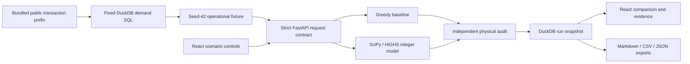

# Architecture and decision model

F1 is a local decision-support application, with one Python server and a prebuilt React interface. It is designed for a single laptop user, small bounded scenarios and explainable calculations.



## Boundaries and responsibilities

| Layer | Owns | Does not own |
|---|---|---|
| React / TypeScript | Navigation, editable draft, displayed server results, stale-input notice, downloads | Optimization, authoritative financial metrics |
| Pydantic / FastAPI | Strict bounded input contract, endpoints, single-origin static serving, errors | External orders or cloud hosting |
| planner.py | Demand rounding, offer eligibility, greedy decisions, integer optimization | Inventing factual business costs |
| audit.py | Independent action/cost/stock reconstruction and 42 limit checks | Reusing the optimizer constraint matrix |
| service.py | Immutable run snapshot, version fingerprints, budget counterfactuals, physical supply bounds, brief | LLM-generated business claims |
| store.py | Parameterized local DuckDB reads/writes under a process lock | Multiple server processes or distributed persistence |

Preparation and history use DuckDB for different purposes: the fixed SQL query reads public transactions; a separate ignored runtime database stores local run JSON. No request accepts SQL or an arbitrary file path. Source CustomerID values never enter API result payloads.

## Model formulation

For each SKU and hub, use nonnegative integer variables: served units, unmet units, ending stock, purchases by supplier, and transfers between hubs.

```text
minimize:
  sum(purchase units × assumed purchase price)
  + sum(transfer units × assumed transfer price)
  + sum(unmet units × assumed per-SKU penalty)

for every SKU/hub:
  served + unmet = scenario requirement
  served + ending + outbound transfers - inbound transfers - purchases = initial stock
  outbound transfers <= max(initial stock - local requirement, 0)

other limits:
  purchased units across hubs <= eligible supplier/SKU capacity
  incoming purchases + incoming transfers <= each hub's receiving capacity
  action spending <= shared budget
  total transfers <= transfer allowance
  total served >= ceil(total requirement × minimum service percentage)
```

An offer is ineligible if its supplier is disabled or its lead time plus added delay exceeds seven days. Eligible capacities use floor(base capacity × capacity percentage). Transfer routes arrive in two days and use initial surplus only. The model has a single end-of-horizon balance, so it does not schedule daily arrivals or consumption and cannot report daily stockouts.

Money coefficients and reconstructed totals are integer pennies; the solver uses floating-point linear algebra internally. Results must be within 1e-5 of integers, independently valid and within 0.1p of the solver objective. A solution failing those checks is rejected and is not saved.

## Baseline and comparison validity

The deterministic baseline serves starting stock, transfers available surplus in SKU/hub order, then purchases remaining requirements in SKU/hub order from cheapest eligible offers. It obeys budget, supply, receiving and transfer limits. It does not plan ahead for a hard global service floor. Such a failure is exposed by the audit; objective-improvement percentages are reported only when both plans are valid.

The objective minimizes assumed spending plus penalties; it does not directly maximize service. More service and lower spending are not guaranteed simultaneously. The actual default run spends more to reduce shortfalls and the chosen objective.

## Status handling

| Situation | Result |
|---|---|
| Solver proves optimality | optimal, under the stated model assumptions |
| Time limit with an audited incumbent | feasible_not_proven_optimal, with reported gap when available |
| Proven infeasible | infeasible; no optimizer metrics or action plan |
| Time limit/no usable solution | not_solved; no invented metrics |
| Independent integrity failure | HTTP 503; no saved run |
| Invalid request / unknown extra fields | HTTP 422 |
| Unknown well-formed run UUID | HTTP 404 |

The budget scan solves a few fixed alternative budgets, holding every other parameter constant. It stores each status and its actual metrics. The physical lower bound per SKU is max(requirement - initial stock - eligible supplier capacity, 0). This bound deliberately ignores other restrictions. Positive values establish an unavoidable shortage within the stated supply assumptions; zero values do not establish feasibility. Constraint zero slack alone is never called a causal bottleneck.

## Run identity and persistence

Every completed comparison, including an infeasible scenario, receives a UUID and UTC timestamp. A snapshot includes parameters, scenario, both plans, audits, sensitivity, physical bounds, source SQL, hashes and runtime versions. An input hash identifies equal scenario/parameter content; run IDs and elapsed times still differ. Equivalent optimal solutions may differ between solver versions.

The browser keeps editable draft parameters separate from the saved result. Editing produces a notice, and downloads continue to reference the saved run. Saved history survives server restarts. The latest 100 are shown; the database itself retains older records. There is no delete button or automatic pruning.

## Local delivery

setup_project.py creates a project-local ignored environment, installs constrained Python dependencies, runs npm ci and builds TypeScript/Vite assets. launch.py starts a localhost Uvicorn process serving the interface and API on the same origin. Charts load lazily. No CORS, frontend cloud service, database server, paid API, LLM or GPU is needed.

The verified build and automated tests run locally. No hosted CI, cloud deployment, concurrent multi-user production operation or automatic order placement is claimed. API schema is available at /openapi.json. Tests use temporary history databases and include an exhaustive tiny optimization example, corrupted-plan checks and API export/persistence checks.
