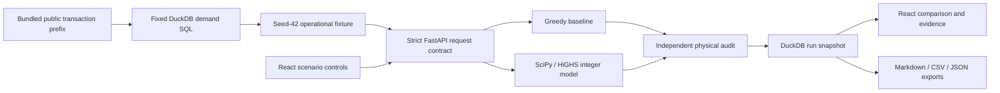
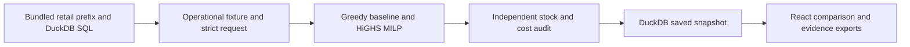
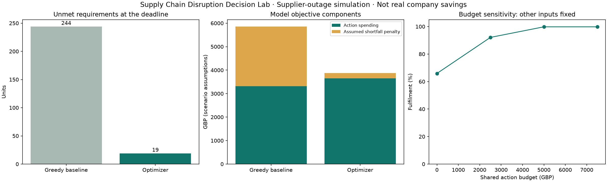

# F1 - folder structure and copyable files

The project is already saved in this folder. Each text source/configuration file has its own block below. The public compressed data bundle and generated evidence are provided as files; do not paste binary charts or dependencies into source files. Setup installs dependencies and builds the interface.

## Folder structure

```text
f1-supply-chain-disruption-lab/
  .gitattributes
  .gitignore
  ARCHITECTURE.md
  INTERVIEW_GUIDE.md
  README.md
  backend/__init__.py
  backend/api.py
  backend/audit.py
  backend/contracts.py
  backend/planner.py
  backend/service.py
  backend/store.py
  constraints.txt
  data/SOURCE.md
  data/demand.sql
  data/retail_first_50000.csv.gz
  data/scenario.json
  evaluate.py
  frontend/index.html
  frontend/package-lock.json
  frontend/package.json
  frontend/src/App.tsx
  frontend/src/Chart.tsx
  frontend/src/EChart.tsx
  frontend/src/main.tsx
  frontend/src/styles.css
  frontend/src/types.ts
  frontend/src/vite-env.d.ts
  frontend/tsconfig.json
  launch.py
  outputs/baseline_allocations.csv
  outputs/baseline_decisions.csv
  outputs/budget_sensitivity.json
  outputs/comparison.png
  outputs/decision_brief.md
  outputs/default_run.json
  outputs/infeasible.png
  outputs/optimized_allocations.csv
  outputs/optimized_decisions.csv
  outputs/overview.png
  outputs/results.png
  outputs/scenario.png
  outputs/scenario_results.csv
  outputs/verification.md
  prepare_data.py
  requirements.txt
  setup_project.py
  tests/__init__.py
  tests/test_planning.py
  PROJECT_FILES.md
```

## .gitattributes

```text
data/*.gz binary
```

## .gitignore

```text
__pycache__/
*.py[cod]
.venv/
.env
.env.*
runtime/
frontend/node_modules/
frontend/dist/
*.duckdb
*.duckdb.wal
.pytest_cache/
```

## ARCHITECTURE.md

````markdown
# Architecture and decision model

F1 is a local decision-support application, with one Python server and a prebuilt React interface. It is designed for a single laptop user, small bounded scenarios and explainable calculations.



## Boundaries and responsibilities

| Layer | Owns | Does not own |
|---|---|---|
| React / TypeScript | Navigation, editable draft, displayed server results, stale-input notice, downloads | Optimization, authoritative financial metrics |
| Pydantic / FastAPI | Strict bounded input contract, endpoints, single-origin static serving, errors | External orders or cloud hosting |
| planner.py | Demand rounding, offer eligibility, greedy decisions, integer optimization | Inventing factual business costs |
| audit.py | Independent action/cost/stock reconstruction and 42 limit checks | Reusing the optimizer constraint matrix |
| service.py | Immutable run snapshot, version fingerprints, budget counterfactuals, physical supply bounds, brief | LLM-generated business claims |
| store.py | Parameterized local DuckDB reads/writes under a process lock | Multiple server processes or distributed persistence |

Preparation and history use DuckDB for different purposes: the fixed SQL query reads public transactions; a separate ignored runtime database stores local run JSON. No request accepts SQL or an arbitrary file path. Source CustomerID values never enter API result payloads.

## Model formulation

For each SKU and hub, use nonnegative integer variables: served units, unmet units, ending stock, purchases by supplier, and transfers between hubs.

```text
minimize:
  sum(purchase units × assumed purchase price)
  + sum(transfer units × assumed transfer price)
  + sum(unmet units × assumed per-SKU penalty)

for every SKU/hub:
  served + unmet = scenario requirement
  served + ending + outbound transfers - inbound transfers - purchases = initial stock
  outbound transfers <= max(initial stock - local requirement, 0)

other limits:
  purchased units across hubs <= eligible supplier/SKU capacity
  incoming purchases + incoming transfers <= each hub's receiving capacity
  action spending <= shared budget
  total transfers <= transfer allowance
  total served >= ceil(total requirement × minimum service percentage)
```

An offer is ineligible if its supplier is disabled or its lead time plus added delay exceeds seven days. Eligible capacities use floor(base capacity × capacity percentage). Transfer routes arrive in two days and use initial surplus only. The model has a single end-of-horizon balance, so it does not schedule daily arrivals or consumption and cannot report daily stockouts.

Money coefficients and reconstructed totals are integer pennies; the solver uses floating-point linear algebra internally. Results must be within 1e-5 of integers, independently valid and within 0.1p of the solver objective. A solution failing those checks is rejected and is not saved.

## Baseline and comparison validity

The deterministic baseline serves starting stock, transfers available surplus in SKU/hub order, then purchases remaining requirements in SKU/hub order from cheapest eligible offers. It obeys budget, supply, receiving and transfer limits. It does not plan ahead for a hard global service floor. Such a failure is exposed by the audit; objective-improvement percentages are reported only when both plans are valid.

The objective minimizes assumed spending plus penalties; it does not directly maximize service. More service and lower spending are not guaranteed simultaneously. The actual default run spends more to reduce shortfalls and the chosen objective.

## Status handling

| Situation | Result |
|---|---|
| Solver proves optimality | optimal, under the stated model assumptions |
| Time limit with an audited incumbent | feasible_not_proven_optimal, with reported gap when available |
| Proven infeasible | infeasible; no optimizer metrics or action plan |
| Time limit/no usable solution | not_solved; no invented metrics |
| Independent integrity failure | HTTP 503; no saved run |
| Invalid request / unknown extra fields | HTTP 422 |
| Unknown well-formed run UUID | HTTP 404 |

The budget scan solves a few fixed alternative budgets, holding every other parameter constant. It stores each status and its actual metrics. The physical lower bound per SKU is max(requirement - initial stock - eligible supplier capacity, 0). This bound deliberately ignores other restrictions. Positive values establish an unavoidable shortage within the stated supply assumptions; zero values do not establish feasibility. Constraint zero slack alone is never called a causal bottleneck.

## Run identity and persistence

Every completed comparison, including an infeasible scenario, receives a UUID and UTC timestamp. A snapshot includes parameters, scenario, both plans, audits, sensitivity, physical bounds, source SQL, hashes and runtime versions. An input hash identifies equal scenario/parameter content; run IDs and elapsed times still differ. Equivalent optimal solutions may differ between solver versions.

The browser keeps editable draft parameters separate from the saved result. Editing produces a notice, and downloads continue to reference the saved run. Saved history survives server restarts. The latest 100 are shown; the database itself retains older records. There is no delete button or automatic pruning.

## Local delivery

setup_project.py creates a project-local ignored environment, installs constrained Python dependencies, runs npm ci and builds TypeScript/Vite assets. launch.py starts a localhost Uvicorn process serving the interface and API on the same origin. Charts load lazily. No CORS, frontend cloud service, database server, paid API, LLM or GPU is needed.

The verified build and automated tests run locally. No hosted CI, cloud deployment, concurrent multi-user production operation or automatic order placement is claimed. API schema is available at /openapi.json. Tests use temporary history databases and include an exhaustive tiny optimization example, corrupted-plan checks and API export/persistence checks.
````

## INTERVIEW_GUIDE.md

````markdown
# Explain F1 in an interview

## A 60-second introduction

I built a local decision-support app for supply disruptions. React and TypeScript handle the workflow; Python owns the calculations. I use a disclosed public retail subset for historical sale counts and clearly fictional operational assumptions. A greedy baseline and an integer optimizer share the same input contract. Independent code reconstructs stock, spending and capacity checks. In the default simulation, unmet requirements fall from 244 to 19 units, while action spending rises from £3,313.52 to £3,654.03. I report that trade-off and the 33.82% lower simulated objective without claiming real company savings.

## A three-minute walkthrough

1. Open Overview and run the supplier-outage demo. Explain which inputs are historical and which are fictional.
2. Compare the service and spending cards. Point out the objective's assumed penalties.
3. Read the physical supply limit for SKU 85099B: 768 initial units + 405 eligible supplier units versus 1,192 required, leaving a lower bound of 19 unmet units.
4. Open Budget sensitivity. £7,500 gives the same default result as £5,000 while other inputs stay fixed.
5. Open Action plan and Constraint checks. Explain conservation and why a zero-capacity offer also has zero slack.
6. Open Data & evidence and inspect the SQL and fingerprint. Export the decision brief and full JSON.
7. Run Impossible service target. Show unavailable optimizer metrics and the baseline's failed service-floor check.
8. Reopen a saved run. Change an input and show the notice that exports still refer to the saved snapshot.

## Questions to prepare for

**Why optimization instead of ML?** The task is choosing actions under stated constraints. There is no labelled dataset of optimal real decisions. The model solves a specified allocation problem, not a learned prediction task.

**Why a simple baseline?** It creates a clear comparison with a rule someone can understand. Its iteration order is disclosed; it is not presented as the best possible heuristic.

**Does optimal mean best in the real world?** No. It means optimal for this mathematical model and its assumptions when the solver proves that status. Costs, requirements, constraints and timing would need operational validation.

**Why is spending higher?** Avoiding shortfalls has an assumed penalty. The objective trades spending against that penalty. Spending and objective are different measures.

**How is leakage avoided?** This is not a predictive model. Historical counts are openly used as a fictional requirement profile; no forecast accuracy or future-period generalization is claimed.

**How is the result checked?** Separate code reconstructs the physical and financial constraints from action rows. Tests also solve a tiny problem by exhaustive enumeration and deliberately corrupt plan data.

**What happens when the model cannot satisfy a target?** No optimizer metrics are invented. The failed scenario and baseline checks remain available, with guidance on which assumptions the user could reconsider.

**What would a real deployment require?** Verified inventory/supplier data, daily arrival and consumption timing, validated costs, authenticated multi-user access, capacity planning, suitable storage/concurrency and operational review. None of those are established by this laptop demonstration.

**What did you learn?** Explicit optimization modelling, a typed frontend/backend contract, local persistence, reproducibility fingerprints, meaningful testing and communicating the boundary between observed data and scenario assumptions.
````

## README.md

````markdown
# Supply Chain Disruption Decision Lab — F1

A local constrained-allocation application comparing a deterministic procurement/transfer heuristic with an independently audited mixed-integer model, including scenario controls, budget counterfactuals and durable decision snapshots.

> Model boundary: public historical sale counts inform illustrative requirements; inventory, supplier offers, capacities and penalties are fictional assumptions. Objective improvements are simulated trade-offs, not measured savings.

## Contents

- [Overview](#overview)
- [Dataset and data contract](#dataset-and-data-contract)
- [Architecture and components](#architecture-and-components)
- [Processing pipeline](#processing-pipeline)
- [Configuration and metric definitions](#configuration-and-metric-definitions)
- [Recorded results and evidence](#recorded-results-and-evidence)
- [Interpretation and operational use](#interpretation-and-operational-use)
- [Running locally](#running-locally)
- [API reference](#api-reference)
- [Validation and reproducibility](#validation-and-reproducibility)
- [Project structure](#project-structure)
- [Technology stack](#technology-stack)
- [Limitations and next steps](#limitations-and-next-steps)
- [Further technical documentation](#further-technical-documentation)

## Overview

**A supplier cannot deliver within our planning horizon. How should we allocate stock, buy alternatives and transfer surplus while respecting budget and capacity limits?**

The app has six navigable sections: **Overview → Design scenario → Compare plans → Data & evidence → Saved runs → Method & model**. Five editable presets cover normal operations, supplier outage, demand surge, zero budget and an impossible service target. A comparison saves automatically and can be exported as a decision brief, action CSV or complete JSON snapshot.

## Dataset and data contract

**Observed inputs:** six SKU codes, descriptions and historical positive-sale counts from [UCI Online Retail](https://archive.ics.uci.edu/dataset/352/online+retail). Citation: Chen, D. (2015). Online Retail [Dataset]. UCI Machine Learning Repository. [DOI: 10.24432/C5BW33](https://doi.org/10.24432/C5BW33). License: [CC BY 4.0](https://creativecommons.org/licenses/by/4.0/).

The full dataset contains 541,909 transaction lines. This repository bundles only its **first 50,000 source rows** in a small compressed CSV, preserving the source fields plus a row identifier. Fixed DuckDB SQL selects six SKUs from **1–7 December 2010**, excluding later exact repeats, cancellation-marked invoices and nonpositive quantities/prices. The selected historical counts total **8,968 units**. The prefix and six selected products are not representative annual demand; exact-repeat quarantine is an analytical choice and can exclude legitimate repeated lines.

**Fictional operational inputs:** all warehouse splits, stock, supplier capacities/costs, priorities, penalties and lead times are generated or explicitly specified using **seed 42**. Three fictional hubs and suppliers have no real operational meaning. The historical profile supplies an illustrative requirement scenario, **not a forecast**. No supplier or inventory information is inferred from retail transactions.

| Input | Meaning |
|---|---|
| sku, description, observed_units | Public product observations after the disclosed SQL transformation |
| base_demand by hub | Fictional split of those units across North/Central/South |
| initial_stock | Fictional starting inventory, fixed as scenario controls change |
| supplier/SKU capacity, price, lead_days | Fictional independent offers from Atlas, Beacon and Cobalt |
| receiving_capacity | Maximum inbound purchase + transfer units at each hub |
| priority / shortfall_penalty_pence | Assumed per-SKU priority and penalty; not calibrated risk or measured lost profit |
| transfer rules | Initial-surplus transfers, 35p/unit, two-day arrival, shared transfer allowance |
| user parameters | Budget, disabled supplier, capacity multiplier, added delay, requirement multiplier, transfer switch/limit, service floor |

All assumptions are in [scenario.json](data/scenario.json); [SOURCE.md](data/SOURCE.md) records provenance, SHA-256 checksums and policy choices. [demand.sql](data/demand.sql) and [prepare_data.py](prepare_data.py) reproduce the fixture from the bundled source. No other project is needed.

## Architecture and components



| Component | Entry points or assets | Responsibility |
|---|---|---|
| [prepare_data.py](prepare_data.py) | Fixture preparation | Apply the fixed DuckDB query and construct explicitly fictional operational assumptions. |
| [backend/contracts.py](backend/contracts.py) | Parameters / PRESETS | Define strict bounded controls and five reproducible scenarios. |
| [backend/planner.py](backend/planner.py) | Baseline and MILP | Apply offer eligibility, allocate stock/purchases/transfers and solve the integer model. |
| [backend/audit.py](backend/audit.py) | Independent reconstruction | Rebuild physical/cost totals and expose the 42 model-limit checks. |
| [backend/service.py](backend/service.py) | Run orchestration | Capture fingerprints, sensitivity results, physical bounds and immutable evidence. |
| [backend/store.py](backend/store.py) | Local DuckDB history | Persist and reopen saved run snapshots under a process lock. |
| [backend/api.py](backend/api.py) | HTTP and static serving | Provide the contract and exports on the same origin as the built interface. |
| [frontend/src/App.tsx](frontend/src/App.tsx) | React workflow | Manage scenario drafts, comparisons, saved results and explicit solver-status presentation. |

## Processing pipeline

1. Verify the public source checksum, use fixed demand SQL, and prepare the operational fixture with seed 42. Embed the transformation SQL/hash in the fixture so an unreviewed SQL change cannot silently describe old requirements.
2. Validate bounded requests with Pydantic: strict types, no unknown fields and a nonblank scenario name. Round scaled per-hub/SKU requirements upward; retain the integer total visibly.
3. Apply offer eligibility: disable the chosen supplier(s), remove arrivals after day seven, and floor remaining capacity after the requested percentage reduction.
4. Calculate the deterministic baseline: use own stock, transfer surplus in SKU/hub order, then purchase in SKU/hub order from cheapest available offers.
5. Use [SciPy/HiGHS mixed-integer optimization](https://docs.scipy.org/doc/scipy/reference/generated/scipy.optimize.milp.html) to minimize **purchase costs + transfer costs + assumed shortfall penalties**. Enforce stock conservation, supplier/SKU capacities, receiving limits, shared spending, transfer allowance and an optional minimum-service constraint. The solver has a five-second limit per solve.
6. Independently reconstruct action costs and stock/demand balances without reusing the MILP matrix. Reject nonintegral or invalid solver results. Expose all **42 limit checks**, including failed baseline service floors. An at-limit constraint alone is not called a causal bottleneck.
7. Solve a few budget counterfactuals, holding other parameters fixed. Compute a conservative physical shortage lower bound per SKU from total starting stock plus eligible supplier capacity.
8. Save a local DuckDB snapshot: parameters, operational data, both plans, checks, counterfactuals, physical bounds, SQL, hashes and runtime versions. Keep browser edits separate from the saved result so exports never silently change with a draft.

Only the server owns business calculations. ECharts renders actual returned results and loads lazily; the same localhost server serves the built React interface and the API. [Architecture and model formulation](ARCHITECTURE.md) explain every layer and limitation.

## Configuration and metric definitions

### Objective and conservation

```text
minimize purchase_spend + transfer_spend + assumed_shortfall_penalty

for each SKU and hub:
  served + unmet = requirement
  served + ending_stock + outbound - inbound - purchases = initial_stock
  outbound <= max(initial_stock - local_requirement, 0)
```

| Control | Supported range or rule |
|---|---|
| Requirement multiplier | 50-180%; scaled SKU/hub requirements rounded upward |
| Shared action budget | £0-£30,000; purchases and transfers share the allowance |
| Disabled supplier | None, Atlas, Beacon, Cobalt or All |
| Supplier capacity multiplier | 0-100%; resulting quantities rounded downward |
| Extra lead time | 0-10 days; arrivals after the seven-day horizon are ineligible |
| Transfers | Enabled/disabled; 0-5,000-unit allowance; initial surplus only |
| Minimum service | 0-100% global served-unit floor |
| Solver limit | Five seconds per solve; status distinguishes optimal, feasible incumbent, infeasible and not solved |

Money is reconstructed in integer pennies. Each supplier/SKU has an independent capacity; receiving limits aggregate incoming actions. An infeasible or unauditable plan has no invented optimizer metrics. A positive physical shortage lower bound proves insufficient aggregate supply under the assumptions; zero does not prove a feasible plan exists.

## Recorded results and evidence

The following values were computed end to end using the **Supplier outage** preset: Atlas unavailable, £5,000 shared action budget, 100% requirements, 1,200-unit transfer allowance, no extra supplier delay, and no minimum-service floor.

| Measure | Greedy baseline | Optimizer |
|---|---:|---:|
| Required units | 8,968 | 8,968 |
| Served units | 8,724 | **8,949** |
| Unmet units | 244 | **19** |
| Fulfilment at deadline | 97.28% | **99.79%** |
| Purchase spending | £2,893.52 | £3,234.03 |
| Transfer spending | £420.00 | £420.00 |
| Total action spending | **£3,313.52** | **£3,654.03** |
| Assumed shortfall penalty | £2,542.98 | £221.92 |
| Model objective | £5,856.50 | £3,875.95 |
| Transferred units | 1,200 | 1,200 |
| Independent audit | Passed | Passed |
| Method status | Heuristic | Proven optimal for this model |

The optimizer serves **225 additional units** while spending **£340.51 more**. Its objective is **33.82% lower** because the assumed shortage penalty falls. **This is a simulated trade-off, not actual company savings.** The objective does not directly maximize fulfilment or minimize spending alone.



The remaining shortage has a direct physical bound: SKU **85099B** requires **1,192 units**, but has **768 starting units + 405 eligible supplier units = 1,173 available units**. At least **19 units** must remain unmet under those supply assumptions, regardless of extra budget. Other constraints can only worsen that lower bound. A zero shortage lower bound for another SKU does not prove feasibility.

| Counterfactual budget | Optimizer served | Unmet | Actual action spending |
|---|---:|---:|---:|
| £0 | 5,908 | 3,060 | £0.00 |
| £2,500 | 8,259 | 709 | £2,499.93 |
| £5,000 | 8,949 | 19 | £3,654.03 |
| £7,500 | 8,949 | 19 | £3,654.03 |

Only budget changes in this table. A higher budget is a limit, not an instruction to spend it all. Under the fixed remaining assumptions, increasing it from £5,000 to £7,500 does not change the optimized metrics.

Other actual preset results: normal operations serve all 8,968 units with £2,784.01 optimizer action spending; the surge scenario serves 10,211 of 12,562 illustrative required units; zero budget permits no paid actions. The impossible-service preset is **infeasible**, so optimizer metrics are **unavailable**. Its baseline fails the required service floor and is not presented as a feasible comparison.

[Application screenshot](outputs/results.png)

Saved evidence: [complete default snapshot](outputs/default_run.json), [all five scenario results](outputs/scenario_results.csv), [budget sensitivity](outputs/budget_sensitivity.json), [optimizer allocation](outputs/optimized_allocations.csv), [optimizer actions](outputs/optimized_decisions.csv), [baseline allocation](outputs/baseline_allocations.csv), [baseline actions](outputs/baseline_decisions.csv), [decision brief](outputs/decision_brief.md) and [verification record](outputs/verification.md). Additional browser captures show [Overview](outputs/overview.png), [scenario controls](outputs/scenario.png) and [infeasibility](outputs/infeasible.png).

## Interpretation and operational use

- **Review the missing supply before increasing budget:** SKU 85099B has a 19-unit physical supply deficit. Investigate an additional eligible source, greater supplier capacity or a revised requirement; funding alone cannot create units within the fixed model.
- **Make the trade-off explicit:** the optimizer spends an extra £340.51 to serve 225 more units in this scenario. Validate real action costs and shortage consequences before adopting a comparable policy in a business.
- **Keep failed scenarios visible:** a service floor can be impossible. Preserve the assumptions and failed checks, and reconsider them explicitly instead of reporting a fabricated plan or an invalid baseline as feasible.

## Running locally

The three setup/launch commands below start at the repository root.

Prerequisites: **Python 3.12+ and a Vite-compatible Node.js installation**. Verified here with Python 3.12, Node **25.2.0** and npm **11.19.0**. Initial setup downloads free packages; normal application use requires no internet, account, key, cloud service, GPU or database server.

```powershell
cd projects/f1-supply-chain-disruption-lab
python setup_project.py
python launch.py
```

Open **http://127.0.0.1:8530**, then choose **Run supplier-outage demo**. setup_project.py creates this project's ignored `.venv`, installs pinned/constrained Python packages, runs `npm ci` and builds the interface. It was tested from a fresh project environment. Setup is normally one-time; later use only `python launch.py`. Ctrl+C stops the server. If the port is already in use, `python launch.py --port 8531` selects another local port. No system service or startup registration is installed.

The raw bundle and prepared scenario are included. Optional developer commands, separate from launching: `.venv/Scripts/python.exe -m unittest discover -s tests -v` runs the checks; `.venv/Scripts/python.exe evaluate.py` regenerates evidence; `.venv/Scripts/python.exe prepare_data.py` rebuilds the fixture. Restart the server after changing backend code or prepared data. The supported default is the built single-origin app.

Saved runs live in ignored `runtime/runs.duckdb`. They survive restart and are not committed. The UI lists the latest 100 and provides exports. The API contract is available locally at `/openapi.json`. Generated environment, npm dependencies and built assets stay outside Git. [PROJECT_FILES.md](PROJECT_FILES.md) contains the folder structure and copyable source blocks.

## API reference

The interface and API share one localhost origin. Route declarations are implemented in [backend/api.py](backend/api.py); `/openapi.json` exposes the generated schemas.

| Method | Route | Handler |
|---|---|---|
| GET | `/api/health` | `health` |
| GET | `/api/catalog` | `catalog` |
| POST | `/api/runs` | `create_run` |
| GET | `/api/runs` | `runs` |
| GET | `/api/runs/{run_id}` | `run_detail` |
| GET | `/api/runs/{run_id}/export/{kind}` | `export` |

### Scenario request

Example body for `POST /api/runs`:

```json
{
  "name": "Supplier outage",
  "demand_pct": 100,
  "budget_gbp": 5000,
  "disrupted_supplier": "Atlas",
  "supplier_capacity_pct": 100,
  "extra_lead_days": 0,
  "allow_transfers": true,
  "transfer_limit": 1200,
  "minimum_service_pct": 0
}
```

Valid comparisons receive HTTP 201 and a run identity, including scenarios whose optimizer status is infeasible. Invalid request fields return 422; integrity-check failures return 503 without saving a run. The export kind is `json`, `md` or `csv`; a well-formed but unknown run UUID returns 404.

The server is intended for a trusted single-user local environment. These routes do not constitute an authenticated public deployment. Saved output identifiers refer to immutable analytical snapshots rather than editable browser drafts.

## Validation and reproducibility

The automated suite contains **14 tests**. It checks the following implementation boundaries:

Test implementation: [tests/test_planning.py](tests/test_planning.py).

- Exhaustive one product optimum.
- Two hub transfer conservation and budget.
- Zero budget prevents paid actions.
- Late and disrupted offers cannot supply.
- Impossible service target is explicit.
- All presets reconcile and do not overstate comparison.
- Independent audit rejects corrupted stock and metrics.
- Receiving cap and transfer switch.
- Repeat inputs preserve objective and fingerprints.
- Valid optimizer with invalid service floor baseline.
- Time limit without incumbent is not called infeasible.
- Source preparation is deterministic.
- Physical supply lower bound explains default shortfall.
- Api validation save reopen and exports.

From the project directory, run:

```powershell
.venv/Scripts/python.exe -m unittest discover -s tests -v
```

Recorded execution and any browser-review evidence is retained in [outputs/verification.md](outputs/verification.md). Reported figures correspond to saved execution artifacts; running a report generator can overwrite its generated outputs. Package requirements, source checksums and fixed parameters define the reproducibility boundary; elapsed times and some model/solver outputs can vary across environments. The setup script also performs TypeScript checking and a production frontend build using the npm lockfile.

## Project structure

```text
f1-supply-chain-disruption-lab/
  ARCHITECTURE.md
  constraints.txt
  evaluate.py
  INTERVIEW_GUIDE.md
  launch.py
  prepare_data.py
  PROJECT_FILES.md
  README.md
  requirements.txt
  setup_project.py
  backend/
    __init__.py
    api.py
    audit.py
    contracts.py
    planner.py
    service.py
    store.py
  frontend/
    package.json
    package-lock.json
    tsconfig.json
    index.html
    src/
      App.tsx
      Chart.tsx
      EChart.tsx
      main.tsx
      styles.css
      types.ts
      vite-env.d.ts
  tests/
    __init__.py
    test_planning.py
  data/
    Bundled inputs, provenance and prepared data
  outputs/
    Recorded metrics, audit files, tables and figures
```

Generated environments, database files, model artifacts and compiled assets follow the project's [.gitignore](.gitignore). The [copyable source bundle](PROJECT_FILES.md) mirrors the README and contains individual file blocks.

## Technology stack

**Interface:** React 19.3.1, TypeScript 7.0.2, Vite 8.3.5, Apache ECharts 6.1.0, Lucide React 1.61.0 and custom CSS. **API and model:** Python, FastAPI, Pydantic, Uvicorn, NumPy, SciPy/HiGHS and DuckDB. **Evidence/checks:** matplotlib, unittest, FastAPI TestClient and an exhaustive tiny optimization fixture. Python direct requirements, transitive constraints and npm lockfile record the tested versions.

## Limitations and next steps

- Historical sales from a small holiday-period subset supply a fictional requirement scenario. They do not establish future demand, annual representativeness, unmet customer demand or actual inventory.
- Operational inputs and cost/penalty weights are assumed. The optimized objective is meaningful only within those assumptions. Sensitivity explores a few budgets, not uncertainty or robustness across a validated probability distribution.
- One seven-day deadline is modelled. There is no daily time-indexed inventory, early-week service guarantee, routing, travel network, multi-leg arrival scheduling, safety stock, minimum order quantity, supplier-wide shared capacity or storage-volume model.
- Transfers are conservatively limited to initial stock above the origin's full local requirement. New receipts cannot be forwarded. Units from different SKUs are not substitutes.
- All 18 supplier/SKU capacities are independent and receiving limits aggregate all incoming action units. Real operations would need verified capacity definitions and an authoritative item/unit catalogue.
- The baseline's fixed order is simple and can affect its result; it is not the strongest possible heuristic. It may fail a hard service floor, which is explicitly flagged. No improvement percentage is then reported.
- The mathematical optimum is not a guarantee of an optimal real policy. A time-limited solution is labelled accordingly; multiple equivalent optima may produce different decisions between library versions.
- Local single-user operation is the intended scope. There is no authentication, distributed worker system, concurrent multi-process database support, hosted CI or cloud deployment claim. No real procurement action is executed.
- Desktop browser flows and the production build were verified. Responsive CSS is supplied; no separate mobile-device performance or accessibility certification is claimed.
- Future improvements should begin with validated daily demand/stock/supplier data and operating rules, then time-indexed modelling and broader sensitivity. The [architecture reference](ARCHITECTURE.md) explains these boundaries.

## Further technical documentation

- [Dataset attribution, licensing and source transformations](data/SOURCE.md)
- [Pinned Python dependencies](requirements.txt)
- [Recorded transitive dependency constraints](constraints.txt)
- [Frontend dependency lockfile](frontend/package-lock.json)
- [Detailed architecture, contracts and implementation boundaries](ARCHITECTURE.md)
- [Recorded execution and verification evidence](outputs/verification.md)
- [Folder structure and individually copyable source files](PROJECT_FILES.md)

[Back to contents](#contents)
````

## backend/__init__.py

```python

```

## backend/api.py

```python
"""Single-origin local API and built React interface. No external services."""
from pathlib import Path
from uuid import UUID
from threading import Lock
import csv
import io
from fastapi import FastAPI, HTTPException
from fastapi.responses import Response, JSONResponse
from fastapi.staticfiles import StaticFiles
from .contracts import Parameters, PRESETS
from .service import load_scenario, make_run, brief
from . import store

ROOT = Path(__file__).resolve().parents[1]
SCENARIO = load_scenario()
app = FastAPI(title="Supply Chain Disruption Decision Lab", version="1.0.0")
RUN_LOCK = Lock()


@app.get("/api/health")
def health():
    return {"status": "ok", "version": "1.0.0", "mode": "local simulation"}


@app.get("/api/catalog")
def catalog():
    return {"scenario": SCENARIO, "presets": PRESETS, "sql": SCENARIO["demand_sql"],
            "source": {"title": "UCI Online Retail", "url": "https://archive.ics.uci.edu/dataset/352/online+retail",
                       "license": "CC BY 4.0", "raw_rows": 50000, "selected_products": 6}}


@app.post("/api/runs", status_code=201)
def create_run(parameters: Parameters):
    if not parameters.name.strip():
        raise HTTPException(422, "Give the scenario a nonblank name.")
    try:
        # A single-user local app serializes solver calls and database writes.
        with RUN_LOCK:
            run = make_run(SCENARIO, parameters)
            store.save(run)
    except RuntimeError as error:
        raise HTTPException(503, "The calculation failed its integrity checks. No run was saved.") from error
    return run


@app.get("/api/runs")
def runs():
    return store.history()


def find_run(run_id: UUID):
    run = store.get(str(run_id))
    if run is None:
        raise HTTPException(404, "Run not found.")
    return run


@app.get("/api/runs/{run_id}")
def run_detail(run_id: UUID):
    return find_run(run_id)


@app.get("/api/runs/{run_id}/export/{kind}")
def export(run_id: UUID, kind: str):
    run = find_run(run_id)
    headers = {"Content-Disposition": f'attachment; filename="decision-{run_id}.{kind}"'}
    if kind == "json":
        return JSONResponse(run, headers=headers)
    if kind == "md":
        return Response(brief(run), media_type="text/markdown", headers=headers)
    if kind == "csv":
        data = io.StringIO(newline="")
        fields = ["method", "kind", "sku", "supplier", "from_hub", "hub", "units", "unit_cost_pence", "arrival_days"]
        writer = csv.DictWriter(data, fieldnames=fields, extrasaction="ignore", lineterminator="\n")
        writer.writeheader()
        for method in ["baseline", "optimized"]:
            for row in run[method]["decisions"]:
                writer.writerow({**row, "method": method})
        return Response(data.getvalue(), media_type="text/csv", headers=headers)
    raise HTTPException(404, "Choose json, md or csv export.")


dist = ROOT / "frontend/dist"
if dist.is_dir():
    app.mount("/", StaticFiles(directory=dist, html=True), name="frontend")
else:
    @app.get("/")
    def missing_build():
        return {"message": "Run python setup_project.py, then python launch.py to open the interface."}
```

## backend/audit.py

```python
"""Reconstruct physical and financial constraints independently of the MILP matrix."""
from collections import defaultdict
import math


def audit_plan(scenario, parameters, cells, offers, plan):
    violations, checks = [], []
    received, supply, outbound = defaultdict(int), defaultdict(int), defaultdict(int)
    buy_by_cell, incoming, outgoing = defaultdict(int), defaultdict(int), defaultdict(int)
    offer_lookup = {(o["supplier"], o["sku"]): o for o in offers}
    costs = 0
    for row in plan["decisions"]:
        qty = row["units"]
        if not isinstance(qty, int) or qty <= 0:
            violations.append("Decision quantities must be positive integers.")
        key = row["sku"], row["hub"]
        received[row["hub"]] += qty
        if row["kind"] == "purchase":
            offer = offer_lookup.get((row["supplier"], row["sku"]))
            if offer is None or offer["available_capacity"] <= 0 or offer["arrival_days"] > scenario["horizon_days"]:
                violations.append("Unavailable/late purchase route used.")
                continue
            if row["unit_cost_pence"] != offer["unit_cost_pence"]:
                violations.append("Purchase price differs from source assumption.")
            if row["arrival_days"] != offer["arrival_days"]:
                violations.append("Purchase arrival differs from source assumption.")
            costs += qty * offer["unit_cost_pence"]
            supply[row["supplier"], row["sku"]] += qty
            buy_by_cell[key] += qty
        elif row["kind"] == "transfer":
            if row["hub"] == row["from_hub"] or row["from_hub"] not in scenario["hubs"] or not parameters.allow_transfers or scenario["transfer_lead_days"] > scenario["horizon_days"]:
                violations.append("Invalid transfer route used.")
            if row["unit_cost_pence"] != scenario["transfer_unit_cost_pence"]:
                violations.append("Transfer price differs from source assumption.")
            if row["arrival_days"] != scenario["transfer_lead_days"]:
                violations.append("Transfer arrival differs from source assumption.")
            costs += qty * scenario["transfer_unit_cost_pence"]
            outbound[row["sku"], row["from_hub"]] += qty
            incoming[key] += qty
            outgoing[row["sku"], row["from_hub"]] += qty
        else:
            violations.append("Unknown action type.")
    expected_keys = {(c["sku"], c["hub"]) for c in cells}
    actual_keys = [(a["sku"], a["hub"]) for a in plan["allocations"]]
    if len(actual_keys) != len(expected_keys) or set(actual_keys) != expected_keys:
        violations.append("Allocation cells are missing or duplicated.")
    if any((row["sku"], row["hub"]) not in expected_keys for row in plan["decisions"]):
        violations.append("Unknown product/warehouse action.")
    originals = {(c["sku"], c["hub"]): c for c in cells}
    for row in plan["allocations"]:
        key = row["sku"], row["hub"]
        cell = originals.get(key)
        if cell is None:
            continue
        for field in ("served", "shortfall", "ending_stock", "purchased", "transfer_in", "transfer_out"):
            if not isinstance(row[field], int) or row[field] < 0:
                violations.append(f"Noninteger/negative {field} at {key}.")
        if row["served"] + row["shortfall"] != cell["demand"]:
            violations.append(f"Demand balance failed at {key}.")
        if any(row[field] != cell[field] for field in ("demand", "initial_stock", "base_demand")):
            violations.append(f"Displayed source quantities differ at {key}.")
        available = cell["initial_stock"] + buy_by_cell[key] + incoming[key] - outgoing[key]
        if row["served"] + row["ending_stock"] != available:
            violations.append(f"Stock conservation failed at {key}.")
        if (row["purchased"], row["transfer_in"], row["transfer_out"]) != (buy_by_cell[key], incoming[key], outgoing[key]):
            violations.append(f"Action totals differ at {key}.")

    def limit(label, used, capacity, unit, minimum=False):
        slack = used - capacity if minimum else capacity - used
        ok = slack >= 0
        checks.append({"label": label, "used": used, "limit": capacity, "slack": slack,
                       "unit": unit, "minimum": minimum, "ok": ok, "at_limit": slack == 0})
        if not ok:
            violations.append(f"Constraint failed: {label}.")

    limit("Shared action budget", costs, parameters.budget_gbp * 100, "pence")
    limit("Transfer allowance", sum(outbound.values()), parameters.transfer_limit if parameters.allow_transfers else 0, "units")
    total = sum(c["demand"] for c in cells)
    limit("Minimum served units", sum(a["served"] for a in plan["allocations"]), math.ceil(total * parameters.minimum_service_pct / 100), "units", minimum=True)
    for hub in scenario["hubs"]:
        limit(f"{hub} receiving capacity", received[hub], scenario["receiving_capacity"][hub], "units")
    for offer in offers:
        limit(f"{offer['supplier']} / {offer['sku']}", supply[offer["supplier"], offer["sku"]], offer["available_capacity"], "units")
    for cell in cells:
        limit(f"Initial surplus / {cell['sku']} / {cell['hub']}", outbound[cell["sku"], cell["hub"]], max(cell["initial_stock"] - cell["demand"], 0), "units")
    if costs != plan["metrics"]["action_cost_pence"]:
        violations.append("Reported action cost differs from independent sum.")
    penalties = {p["sku"]: p["shortfall_penalty_pence"] for p in scenario["products"]}
    served = sum(a["served"] for a in plan["allocations"])
    shortfall = sum(a["shortfall"] for a in plan["allocations"])
    penalty = sum(a["shortfall"] * penalties[a["sku"]] for a in plan["allocations"] if a["sku"] in penalties)
    expected = {"demand": total, "served": served, "shortfall": shortfall,
                "objective_pence": costs + penalty, "shortfall_penalty_pence": penalty,
                "purchase_cost_pence": sum(r["units"] * r["unit_cost_pence"] for r in plan["decisions"] if r["kind"] == "purchase"),
                "transfer_cost_pence": sum(r["units"] * r["unit_cost_pence"] for r in plan["decisions"] if r["kind"] == "transfer"),
                "transferred_units": sum(outbound.values())}
    for name, value in expected.items():
        if plan["metrics"][name] != value:
            violations.append(f"Reported {name} differs from independent reconstruction.")
    if abs(plan["metrics"]["service_pct"] - 100 * served / total) > 1e-8:
        violations.append("Reported service percentage differs from allocation.")
    return {"valid": not violations, "violations": violations, "checks": checks,
            "note": "At-limit constraints are descriptive; zero slack alone is not a causal or economic bottleneck proof."}
```

## backend/contracts.py

```python
"""One strict request contract for presets, API calls and saved runs."""
from typing import Literal
from pydantic import BaseModel, ConfigDict, Field


class Parameters(BaseModel):
    model_config = ConfigDict(extra="forbid", strict=True)
    name: str = Field(default="Supplier outage", min_length=1, max_length=80)
    demand_pct: int = Field(default=100, ge=50, le=180)
    budget_gbp: int = Field(default=5000, ge=0, le=30000)
    disrupted_supplier: Literal["None", "Atlas", "Beacon", "Cobalt", "All"] = "Atlas"
    supplier_capacity_pct: int = Field(default=100, ge=0, le=100)
    extra_lead_days: int = Field(default=0, ge=0, le=10)
    allow_transfers: bool = True
    transfer_limit: int = Field(default=1200, ge=0, le=5000)
    minimum_service_pct: int = Field(default=0, ge=0, le=100)


PRESETS = [
    {"id": "outage", "title": "Supplier outage", "description": "Atlas is unavailable. Compare substitutes and stock transfers.", "parameters": Parameters().model_dump()},
    {"id": "normal", "title": "Normal operations", "description": "All three suppliers available under the same budget.", "parameters": Parameters(name="Normal operations", disrupted_supplier="None").model_dump()},
    {"id": "surge", "title": "Demand surge", "description": "Illustrative requirements increase by 40%; stock stays fixed.", "parameters": Parameters(name="Demand surge", demand_pct=140).model_dump()},
    {"id": "zero", "title": "No purchasing budget", "description": "Zero shared action budget also prevents paid transfers.", "parameters": Parameters(name="No purchasing budget", budget_gbp=0).model_dump()},
    {"id": "infeasible", "title": "Impossible service target", "description": "No suppliers or action budget, but a 100% service requirement.", "parameters": Parameters(name="Impossible service target", budget_gbp=0, disrupted_supplier="All", minimum_service_pct=100).model_dump()},
]
```

## backend/planner.py

```python
"""A small, explicit end-of-horizon allocation model and a greedy comparator."""
from collections import defaultdict
import math
import time
import numpy as np
from scipy.optimize import Bounds, LinearConstraint, milp
from .audit import audit_plan


def planning_inputs(scenario, parameters):
    cells = []
    for row in scenario["inventory"]:
        cell = dict(row)
        # Ceil per cell is intentional and visible; demand is a scenario assumption.
        cell["demand"] = math.ceil(row["base_demand"] * parameters.demand_pct / 100)
        cells.append(cell)
    offers = []
    for row in scenario["offers"]:
        offer = dict(row)
        offer["arrival_days"] = row["lead_days"] + parameters.extra_lead_days
        unavailable = parameters.disrupted_supplier in (row["supplier"], "All")
        late = offer["arrival_days"] > scenario["horizon_days"]
        offer["available_capacity"] = 0 if unavailable or late else row["capacity"] * parameters.supplier_capacity_pct // 100
        offers.append(offer)
    return cells, offers


def assemble(scenario, parameters, cells, offers, decisions, method, status, seconds, gap=None):
    """Turn decisions into a common report, then independently check conservation."""
    allocations = []
    for cell in cells:
        sku, hub = cell["sku"], cell["hub"]
        purchases = sum(r["units"] for r in decisions if r["kind"] == "purchase" and r["sku"] == sku and r["hub"] == hub)
        incoming = sum(r["units"] for r in decisions if r["kind"] == "transfer" and r["sku"] == sku and r["hub"] == hub)
        outgoing = sum(r["units"] for r in decisions if r["kind"] == "transfer" and r["sku"] == sku and r["from_hub"] == hub)
        available = cell["initial_stock"] + purchases + incoming - outgoing
        served = min(cell["demand"], available)
        allocations.append({**cell, "purchased": purchases, "transfer_in": incoming, "transfer_out": outgoing,
                            "served": served, "shortfall": cell["demand"] - served, "ending_stock": available - served})
    penalties = {p["sku"]: p["shortfall_penalty_pence"] for p in scenario["products"]}
    purchase = sum(r["units"] * r["unit_cost_pence"] for r in decisions if r["kind"] == "purchase")
    transfer = sum(r["units"] * r["unit_cost_pence"] for r in decisions if r["kind"] == "transfer")
    penalty = sum(r["shortfall"] * penalties[r["sku"]] for r in allocations)
    demand = sum(r["demand"] for r in cells)
    served = sum(r["served"] for r in allocations)
    result = {"method": method, "status": status, "seconds": round(seconds, 6), "mip_gap": gap,
              "allocations": allocations, "decisions": decisions,
              "metrics": {"demand": demand, "served": served, "shortfall": demand - served,
                          "service_pct": 100 * served / demand if demand else None,
                          "purchase_cost_pence": purchase, "transfer_cost_pence": transfer,
                          "action_cost_pence": purchase + transfer, "shortfall_penalty_pence": penalty,
                          "objective_pence": purchase + transfer + penalty,
                          "transferred_units": sum(r["units"] for r in decisions if r["kind"] == "transfer")}}
    result["audit"] = audit_plan(scenario, parameters, cells, offers, result)
    return result


def greedy(scenario, parameters):
    """Use initial stock, then transfer surplus, then buy by SKU and cheapest offer."""
    started = time.perf_counter()
    cells, offers = planning_inputs(scenario, parameters)
    remaining = {(r["sku"], r["hub"]): max(r["demand"] - r["initial_stock"], 0) for r in cells}
    surplus = {(r["sku"], r["hub"]): max(r["initial_stock"] - r["demand"], 0) for r in cells}
    receipts = defaultdict(int)
    budget = parameters.budget_gbp * 100
    decisions = []
    transfer_left = parameters.transfer_limit if parameters.allow_transfers and scenario["transfer_lead_days"] <= scenario["horizon_days"] else 0
    cost = scenario["transfer_unit_cost_pence"]
    for sku, hub in remaining:
        for origin in scenario["hubs"]:
            if origin == hub:
                continue
            qty = min(remaining[sku, hub], surplus[sku, origin], transfer_left, budget // cost,
                      scenario["receiving_capacity"][hub] - receipts[hub])
            if qty > 0:
                decisions.append({"kind": "transfer", "sku": sku, "hub": hub, "from_hub": origin,
                                  "units": qty, "unit_cost_pence": cost, "arrival_days": scenario["transfer_lead_days"]})
                remaining[sku, hub] -= qty
                surplus[sku, origin] -= qty
                transfer_left -= qty
                receipts[hub] += qty
                budget -= qty * cost
    capacity = {(o["supplier"], o["sku"]): o["available_capacity"] for o in offers}
    for sku, hub in remaining:
        for offer in sorted((o for o in offers if o["sku"] == sku), key=lambda o: (o["unit_cost_pence"], o["supplier"])):
            cost = offer["unit_cost_pence"]
            key = offer["supplier"], sku
            qty = min(remaining[sku, hub], capacity[key], budget // cost, scenario["receiving_capacity"][hub] - receipts[hub])
            if qty > 0:
                decisions.append({"kind": "purchase", "sku": sku, "hub": hub, "supplier": offer["supplier"],
                                  "units": qty, "unit_cost_pence": cost, "arrival_days": offer["arrival_days"]})
                remaining[sku, hub] -= qty
                capacity[key] -= qty
                receipts[hub] += qty
                budget -= qty * cost
    return assemble(scenario, parameters, cells, offers, decisions, "Greedy baseline", "heuristic", time.perf_counter() - started)


def optimize(scenario, parameters):
    """Minimize action costs + assumed shortfall penalties, in integer pennies."""
    started = time.perf_counter()
    cells, offers = planning_inputs(scenario, parameters)
    products = {p["sku"]: p for p in scenario["products"]}
    variables = []
    costs, upper = [], []

    def add(kind, sku, hub, bound, cost=0, **extra):
        variables.append({"kind": kind, "sku": sku, "hub": hub, **extra})
        costs.append(cost)
        upper.append(bound)
        return len(variables) - 1

    served, unmet, ending = {}, {}, {}
    for cell in cells:
        key = cell["sku"], cell["hub"]
        served[key] = add("served", *key, cell["demand"])
        unmet[key] = add("unmet", *key, cell["demand"], products[cell["sku"]]["shortfall_penalty_pence"])
        ending[key] = add("ending", *key, np.inf)
    for offer in offers:
        for hub in scenario["hubs"]:
            add("purchase", offer["sku"], hub, offer["available_capacity"], offer["unit_cost_pence"],
                supplier=offer["supplier"], arrival_days=offer["arrival_days"], unit_cost_pence=offer["unit_cost_pence"])
    for cell in cells:
        limit = max(cell["initial_stock"] - cell["demand"], 0)
        if not parameters.allow_transfers or scenario["transfer_lead_days"] > scenario["horizon_days"]:
            limit = 0
        for hub in scenario["hubs"]:
            if hub != cell["hub"]:
                add("transfer", cell["sku"], hub, limit, scenario["transfer_unit_cost_pence"], from_hub=cell["hub"],
                    arrival_days=scenario["transfer_lead_days"], unit_cost_pence=scenario["transfer_unit_cost_pence"])
    matrix, lower, higher = [], [], []

    def constraint(terms, low=-np.inf, high=np.inf):
        row = np.zeros(len(variables))
        for index, coefficient in terms:
            row[index] += coefficient
        matrix.append(row)
        lower.append(low)
        higher.append(high)

    for cell in cells:
        key = cell["sku"], cell["hub"]
        constraint([(served[key], 1), (unmet[key], 1)], cell["demand"], cell["demand"])
        balance = [(served[key], 1), (ending[key], 1)]
        for i, variable in enumerate(variables):
            if variable["sku"] != cell["sku"]:
                continue
            if variable["kind"] in ("purchase", "transfer") and variable["hub"] == cell["hub"]:
                balance.append((i, -1))
            if variable["kind"] == "transfer" and variable["from_hub"] == cell["hub"]:
                balance.append((i, 1))
        constraint(balance, cell["initial_stock"], cell["initial_stock"])
        outgoing = [(i, 1) for i, v in enumerate(variables) if v["kind"] == "transfer" and v["sku"] == cell["sku"] and v["from_hub"] == cell["hub"]]
        constraint(outgoing, high=max(cell["initial_stock"] - cell["demand"], 0))
    for offer in offers:
        constraint([(i, 1) for i, v in enumerate(variables) if v["kind"] == "purchase" and v["supplier"] == offer["supplier"] and v["sku"] == offer["sku"]], high=offer["available_capacity"])
    for hub in scenario["hubs"]:
        constraint([(i, 1) for i, v in enumerate(variables) if v["kind"] in ("purchase", "transfer") and v["hub"] == hub], high=scenario["receiving_capacity"][hub])
    constraint([(i, costs[i]) for i, v in enumerate(variables) if v["kind"] in ("purchase", "transfer")], high=parameters.budget_gbp * 100)
    constraint([(i, 1) for i, v in enumerate(variables) if v["kind"] == "transfer"], high=parameters.transfer_limit if parameters.allow_transfers else 0)
    required = math.ceil(sum(c["demand"] for c in cells) * parameters.minimum_service_pct / 100)
    constraint([(i, 1) for i in served.values()], low=required)
    solution = milp(np.array(costs, dtype=float), integrality=np.ones(len(variables)),
                    bounds=Bounds(np.zeros(len(variables)), np.array(upper)),
                    constraints=LinearConstraint(np.array(matrix), np.array(lower), np.array(higher)),
                    options={"time_limit": 5, "mip_rel_gap": 0.0})
    seconds = time.perf_counter() - started
    if solution.x is None:
        return {"method": "Constrained optimizer", "status": "infeasible" if solution.status == 2 else "not_solved",
                "seconds": round(seconds, 6), "message": str(solution.message), "metrics": None,
                "decisions": [], "allocations": [], "audit": None, "mip_gap": None}
    # Reject nonintegral results rather than silently publishing rounded violations.
    rounded = np.rint(solution.x)
    if np.max(np.abs(solution.x - rounded)) > 1e-5:
        raise RuntimeError("Solver returned a nonintegral plan.")
    decisions = [{**v, "units": int(qty)} for v, qty in zip(variables, rounded) if v["kind"] in ("purchase", "transfer") and qty > 0]
    gap = float(solution.mip_gap) if getattr(solution, "mip_gap", None) is not None and math.isfinite(solution.mip_gap) else None
    status = "optimal" if solution.status == 0 else "feasible_not_proven_optimal"
    report = assemble(scenario, parameters, cells, offers, decisions, "Constrained optimizer", status, seconds, gap)
    if not report["audit"]["valid"]:
        raise RuntimeError("Independent physical audit rejected the solver plan.")
    if abs(report["metrics"]["objective_pence"] - float(solution.fun)) > .1:
        raise RuntimeError("Reconstructed objective does not match solver objective.")
    return report
```

## backend/service.py

```python
"""Reproducible run snapshots and a plain-English decision brief; no LLM."""
from datetime import datetime, timezone
from pathlib import Path
from uuid import uuid4
import gzip
import hashlib
import json
import platform
from importlib.metadata import version
from .planner import greedy, optimize, planning_inputs
from .contracts import Parameters

ROOT = Path(__file__).resolve().parents[1]
SOURCE_SHA = "a236999d5fd3429de9a2726aa69bdf73ca83256cf9ed5284db9fe35756e0715a"
ENGINE_TEXT = "\n".join((ROOT / "backend" / name).read_text(encoding="utf-8") for name in ["contracts.py", "planner.py", "audit.py", "service.py"])
ENGINE_SHA = hashlib.sha256(ENGINE_TEXT.encode()).hexdigest()


def load_scenario():
    source = ROOT / "data/retail_first_50000.csv.gz"
    if hashlib.sha256(gzip.decompress(source.read_bytes())).hexdigest() != SOURCE_SHA:
        raise ValueError("Public source changed. Restore or review the data bundle.")
    scenario = json.loads((ROOT / "data/scenario.json").read_text(encoding="utf-8"))
    if scenario["source_sha256"] != SOURCE_SHA or len(scenario["products"]) != 6 or len(scenario["inventory"]) != 18:
        raise ValueError("Unexpected scenario shape or provenance.")
    sql = (ROOT / "data/demand.sql").read_text(encoding="utf-8")
    if sql != scenario["demand_sql"] or hashlib.sha256(sql.encode()).hexdigest() != scenario["demand_sql_sha256"]:
        raise ValueError("Demand SQL changed. Review it and regenerate the fixture before startup.")
    return scenario


def digest(value):
    return hashlib.sha256(json.dumps(value, sort_keys=True, separators=(",", ":"), allow_nan=False).encode()).hexdigest()


def make_run(scenario, parameters):
    baseline, optimized = greedy(scenario, parameters), optimize(scenario, parameters)
    comparable = bool(optimized["audit"] and optimized["audit"]["valid"] and baseline["audit"]["valid"])
    reduction = None
    if comparable and baseline["metrics"]["objective_pence"]:
        reduction = 100 * (baseline["metrics"]["objective_pence"] - optimized["metrics"]["objective_pence"]) / baseline["metrics"]["objective_pence"]
    sql = scenario["demand_sql"]
    budgets = sorted({0, parameters.budget_gbp // 2, parameters.budget_gbp,
                      min(30000, parameters.budget_gbp + max(500, parameters.budget_gbp // 2))})
    sensitivity = []
    for budget in budgets:
        candidate = optimized if budget == parameters.budget_gbp else optimize(
            scenario, Parameters(**{**parameters.model_dump(), "budget_gbp": budget}))
        sensitivity.append({"budget_gbp": budget, "status": candidate["status"], "metrics": candidate["metrics"]})
    cells, offers = planning_inputs(scenario, parameters)
    supply_bounds = []
    for product in scenario["products"]:
        sku = product["sku"]
        required = sum(c["demand"] for c in cells if c["sku"] == sku)
        initial = sum(c["initial_stock"] for c in cells if c["sku"] == sku)
        capacity = sum(o["available_capacity"] for o in offers if o["sku"] == sku)
        supply_bounds.append({"sku": sku, "required": required, "initial_stock": initial,
                              "eligible_supplier_capacity": capacity,
                              "minimum_unmet_from_supply": max(required - initial - capacity, 0)})
    return {"id": str(uuid4()), "created_at": datetime.now(timezone.utc).isoformat(timespec="microseconds"),
            "parameters": parameters.model_dump(), "scenario_snapshot": scenario, "scenario_sha256": digest(scenario),
            "input_sha256": digest({"scenario": scenario, "parameters": parameters.model_dump()}),
            "engine_version": "1.0.0", "engine_sha256": ENGINE_SHA,
            "source_sql": sql, "source_sql_sha256": hashlib.sha256(sql.encode()).hexdigest(),
            "runtime": {"python": platform.python_version(), **{p: version(p) for p in ["numpy", "scipy", "duckdb", "fastapi"]}},
            "baseline": baseline, "optimized": optimized, "comparable": comparable,
            "budget_sensitivity": sensitivity,
            "supply_bounds": supply_bounds,
            "objective_reduction_pct": reduction,
            "interpretation": "Model objective = action spending + assumed shortfall penalties. It is not measured company savings. The solver optimizes this objective, not service alone."}


def brief(run):
    p = run["parameters"]
    lines = ["# Supply Chain Disruption Decision Brief", "", f"Scenario: {p['name']}", f"Run: {run['id']}",
             f"Created UTC: {run['created_at']}", "", "## Scope", "Seven-day, end-of-horizon allocation simulation. Historical sale counts inform assumed requirements; all stock, supplier and cost inputs are fictional (seed 42). This is not a forecast or real savings claim.", "", "## Parameters", "```json", json.dumps(p, indent=2), "```", "", "## Comparison", "| Measure | Greedy baseline | Optimizer |", "|---|---:|---:|"]
    b, o = run["baseline"], run["optimized"]
    for label, key, money in [("Served units", "served", False), ("Unmet units", "shortfall", False), ("Action spending GBP", "action_cost_pence", True), ("Assumed penalty GBP", "shortfall_penalty_pence", True), ("Model objective GBP", "objective_pence", True)]:
        def fmt(plan):
            if plan["metrics"] is None:
                return "unavailable"
            value = plan["metrics"][key]
            return f"{value / 100:,.2f}" if money else f"{value:,}"
        lines.append(f"| {label} | {fmt(b)} | {fmt(o)} |")
    lines.extend(["", f"Solver status: {o['status']}. Baseline constraint-valid: {b['audit']['valid']}.", run["interpretation"], "", "## Recommended actions for review", "| Type | SKU | Origin / supplier | Destination | Units |", "|---|---|---|---|---:|"])
    for row in o["decisions"]:
        lines.append(f"| {row['kind']} | {row['sku']} | {row.get('supplier', row.get('from_hub'))} | {row['hub']} | {row['units']} |")
    if not o["decisions"]:
        lines.append("| No optimizer action plan available | | | | |")
    lines.extend(["", "## Physical supply bounds", "| SKU | Required | Initial stock | Eligible supply capacity | Unavoidable unmet units (lower bound) |", "|---|---:|---:|---:|---:|"])
    for row in run["supply_bounds"]:
        lines.append(f"| {row['sku']} | {row['required']} | {row['initial_stock']} | {row['eligible_supplier_capacity']} | {row['minimum_unmet_from_supply']} |")
    lines.append("These bounds ignore budget, receiving and transfer restrictions. A zero lower bound does not establish feasibility.")
    lines.extend(["", "## Evidence", f"Input SHA-256: {run['input_sha256']}", f"Scenario SHA-256: {run['scenario_sha256']}", f"Engine SHA-256: {run['engine_sha256']}", f"Public source SHA-256: {run['scenario_snapshot']['source_sha256']}", "", "Source: Chen, D. (2015). Online Retail. UCI Machine Learning Repository. https://doi.org/10.24432/C5BW33. CC BY 4.0.", "", "## Limits", "No daily stockout timing, original-purchase matching, verified supplier data, uncertainty distribution, optimal real-world policy or automated order placement. Transfers use initial surplus only; new receipts cannot be forwarded. At-limit constraints alone do not prove causal bottlenecks."])
    return "\n".join(lines) + "\n"
```

## backend/store.py

```python
"""One-process local run history; parameterized SQL and a lock serialize writes."""
from contextlib import contextmanager
from pathlib import Path
from threading import Lock
import json
import duckdb

ROOT = Path(__file__).resolve().parents[1]
LOCK = Lock()


@contextmanager
def connection(path=None):
    target = Path(path) if path else ROOT / "runtime/runs.duckdb"
    target.parent.mkdir(parents=True, exist_ok=True)
    with LOCK:
        with duckdb.connect(str(target)) as db:
            db.execute("CREATE TABLE IF NOT EXISTS runs (id VARCHAR PRIMARY KEY, created_at VARCHAR, name VARCHAR, payload VARCHAR)")
            yield db


def save(run, path=None):
    with connection(path) as db:
        db.execute("INSERT INTO runs VALUES (?, ?, ?, ?)", [run["id"], run["created_at"], run["parameters"]["name"], json.dumps(run, allow_nan=False)])


def get(run_id, path=None):
    with connection(path) as db:
        row = db.execute("SELECT payload FROM runs WHERE id = ?", [run_id]).fetchone()
    return json.loads(row[0]) if row else None


def history(path=None):
    with connection(path) as db:
        rows = db.execute("SELECT id, created_at, name, payload FROM runs ORDER BY created_at DESC LIMIT 100").fetchall()
    return [{"id": row[0], "created_at": row[1], "name": row[2], "status": json.loads(row[3])["optimized"]["status"]} for row in rows]
```

## constraints.txt

```text
# Exact tested Python dependency versions (Python 3.12 / Windows).
annotated-doc==0.0.5
annotated-types==0.8.0
anyio==4.15.1
certifi==2026.10.23
click==8.5.0
contourpy==1.4.0
cycler==0.12.1
duckdb==2.0.0
fastapi==0.162.0
fonttools==4.67.0
h11==0.16.0
httpcore==1.0.9
httpx==0.28.1
idna==3.20
kiwisolver==1.5.1
matplotlib==3.11.2
numpy==2.5.4
opentelemetry-api==1.45.1
packaging==26.3
pillow==13.0.0
pydantic==2.14.1
pydantic_core==2.50.1
pyparsing==3.3.3
python-dateutil==3.0.0
scipy==1.18.1
six==1.17.0
starlette==1.10.0
typing-inspection==0.4.4
typing_extensions==4.16.0
tzdata==2026.5
uvicorn==0.54.0
```

## data/SOURCE.md

````markdown
# Sources, transformations and fictional assumptions

**Observed source:** Chen, D. (2015). Online Retail [Dataset]. UCI Machine Learning Repository. https://doi.org/10.24432/C5BW33. [Dataset page](https://archive.ics.uci.edu/dataset/352/online+retail). [CC BY 4.0](https://creativecommons.org/licenses/by/4.0/).

The original contains 541,909 transaction lines. The bundled `retail_first_50000.csv.gz` contains the first 50,000 data rows in original workbook order, all eight original fields, and the added `source_row` traceability field. It is a deterministic teaching prefix, not a representative annual sample. The final prefix day is partial; the selected 1–7 December window precedes that boundary. Original workbook row 50,001 starts a new invoice. Customer identifiers are source pseudonymous fields and are not used or exposed by this app.

- Official no-login archive: https://archive.ics.uci.edu/static/public/352/online%2Bretail.zip.
- Original ZIP SHA-256: `f5385cbb54bbebf7196389109c6b0621faab0c304e3702548165e71c84aede8b`.
- Original `Online Retail.xlsx` SHA-256: `43465a06f2ccf7c8b5bd2892bc7defb52f97487934fe93b16ae4c3936424676d`.
- Bundled decompressed CSV SHA-256: `a236999d5fd3429de9a2726aa69bdf73ca83256cf9ed5284db9fe35756e0715a`.
- The same public prefix is also used elsewhere in the portfolio, but this project contains its own copy and has no cross-project imports or runtime dependency.

`demand.sql` quarantines later exact repeats of the eight original fields, preserves the first by source_row, and selects positive-quantity, positive-price, non-C transaction lines from 1 December 2010 inclusive to 8 December exclusive for six fixed SKUs. Identical lines may be legitimate; quarantine is an analytical choice. Negative/cancellation lines are not treated as demand or matched to purchases. Minimum alphabetical description per code is a display label, not the grouping key. This produces:

| SKU | Observed sale units |
|---|---:|
| 21212 | 1,377 |
| 22197 | 888 |
| 22834 | 566 |
| 84077 | 3,467 |
| 85099B | 1,192 |
| 85123A | 1,478 |
| Total | **8,968** |

**Every operational field is fictional.** `prepare_data.py` uses NumPy's generator with seed 42 to split each SKU's units across North/Central/South hubs using Dirichlet shares and reconcile integer totals. It rotates stock factors 1.45/0.48/0.36 across hubs, generates base purchase costs, and specifies priority multipliers, supplier capacity fractions, cost markups and arrival times. `scenario.json` stores the complete result. Three suppliers are fictional: Atlas, Beacon and Cobalt. Their names imply no real organization or measured reliability.

The explicit fixed policy inputs include a seven-day deadline, 2,000-unit receiving capacity per hub, 35p per transferred unit and two-day transfers. Supplier lead times are 2/4/6 days before the user-added delay. Shortfall penalties are not revenue, profit or verified lost-sales costs. Supplier capacities are separate by SKU; there is no additional shared supplier-wide capacity assumption.

Scenario demand is an illustrative requirement profile, **not a forecast of future demand**. Changing its multiplier applies a ceiling to each hub/SKU quantity, so non-100% totals include disclosed integer rounding. Initial stock stays fixed. New receipts cannot be forwarded: outbound transfers are limited to initial stock above the origin's full local scenario requirement.

Raw source bytes are verified during preparation and API startup. Each saved run includes the operational snapshot, parameters, input/scenario/source/SQL/engine fingerprints and runtime versions. Do not present the simulated objective difference as actual company savings.
````

## data/demand.sql

```sql
-- Public observations provide an illustrative demand profile, not a forecast.
-- Exact repeat quarantine uses the original eight fields, not source_row.
WITH ranked AS (
  SELECT *, row_number() OVER (
    PARTITION BY InvoiceNo, StockCode, Description, Quantity,
                 InvoiceDate, UnitPrice, CustomerID, Country
    ORDER BY CAST(source_row AS INTEGER)
  ) AS repeat_number FROM raw
)
SELECT StockCode AS sku, min(Description) AS description,
       sum(CAST(Quantity AS INTEGER))::INTEGER AS observed_units
FROM ranked
WHERE repeat_number = 1
  AND upper(InvoiceNo) NOT LIKE 'C%'
  AND CAST(Quantity AS INTEGER) > 0
  AND CAST(UnitPrice AS DOUBLE) > 0
  AND CAST(InvoiceDate AS TIMESTAMP) >= TIMESTAMP '2010-12-01 00:00:00'
  AND CAST(InvoiceDate AS TIMESTAMP) < TIMESTAMP '2010-12-08 00:00:00'
  AND StockCode IN ('84077', '85123A', '21212', '22834', '22197', '85099B')
GROUP BY StockCode ORDER BY StockCode;
```

## data/scenario.json

```json
{
  "version": "f1.1",
  "seed": 42,
  "horizon_days": 7,
  "source_sha256": "a236999d5fd3429de9a2726aa69bdf73ca83256cf9ed5284db9fe35756e0715a",
  "demand_sql": "-- Public observations provide an illustrative demand profile, not a forecast.\n-- Exact repeat quarantine uses the original eight fields, not source_row.\nWITH ranked AS (\n  SELECT *, row_number() OVER (\n    PARTITION BY InvoiceNo, StockCode, Description, Quantity,\n                 InvoiceDate, UnitPrice, CustomerID, Country\n    ORDER BY CAST(source_row AS INTEGER)\n  ) AS repeat_number FROM raw\n)\nSELECT StockCode AS sku, min(Description) AS description,\n       sum(CAST(Quantity AS INTEGER))::INTEGER AS observed_units\nFROM ranked\nWHERE repeat_number = 1\n  AND upper(InvoiceNo) NOT LIKE 'C%'\n  AND CAST(Quantity AS INTEGER) > 0\n  AND CAST(UnitPrice AS DOUBLE) > 0\n  AND CAST(InvoiceDate AS TIMESTAMP) >= TIMESTAMP '2010-12-01 00:00:00'\n  AND CAST(InvoiceDate AS TIMESTAMP) < TIMESTAMP '2010-12-08 00:00:00'\n  AND StockCode IN ('84077', '85123A', '21212', '22834', '22197', '85099B')\nGROUP BY StockCode ORDER BY StockCode;\n",
  "demand_sql_sha256": "051b9ffa7a655a0bd36685f73cdf82d031b4392218be7ef8650e6665f8298c79",
  "historical_window": "2010-12-01 through 2010-12-07",
  "products": [
    {
      "sku": "21212",
      "description": "PACK OF 72 RETROSPOT CAKE CASES",
      "observed_units": 1377,
      "priority": 2,
      "shortfall_penalty_pence": 1232
    },
    {
      "sku": "22197",
      "description": "SMALL POPCORN HOLDER",
      "observed_units": 888,
      "priority": 1,
      "shortfall_penalty_pence": 522
    },
    {
      "sku": "22834",
      "description": "HAND WARMER BABUSHKA DESIGN",
      "observed_units": 566,
      "priority": 3,
      "shortfall_penalty_pence": 1870
    },
    {
      "sku": "84077",
      "description": "WORLD WAR 2 GLIDERS ASSTD DESIGNS",
      "observed_units": 3467,
      "priority": 1,
      "shortfall_penalty_pence": 762
    },
    {
      "sku": "85099B",
      "description": "JUMBO BAG RED RETROSPOT",
      "observed_units": 1192,
      "priority": 2,
      "shortfall_penalty_pence": 1168
    },
    {
      "sku": "85123A",
      "description": "WHITE HANGING HEART T-LIGHT HOLDER",
      "observed_units": 1478,
      "priority": 3,
      "shortfall_penalty_pence": 870
    }
  ],
  "inventory": [
    {
      "sku": "21212",
      "hub": "North",
      "base_demand": 545,
      "initial_stock": 790
    },
    {
      "sku": "21212",
      "hub": "Central",
      "base_demand": 539,
      "initial_stock": 259
    },
    {
      "sku": "21212",
      "hub": "South",
      "base_demand": 293,
      "initial_stock": 105
    },
    {
      "sku": "22197",
      "hub": "North",
      "base_demand": 202,
      "initial_stock": 73
    },
    {
      "sku": "22197",
      "hub": "Central",
      "base_demand": 357,
      "initial_stock": 518
    },
    {
      "sku": "22197",
      "hub": "South",
      "base_demand": 329,
      "initial_stock": 158
    },
    {
      "sku": "22834",
      "hub": "North",
      "base_demand": 224,
      "initial_stock": 108
    },
    {
      "sku": "22834",
      "hub": "Central",
      "base_demand": 154,
      "initial_stock": 55
    },
    {
      "sku": "22834",
      "hub": "South",
      "base_demand": 188,
      "initial_stock": 273
    },
    {
      "sku": "84077",
      "hub": "North",
      "base_demand": 1891,
      "initial_stock": 2742
    },
    {
      "sku": "84077",
      "hub": "Central",
      "base_demand": 700,
      "initial_stock": 336
    },
    {
      "sku": "84077",
      "hub": "South",
      "base_demand": 876,
      "initial_stock": 315
    },
    {
      "sku": "85099B",
      "hub": "North",
      "base_demand": 551,
      "initial_stock": 198
    },
    {
      "sku": "85099B",
      "hub": "Central",
      "base_demand": 270,
      "initial_stock": 392
    },
    {
      "sku": "85099B",
      "hub": "South",
      "base_demand": 371,
      "initial_stock": 178
    },
    {
      "sku": "85123A",
      "hub": "North",
      "base_demand": 385,
      "initial_stock": 185
    },
    {
      "sku": "85123A",
      "hub": "Central",
      "base_demand": 635,
      "initial_stock": 229
    },
    {
      "sku": "85123A",
      "hub": "South",
      "base_demand": 458,
      "initial_stock": 664
    }
  ],
  "offers": [
    {
      "supplier": "Atlas",
      "sku": "21212",
      "capacity": 358,
      "unit_cost_pence": 154,
      "lead_days": 2
    },
    {
      "supplier": "Beacon",
      "sku": "21212",
      "capacity": 275,
      "unit_cost_pence": 208,
      "lead_days": 4
    },
    {
      "supplier": "Cobalt",
      "sku": "21212",
      "capacity": 193,
      "unit_cost_pence": 270,
      "lead_days": 6
    },
    {
      "supplier": "Atlas",
      "sku": "22197",
      "capacity": 231,
      "unit_cost_pence": 87,
      "lead_days": 2
    },
    {
      "supplier": "Beacon",
      "sku": "22197",
      "capacity": 178,
      "unit_cost_pence": 117,
      "lead_days": 4
    },
    {
      "supplier": "Cobalt",
      "sku": "22197",
      "capacity": 124,
      "unit_cost_pence": 152,
      "lead_days": 6
    },
    {
      "supplier": "Atlas",
      "sku": "22834",
      "capacity": 147,
      "unit_cost_pence": 187,
      "lead_days": 2
    },
    {
      "supplier": "Beacon",
      "sku": "22834",
      "capacity": 113,
      "unit_cost_pence": 252,
      "lead_days": 4
    },
    {
      "supplier": "Cobalt",
      "sku": "22834",
      "capacity": 79,
      "unit_cost_pence": 327,
      "lead_days": 6
    },
    {
      "supplier": "Atlas",
      "sku": "84077",
      "capacity": 901,
      "unit_cost_pence": 127,
      "lead_days": 2
    },
    {
      "supplier": "Beacon",
      "sku": "84077",
      "capacity": 693,
      "unit_cost_pence": 171,
      "lead_days": 4
    },
    {
      "supplier": "Cobalt",
      "sku": "84077",
      "capacity": 485,
      "unit_cost_pence": 222,
      "lead_days": 6
    },
    {
      "supplier": "Atlas",
      "sku": "85099B",
      "capacity": 310,
      "unit_cost_pence": 146,
      "lead_days": 2
    },
    {
      "supplier": "Beacon",
      "sku": "85099B",
      "capacity": 238,
      "unit_cost_pence": 197,
      "lead_days": 4
    },
    {
      "supplier": "Cobalt",
      "sku": "85099B",
      "capacity": 167,
      "unit_cost_pence": 256,
      "lead_days": 6
    },
    {
      "supplier": "Atlas",
      "sku": "85123A",
      "capacity": 384,
      "unit_cost_pence": 87,
      "lead_days": 2
    },
    {
      "supplier": "Beacon",
      "sku": "85123A",
      "capacity": 296,
      "unit_cost_pence": 117,
      "lead_days": 4
    },
    {
      "supplier": "Cobalt",
      "sku": "85123A",
      "capacity": 207,
      "unit_cost_pence": 152,
      "lead_days": 6
    }
  ],
  "hubs": [
    "North",
    "Central",
    "South"
  ],
  "receiving_capacity": {
    "North": 2000,
    "Central": 2000,
    "South": 2000
  },
  "transfer_unit_cost_pence": 35,
  "transfer_lead_days": 2,
  "provenance": "Only SKU codes, descriptions and observed_units are public observations. Every operational field is a seed-42 fictional planning assumption. Demand is not a forecast."
}
```

## evaluate.py

```python
"""Regenerate actual portfolio evidence without starting a server or writing history."""
from pathlib import Path
import csv
import json
import matplotlib
matplotlib.use("Agg")
import matplotlib.pyplot as plt
from backend.contracts import PRESETS, Parameters
from backend.service import make_run, load_scenario, brief

ROOT = Path(__file__).resolve().parent


def evaluate():
    output = ROOT / "outputs"
    output.mkdir(exist_ok=True)
    scenario = load_scenario()
    runs = [make_run(scenario, Parameters(**preset["parameters"])) for preset in PRESETS]
    rows = []
    for preset, run in zip(PRESETS, runs):
        for name in ["baseline", "optimized"]:
            plan = run[name]
            rows.append({"scenario": preset["id"], "method": name, "status": plan["status"],
                         "constraint_valid": plan["audit"]["valid"] if plan["audit"] else None,
                         **(plan["metrics"] or {}), "solver_seconds": plan["seconds"]})
    columns = list(rows[0])
    with (output / "scenario_results.csv").open("w", newline="", encoding="utf-8") as handle:
        writer = csv.DictWriter(handle, fieldnames=columns)
        writer.writeheader()
        writer.writerows(rows)
    default = runs[0]
    (output / "default_run.json").write_text(json.dumps(default, indent=2, allow_nan=False) + "\n", encoding="utf-8")
    (output / "decision_brief.md").write_text(brief(default), encoding="utf-8")
    (output / "budget_sensitivity.json").write_text(json.dumps(default["budget_sensitivity"], indent=2) + "\n", encoding="utf-8")
    for name in ["baseline", "optimized"]:
        plan = default[name]
        for label in ["allocations", "decisions"]:
            data = plan[label]
            columns = sorted(set().union(*(row.keys() for row in data)))
            with (output / f"{name}_{label}.csv").open("w", newline="", encoding="utf-8") as handle:
                writer = csv.DictWriter(handle, fieldnames=columns)
                writer.writeheader()
                writer.writerows(data)
    b, o = default["baseline"]["metrics"], default["optimized"]["metrics"]
    fig, axes = plt.subplots(1, 3, figsize=(16, 4.8), layout="constrained")
    names = ["Greedy baseline", "Optimizer"]
    axes[0].bar(names, [b["shortfall"], o["shortfall"]], color=["#a8b8b2", "#12756c"])
    axes[0].set(title="Unmet requirements at the deadline", ylabel="Units")
    for index, plan in enumerate([b, o]):
        axes[0].text(index, plan["shortfall"] + 3, str(plan["shortfall"]), ha="center")
    action = [b["action_cost_pence"] / 100, o["action_cost_pence"] / 100]
    penalty = [b["shortfall_penalty_pence"] / 100, o["shortfall_penalty_pence"] / 100]
    axes[1].bar(names, action, color="#12756c", label="Action spending")
    axes[1].bar(names, penalty, bottom=action, color="#dda64a", label="Assumed shortfall penalty")
    axes[1].set(title="Model objective components", ylabel="GBP (scenario assumptions)")
    axes[1].legend(fontsize=8)
    sensitivity = default["budget_sensitivity"]
    axes[2].plot([r["budget_gbp"] for r in sensitivity], [r["metrics"]["service_pct"] if r["metrics"] else float("nan") for r in sensitivity], marker="o", color="#12756c")
    axes[2].set(title="Budget sensitivity: other inputs fixed", xlabel="Shared action budget (GBP)", ylabel="Fulfilment (%)", ylim=(0, 105))
    fig.suptitle("Supply Chain Disruption Decision Lab · Supplier-outage simulation · Not real company savings", fontsize=13)
    fig.savefig(output / "comparison.png", dpi=150)
    plt.close(fig)
    print(json.dumps({"baseline": b, "optimized": o, "objective_reduction_pct": default["objective_reduction_pct"],
                      "sensitivity": sensitivity}, indent=2))
    return default


if __name__ == "__main__":
    evaluate()
```

## frontend/index.html

```html
<!doctype html>
<html lang="en">
  <head>
    <meta charset="UTF-8" />
    <meta name="viewport" content="width=device-width, initial-scale=1.0" />
    <meta
      name="description"
      content="An auditable local supply chain allocation simulator by Hitesh Milind Mahajan."
    />
    <title>Supply Chain · Decision Lab</title>
  </head>
  <body>
    <div id="root"></div>
    <script type="module" src="/src/main.tsx"></script>
  </body>
</html>
```

## frontend/package-lock.json

```json
{
  "name": "supply-chain-disruption-lab",
  "version": "1.0.0",
  "lockfileVersion": 3,
  "requires": true,
  "packages": {
    "": {
      "name": "supply-chain-disruption-lab",
      "version": "1.0.0",
      "dependencies": {
        "echarts": "6.1.0",
        "lucide-react": "1.61.0",
        "react": "19.3.1",
        "react-dom": "19.3.1"
      },
      "devDependencies": {
        "@types/react": "19.3.0",
        "@types/react-dom": "19.3.0",
        "prettier": "3.9.10",
        "typescript": "7.0.2",
        "vite": "8.3.5"
      }
    },
    "node_modules/@oxc-project/types": {
      "version": "0.155.0",
      "resolved": "https://registry.npmjs.org/@oxc-project/types/-/types-0.155.0.tgz",
      "integrity": "sha512-SeE8JPwW1xs1tHeNycjUtUBdhorRa8o4jlvjwk49R7/Z291i+4DQa7JJIgOm/TaYQZx+QrPQbVJ/9c8dMIZN8Q==",
      "dev": true,
      "license": "MIT",
      "funding": {
        "url": "https://github.com/sponsors/oxc-project"
      }
    },
    "node_modules/@rolldown/binding-android-arm-eabi": {
      "version": "1.2.15",
      "resolved": "https://registry.npmjs.org/@rolldown/binding-android-arm-eabi/-/binding-android-arm-eabi-1.2.15.tgz",
      "integrity": "sha512-aLcgK9gIJ3YRvrrtfSBbRa27F5WrpiTaPulnFpsHPxpUHgFlSgnU4854MHwoRGEBhfRJDWCS2WQ7lIjskE9Olw==",
      "cpu": [
        "arm"
      ],
      "dev": true,
      "license": "MIT",
      "optional": true,
      "os": [
        "android"
      ],
      "engines": {
        "node": "^20.19.0 || >=22.12.0"
      }
    },
    "node_modules/@rolldown/binding-android-arm64": {
      "version": "1.2.15",
      "resolved": "https://registry.npmjs.org/@rolldown/binding-android-arm64/-/binding-android-arm64-1.2.15.tgz",
      "integrity": "sha512-xD7DdZCrbThKuxNg7ooQmvp07ys4J/pnSEMTG3/OdOWl6daC67m/Q4fL78sRHMxTH/N4fGUbYhcPM0MF5WFHkg==",
      "cpu": [
        "arm64"
      ],
      "dev": true,
      "license": "MIT",
      "optional": true,
      "os": [
        "android"
      ],
      "engines": {
        "node": "^20.19.0 || >=22.12.0"
      }
    },
    "node_modules/@rolldown/binding-darwin-arm64": {
      "version": "1.2.15",
      "resolved": "https://registry.npmjs.org/@rolldown/binding-darwin-arm64/-/binding-darwin-arm64-1.2.15.tgz",
      "integrity": "sha512-m2WuQ6r0B4OTYxyPpNLtXaMRbRDUbG8YQV2Q3KTdSSK8Th6KHCnC8jVCJt8bvYeSB5WivkkNbc85mKadaSdOxA==",
      "cpu": [
        "arm64"
      ],
      "dev": true,
      "license": "MIT",
      "optional": true,
      "os": [
        "darwin"
      ],
      "engines": {
        "node": "^20.19.0 || >=22.12.0"
      }
    },
    "node_modules/@rolldown/binding-darwin-x64": {
      "version": "1.2.15",
      "resolved": "https://registry.npmjs.org/@rolldown/binding-darwin-x64/-/binding-darwin-x64-1.2.15.tgz",
      "integrity": "sha512-5RtnsHM36nodM9WbMy+zip0LGS/G+y5wro5RHrpOlr4ac24+1zSi9kiV2MP1myZeZ/ifEHfulQcWjnAXzc2C2A==",
      "cpu": [
        "x64"
      ],
      "dev": true,
      "license": "MIT",
      "optional": true,
      "os": [
        "darwin"
      ],
      "engines": {
        "node": "^20.19.0 || >=22.12.0"
      }
    },
    "node_modules/@rolldown/binding-freebsd-x64": {
      "version": "1.2.15",
      "resolved": "https://registry.npmjs.org/@rolldown/binding-freebsd-x64/-/binding-freebsd-x64-1.2.15.tgz",
      "integrity": "sha512-g3l09pyFqhu+135JKkbkwiKGQmwU5hUMUPJ4VdBADvuqR8d33L6H578rh8m7rtxbdp+VmX/+nzI7nvhSZlzpUQ==",
      "cpu": [
        "x64"
      ],
      "dev": true,
      "license": "MIT",
      "optional": true,
      "os": [
        "freebsd"
      ],
      "engines": {
        "node": "^20.19.0 || >=22.12.0"
      }
    },
    "node_modules/@rolldown/binding-linux-arm-gnueabihf": {
      "version": "1.2.15",
      "resolved": "https://registry.npmjs.org/@rolldown/binding-linux-arm-gnueabihf/-/binding-linux-arm-gnueabihf-1.2.15.tgz",
      "integrity": "sha512-nIe3VugI97nGQtspPxDqA4sXMUpeiocKIP/CqpY/u/vgbT+alX+cVxu1C/oVBPKg4feNTmYovE91v4DgXvXNwQ==",
      "cpu": [
        "arm"
      ],
      "dev": true,
      "license": "MIT",
      "optional": true,
      "os": [
        "linux"
      ],
      "engines": {
        "node": "^20.19.0 || >=22.12.0"
      }
    },
    "node_modules/@rolldown/binding-linux-arm64-gnu": {
      "version": "1.2.15",
      "resolved": "https://registry.npmjs.org/@rolldown/binding-linux-arm64-gnu/-/binding-linux-arm64-gnu-1.2.15.tgz",
      "integrity": "sha512-iTBjXx+B5QSvgI89lJfmqh4wTh8NabR1YZIIN3hNx4zSG0EVfVqkOvLulNpG4251pbd6/IAmZ/LefVk1Y4rPhw==",
      "cpu": [
        "arm64"
      ],
      "dev": true,
      "libc": [
        "glibc"
      ],
      "license": "MIT",
      "optional": true,
      "os": [
        "linux"
      ],
      "engines": {
        "node": "^20.19.0 || >=22.12.0"
      }
    },
    "node_modules/@rolldown/binding-linux-arm64-musl": {
      "version": "1.2.15",
      "resolved": "https://registry.npmjs.org/@rolldown/binding-linux-arm64-musl/-/binding-linux-arm64-musl-1.2.15.tgz",
      "integrity": "sha512-uN26XOnVR7rqQupG3V9oAG2EGGatWjcJHOeDOHUFCh4TBWmP2tHTFoVN13aYbwfm0aHqJAEmcwhAu6sooIjfqQ==",
      "cpu": [
        "arm64"
      ],
      "dev": true,
      "libc": [
        "musl"
      ],
      "license": "MIT",
      "optional": true,
      "os": [
        "linux"
      ],
      "engines": {
        "node": "^20.19.0 || >=22.12.0"
      }
    },
    "node_modules/@rolldown/binding-linux-ppc64-gnu": {
      "version": "1.2.15",
      "resolved": "https://registry.npmjs.org/@rolldown/binding-linux-ppc64-gnu/-/binding-linux-ppc64-gnu-1.2.15.tgz",
      "integrity": "sha512-9nWkcdd+H+XhaA3fQIwpHnKIrfx/PQ6rO0pivr78Og07tXlUlctBBJoEYLPfhTmCR/QxEVdn6uPjHV5SymPhdw==",
      "cpu": [
        "ppc64"
      ],
      "dev": true,
      "libc": [
        "glibc"
      ],
      "license": "MIT",
      "optional": true,
      "os": [
        "linux"
      ],
      "engines": {
        "node": "^20.19.0 || >=22.12.0"
      }
    },
    "node_modules/@rolldown/binding-linux-s390x-gnu": {
      "version": "1.2.15",
      "resolved": "https://registry.npmjs.org/@rolldown/binding-linux-s390x-gnu/-/binding-linux-s390x-gnu-1.2.15.tgz",
      "integrity": "sha512-Ggh0ciFjLwIusLSLz7LZYEaGdxOAUJXI+Qu5JCbhPJJHEt8vP+IjRATTJheiJsdzzTYgUiHUiw3X1Ea3ZpMBdA==",
      "cpu": [
        "s390x"
      ],
      "dev": true,
      "libc": [
        "glibc"
      ],
      "license": "MIT",
      "optional": true,
      "os": [
        "linux"
      ],
      "engines": {
        "node": "^20.19.0 || >=22.12.0"
      }
    },
    "node_modules/@rolldown/binding-linux-x64-gnu": {
      "version": "1.2.15",
      "resolved": "https://registry.npmjs.org/@rolldown/binding-linux-x64-gnu/-/binding-linux-x64-gnu-1.2.15.tgz",
      "integrity": "sha512-FHg60rS6DBePAYZ9X9F67x+JObFdmgn6tupA1C/a3B+CufFmTD4mX+e8M75tCiAO3foR/6xwVBI0KQiI7sn/rw==",
      "cpu": [
        "x64"
      ],
      "dev": true,
      "libc": [
        "glibc"
      ],
      "license": "MIT",
      "optional": true,
      "os": [
        "linux"
      ],
      "engines": {
        "node": "^20.19.0 || >=22.12.0"
      }
    },
    "node_modules/@rolldown/binding-linux-x64-musl": {
      "version": "1.2.15",
      "resolved": "https://registry.npmjs.org/@rolldown/binding-linux-x64-musl/-/binding-linux-x64-musl-1.2.15.tgz",
      "integrity": "sha512-/cvV/7v5VGz/moiz0XKRj2dE8DzsKyhIu1KpOvJGPjRywg3yscON889UGvAe8zfiJLHup7VLjBduoGWi3HusWQ==",
      "cpu": [
        "x64"
      ],
      "dev": true,
      "libc": [
        "musl"
      ],
      "license": "MIT",
      "optional": true,
      "os": [
        "linux"
      ],
      "engines": {
        "node": "^20.19.0 || >=22.12.0"
      }
    },
    "node_modules/@rolldown/binding-openharmony-arm64": {
      "version": "1.2.15",
      "resolved": "https://registry.npmjs.org/@rolldown/binding-openharmony-arm64/-/binding-openharmony-arm64-1.2.15.tgz",
      "integrity": "sha512-MyzC5Hrv/sm+Z7TSGKP/j8001RO2xQm1zOpCNVL4j0cY/VhBZviludA2YFQ7i4lH6ZAXxQm0lcMdBzM+99mE7w==",
      "cpu": [
        "arm64"
      ],
      "dev": true,
      "license": "MIT",
      "optional": true,
      "os": [
        "openharmony"
      ],
      "engines": {
        "node": "^20.19.0 || >=22.12.0"
      }
    },
    "node_modules/@rolldown/binding-win32-arm64-msvc": {
      "version": "1.2.15",
      "resolved": "https://registry.npmjs.org/@rolldown/binding-win32-arm64-msvc/-/binding-win32-arm64-msvc-1.2.15.tgz",
      "integrity": "sha512-+PgYiS+AH5omy6L45ZLxybasauJaj3M8buoT83D+nzPmCayXlxUV9hydhciCKVyIg0B/v0BtXPDE1uGqNwCPpg==",
      "cpu": [
        "arm64"
      ],
      "dev": true,
      "license": "MIT",
      "optional": true,
      "os": [
        "win32"
      ],
      "engines": {
        "node": "^20.19.0 || >=22.12.0"
      }
    },
    "node_modules/@rolldown/binding-win32-x64-msvc": {
      "version": "1.2.15",
      "resolved": "https://registry.npmjs.org/@rolldown/binding-win32-x64-msvc/-/binding-win32-x64-msvc-1.2.15.tgz",
      "integrity": "sha512-HFZd2QNQYn1JbIi+Hpd7H+r/lkWxcfIu28nirZ6eCn2LafuvmExMlb/P96Sfx5tf7pPArw39IdhmCF8vmV+NhQ==",
      "cpu": [
        "x64"
      ],
      "dev": true,
      "license": "MIT",
      "optional": true,
      "os": [
        "win32"
      ],
      "engines": {
        "node": "^20.19.0 || >=22.12.0"
      }
    },
    "node_modules/@rolldown/pluginutils": {
      "version": "1.0.1",
      "resolved": "https://registry.npmjs.org/@rolldown/pluginutils/-/pluginutils-1.0.1.tgz",
      "integrity": "sha512-2j9bGt5Jh8hj+vPtgzPtl72j0yRxHAyumoo6TNfAjsLB04UtpSvPbPcDcBMxz7n+9CYB0c1GxQFxYRg2jimqGw==",
      "dev": true,
      "license": "MIT"
    },
    "node_modules/@types/react": {
      "version": "19.3.0",
      "resolved": "https://registry.npmjs.org/@types/react/-/react-19.3.0.tgz",
      "integrity": "sha512-N0rFCuH9YoxG9/m61l9MfpJKfmLOVU0em7ipIz6TRgSSkvReLB9vL85GB+yr8Bs5leqpvg96JSwF4ZS1s4viQg==",
      "devOptional": true,
      "license": "MIT",
      "dependencies": {
        "csstype": "^3.2.2"
      }
    },
    "node_modules/@types/react-dom": {
      "version": "19.3.0",
      "resolved": "https://registry.npmjs.org/@types/react-dom/-/react-dom-19.3.0.tgz",
      "integrity": "sha512-ZI7bU42mZXXKHn/qNLEw2IrbiINU7X5+vfgdixBHkCNpYWXjKgfQ/P+uyGb5CjOLB9UcnTeg3rylQtV2hym44Q==",
      "dev": true,
      "license": "MIT",
      "peerDependencies": {
        "@types/react": "^19.3.0"
      }
    },
    "node_modules/@typescript/typescript-aix-ppc64": {
      "version": "7.0.2",
      "resolved": "https://registry.npmjs.org/@typescript/typescript-aix-ppc64/-/typescript-aix-ppc64-7.0.2.tgz",
      "integrity": "sha512-MTKKkWB7p/0E9xi1d1tHtZ5PiLkGEMIq88pK2CubZjOsLtYTLqhgIgi6zepFa+9GHZ6h05NMCkQxGKiPXMxXtQ==",
      "cpu": [
        "ppc64"
      ],
      "dev": true,
      "license": "Apache-2.0",
      "optional": true,
      "os": [
        "aix"
      ],
      "engines": {
        "node": ">=16.20.0"
      }
    },
    "node_modules/@typescript/typescript-darwin-arm64": {
      "version": "7.0.2",
      "resolved": "https://registry.npmjs.org/@typescript/typescript-darwin-arm64/-/typescript-darwin-arm64-7.0.2.tgz",
      "integrity": "sha512-gowzar9MwS/aRWp6f3a4KUqzRjAZjOsmGNCM6LcTgXum+dBfgsBVMN+AgvOCCbguXyick6LJhpBszxMebJ8syA==",
      "cpu": [
        "arm64"
      ],
      "dev": true,
      "license": "Apache-2.0",
      "optional": true,
      "os": [
        "darwin"
      ],
      "engines": {
        "node": ">=16.20.0"
      }
    },
    "node_modules/@typescript/typescript-darwin-x64": {
      "version": "7.0.2",
      "resolved": "https://registry.npmjs.org/@typescript/typescript-darwin-x64/-/typescript-darwin-x64-7.0.2.tgz",
      "integrity": "sha512-SZ9xZInqApNlNGc9s0W1VSsktYSOe9cFqNOIqmN1Gs8SmkjKZYFt017G4VwPxASInODuAdbTW7sXiFUf893RgA==",
      "cpu": [
        "x64"
      ],
      "dev": true,
      "license": "Apache-2.0",
      "optional": true,
      "os": [
        "darwin"
      ],
      "engines": {
        "node": ">=16.20.0"
      }
    },
    "node_modules/@typescript/typescript-freebsd-arm64": {
      "version": "7.0.2",
      "resolved": "https://registry.npmjs.org/@typescript/typescript-freebsd-arm64/-/typescript-freebsd-arm64-7.0.2.tgz",
      "integrity": "sha512-W5NH4y/J0plIIS5b2xvTEkU7JFxyqdMAOgf+Ilhl0vHQXKO5dZoxd+C/jEtq56c4F3wk71RB4BMRQ2XdI+bwYQ==",
      "cpu": [
        "arm64"
      ],
      "dev": true,
      "license": "Apache-2.0",
      "optional": true,
      "os": [
        "freebsd"
      ],
      "engines": {
        "node": ">=16.20.0"
      }
    },
    "node_modules/@typescript/typescript-freebsd-x64": {
      "version": "7.0.2",
      "resolved": "https://registry.npmjs.org/@typescript/typescript-freebsd-x64/-/typescript-freebsd-x64-7.0.2.tgz",
      "integrity": "sha512-UMGDx5sTpzNw3WiPebH7l90IWfJggEd+egHt/q6p7/Cm3zqoV7VxkGXt+3DxPIw8CcmvAB0j3sVVfbhX+M4Tpw==",
      "cpu": [
        "x64"
      ],
      "dev": true,
      "license": "Apache-2.0",
      "optional": true,
      "os": [
        "freebsd"
      ],
      "engines": {
        "node": ">=16.20.0"
      }
    },
    "node_modules/@typescript/typescript-linux-arm": {
      "version": "7.0.2",
      "resolved": "https://registry.npmjs.org/@typescript/typescript-linux-arm/-/typescript-linux-arm-7.0.2.tgz",
      "integrity": "sha512-gffT3xPz9sR7j/YJExkyPntrI0P2EP9XbOyWzth2/Gs0RstK+90RBcO0ncXoXy/beYll1SXw846Nf2zdnEz0QQ==",
      "cpu": [
        "arm"
      ],
      "dev": true,
      "license": "Apache-2.0",
      "optional": true,
      "os": [
        "linux"
      ],
      "engines": {
        "node": ">=16.20.0"
      }
    },
    "node_modules/@typescript/typescript-linux-arm64": {
      "version": "7.0.2",
      "resolved": "https://registry.npmjs.org/@typescript/typescript-linux-arm64/-/typescript-linux-arm64-7.0.2.tgz",
      "integrity": "sha512-Qh4eU4/y3yDjnfjjyPYihMj5/ODIlmt+Bzu17OI+fiSRDW57QmU5SiN63exPRNJPKUzcc1INa1NXdrJ+MqHjUQ==",
      "cpu": [
        "arm64"
      ],
      "dev": true,
      "license": "Apache-2.0",
      "optional": true,
      "os": [
        "linux"
      ],
      "engines": {
        "node": ">=16.20.0"
      }
    },
    "node_modules/@typescript/typescript-linux-loong64": {
      "version": "7.0.2",
      "resolved": "https://registry.npmjs.org/@typescript/typescript-linux-loong64/-/typescript-linux-loong64-7.0.2.tgz",
      "integrity": "sha512-uEHck9i8hoAzXPiYRib1O7miOnz23SxIeVl6F4LXox+qov1K35jHcEW6VHKvZI+pyvl7fZEP4MCU5LYvIq1GuQ==",
      "cpu": [
        "loong64"
      ],
      "dev": true,
      "license": "Apache-2.0",
      "optional": true,
      "os": [
        "linux"
      ],
      "engines": {
        "node": ">=16.20.0"
      }
    },
    "node_modules/@typescript/typescript-linux-mips64el": {
      "version": "7.0.2",
      "resolved": "https://registry.npmjs.org/@typescript/typescript-linux-mips64el/-/typescript-linux-mips64el-7.0.2.tgz",
      "integrity": "sha512-R4KvAMnE43W5Qeqb0Ly56O3mWMWIAgsMyz36DCaycd5nbg/9kzm0liw3JocfRqyJY0KPmzFjbswozXyW0DnIYA==",
      "cpu": [
        "mips64el"
      ],
      "dev": true,
      "license": "Apache-2.0",
      "optional": true,
      "os": [
        "linux"
      ],
      "engines": {
        "node": ">=16.20.0"
      }
    },
    "node_modules/@typescript/typescript-linux-ppc64": {
      "version": "7.0.2",
      "resolved": "https://registry.npmjs.org/@typescript/typescript-linux-ppc64/-/typescript-linux-ppc64-7.0.2.tgz",
      "integrity": "sha512-DORx5b3sd/4S7eayxm4FQv+A7CrkUIGRaHiwI8oiHTAI1fAPWhF4J0vAlkC8biAlHSVVwxMQ3tjZ2/DVbnQiiA==",
      "cpu": [
        "ppc64"
      ],
      "dev": true,
      "license": "Apache-2.0",
      "optional": true,
      "os": [
        "linux"
      ],
      "engines": {
        "node": ">=16.20.0"
      }
    },
    "node_modules/@typescript/typescript-linux-riscv64": {
      "version": "7.0.2",
      "resolved": "https://registry.npmjs.org/@typescript/typescript-linux-riscv64/-/typescript-linux-riscv64-7.0.2.tgz",
      "integrity": "sha512-wf0jqEDOjrPRnKwYRyyJDRo11KMbvMFrU+q4zqKyChODBzvlkbhNQfKvLxQCcwTpdDaXSHZTVuh0JoCrKCUMHQ==",
      "cpu": [
        "riscv64"
      ],
      "dev": true,
      "license": "Apache-2.0",
      "optional": true,
      "os": [
        "linux"
      ],
      "engines": {
        "node": ">=16.20.0"
      }
    },
    "node_modules/@typescript/typescript-linux-s390x": {
      "version": "7.0.2",
      "resolved": "https://registry.npmjs.org/@typescript/typescript-linux-s390x/-/typescript-linux-s390x-7.0.2.tgz",
      "integrity": "sha512-IkwJc3L7yhytWd/ewjyxNDfOmswCm9GWMJT/ue/dU4aZNbwZeYAetq42VyLmsmSjvoX7z74X6ZaYCtzAr0EuGw==",
      "cpu": [
        "s390x"
      ],
      "dev": true,
      "license": "Apache-2.0",
      "optional": true,
      "os": [
        "linux"
      ],
      "engines": {
        "node": ">=16.20.0"
      }
    },
    "node_modules/@typescript/typescript-linux-x64": {
      "version": "7.0.2",
      "resolved": "https://registry.npmjs.org/@typescript/typescript-linux-x64/-/typescript-linux-x64-7.0.2.tgz",
      "integrity": "sha512-EYdf2cNg7rgCWJnxCdJ+F3V39O8ihb37eHAu1LK8oAFizgTQbPOK7zHHXbPt8rX24COqODXeI3sIf0fCXG7H/A==",
      "cpu": [
        "x64"
      ],
      "dev": true,
      "license": "Apache-2.0",
      "optional": true,
      "os": [
        "linux"
      ],
      "engines": {
        "node": ">=16.20.0"
      }
    },
    "node_modules/@typescript/typescript-netbsd-arm64": {
      "version": "7.0.2",
      "resolved": "https://registry.npmjs.org/@typescript/typescript-netbsd-arm64/-/typescript-netbsd-arm64-7.0.2.tgz",
      "integrity": "sha512-+polYF4MF04aPpO5FTkHran9yUQDSXqy5GiSDKpsll5jy3l3+g9QLhpf39T+ePtefhXLOGrLl0QIjkQP6VnelA==",
      "cpu": [
        "arm64"
      ],
      "dev": true,
      "license": "Apache-2.0",
      "optional": true,
      "os": [
        "netbsd"
      ],
      "engines": {
        "node": ">=16.20.0"
      }
    },
    "node_modules/@typescript/typescript-netbsd-x64": {
      "version": "7.0.2",
      "resolved": "https://registry.npmjs.org/@typescript/typescript-netbsd-x64/-/typescript-netbsd-x64-7.0.2.tgz",
      "integrity": "sha512-8YIT0EHM/3dq10ZOVF/A7pc/YSMtbcecct4rWtexrnSCHOPcpC2KTLXfTCR6vDpnSiY12heNb1GiN/wu+T/FyA==",
      "cpu": [
        "x64"
      ],
      "dev": true,
      "license": "Apache-2.0",
      "optional": true,
      "os": [
        "netbsd"
      ],
      "engines": {
        "node": ">=16.20.0"
      }
    },
    "node_modules/@typescript/typescript-openbsd-arm64": {
      "version": "7.0.2",
      "resolved": "https://registry.npmjs.org/@typescript/typescript-openbsd-arm64/-/typescript-openbsd-arm64-7.0.2.tgz",
      "integrity": "sha512-APT8+ClYnuYm1u9+kgGXoMj2VzWzcymwh2gNSQVySHfkRDGOTVkoWLjCmOQSaO+PoqQ57B0flRp9SA+7GnnkzQ==",
      "cpu": [
        "arm64"
      ],
      "dev": true,
      "license": "Apache-2.0",
      "optional": true,
      "os": [
        "openbsd"
      ],
      "engines": {
        "node": ">=16.20.0"
      }
    },
    "node_modules/@typescript/typescript-openbsd-x64": {
      "version": "7.0.2",
      "resolved": "https://registry.npmjs.org/@typescript/typescript-openbsd-x64/-/typescript-openbsd-x64-7.0.2.tgz",
      "integrity": "sha512-yX7s+Q0Dln0Dt9tEzZsAjXXR/+ytBM7AlglaqyeMPxQszJ1JhlJdZ6jLA+IzldHtflX81em7lDao1xXu+aRRkg==",
      "cpu": [
        "x64"
      ],
      "dev": true,
      "license": "Apache-2.0",
      "optional": true,
      "os": [
        "openbsd"
      ],
      "engines": {
        "node": ">=16.20.0"
      }
    },
    "node_modules/@typescript/typescript-sunos-x64": {
      "version": "7.0.2",
      "resolved": "https://registry.npmjs.org/@typescript/typescript-sunos-x64/-/typescript-sunos-x64-7.0.2.tgz",
      "integrity": "sha512-dLJDGaLZ1D4HPQn62u1n8mBDkJREwMsAkCdkwd4Ieqw+x3TUyTsqY0YiBCtE6H6OzzgGk3iuZ3vFWRS+E8/d1g==",
      "cpu": [
        "x64"
      ],
      "dev": true,
      "license": "Apache-2.0",
      "optional": true,
      "os": [
        "sunos"
      ],
      "engines": {
        "node": ">=16.20.0"
      }
    },
    "node_modules/@typescript/typescript-win32-arm64": {
      "version": "7.0.2",
      "resolved": "https://registry.npmjs.org/@typescript/typescript-win32-arm64/-/typescript-win32-arm64-7.0.2.tgz",
      "integrity": "sha512-Gyl1Vy6OsWesLzmq+EP0Fb7b4Nid5232AvcA2SFcdYreldpNtYFFofPjnt62y9hQy7VTaZp65ICJjuAQRaVcIQ==",
      "cpu": [
        "arm64"
      ],
      "dev": true,
      "license": "Apache-2.0",
      "optional": true,
      "os": [
        "win32"
      ],
      "engines": {
        "node": ">=16.20.0"
      }
    },
    "node_modules/@typescript/typescript-win32-x64": {
      "version": "7.0.2",
      "resolved": "https://registry.npmjs.org/@typescript/typescript-win32-x64/-/typescript-win32-x64-7.0.2.tgz",
      "integrity": "sha512-0BQ3HkAHHlKLSp1qRvf3SUhGpGsDuhB/jgFw75guyqbxJqEaS0Cw/VFO8i2nHglJUzQCRtMMR/IBAKE3ETMC4g==",
      "cpu": [
        "x64"
      ],
      "dev": true,
      "license": "Apache-2.0",
      "optional": true,
      "os": [
        "win32"
      ],
      "engines": {
        "node": ">=16.20.0"
      }
    },
    "node_modules/csstype": {
      "version": "3.2.3",
      "resolved": "https://registry.npmjs.org/csstype/-/csstype-3.2.3.tgz",
      "integrity": "sha512-z1HGKcYy2xA8AGQfwrn0PAy+PB7X/GSj3UVJW9qKyn43xWa+gl5nXmU4qqLMRzWVLFC8KusUX8T/0kCiOYpAIQ==",
      "devOptional": true,
      "license": "MIT"
    },
    "node_modules/detect-libc": {
      "version": "2.1.2",
      "resolved": "https://registry.npmjs.org/detect-libc/-/detect-libc-2.1.2.tgz",
      "integrity": "sha512-Btj2BOOO83o3WyH59e8MgXsxEQVcarkUOpEYrubB0urwnN10yQ364rsiByU11nZlqWYZm05i/of7io4mzihBtQ==",
      "dev": true,
      "license": "Apache-2.0",
      "engines": {
        "node": ">=8"
      }
    },
    "node_modules/echarts": {
      "version": "6.1.0",
      "resolved": "https://registry.npmjs.org/echarts/-/echarts-6.1.0.tgz",
      "integrity": "sha512-q0yaFPggC9FUdsWH4blavRWFmxdrIodbkoKNAjJudAI6CA9gNPxHtV2RcZNEepZVlk4yvBYkOkbk6HIVpIyHZA==",
      "license": "Apache-2.0",
      "dependencies": {
        "tslib": "2.3.0",
        "zrender": "6.1.0"
      }
    },
    "node_modules/fdir": {
      "version": "6.5.0",
      "resolved": "https://registry.npmjs.org/fdir/-/fdir-6.5.0.tgz",
      "integrity": "sha512-tIbYtZbucOs0BRGqPJkshJUYdL+SDH7dVM8gjy+ERp3WAUjLEFJE+02kanyHtwjWOnwrKYBiwAmM0p4kLJAnXg==",
      "dev": true,
      "license": "MIT",
      "engines": {
        "node": ">=12.0.0"
      },
      "peerDependencies": {
        "picomatch": "^3 || ^4"
      },
      "peerDependenciesMeta": {
        "picomatch": {
          "optional": true
        }
      }
    },
    "node_modules/fsevents": {
      "version": "2.3.3",
      "resolved": "https://registry.npmjs.org/fsevents/-/fsevents-2.3.3.tgz",
      "integrity": "sha512-5xoDfX+fL7faATnagmWPpbFtwh/R77WmMMqqHGS65C3vvB0YHrgF+B1YmZ3441tMj5n63k0212XNoJwzlhffQw==",
      "dev": true,
      "hasInstallScript": true,
      "license": "MIT",
      "optional": true,
      "os": [
        "darwin"
      ],
      "engines": {
        "node": "^8.16.0 || ^10.6.0 || >=11.0.0"
      }
    },
    "node_modules/lightningcss": {
      "version": "1.33.0",
      "resolved": "https://registry.npmjs.org/lightningcss/-/lightningcss-1.33.0.tgz",
      "integrity": "sha512-WkUDrojuJs0xkgGf2udWxa3yGBRxPtxUkB79i6aCZLRgc7PM8fZe9TosfPDcvEpQZbuFASnHYmRLBLUbmLOIIA==",
      "dev": true,
      "license": "MPL-2.0",
      "dependencies": {
        "detect-libc": "^2.0.3"
      },
      "engines": {
        "node": ">= 12.0.0"
      },
      "funding": {
        "type": "opencollective",
        "url": "https://opencollective.com/parcel"
      },
      "optionalDependencies": {
        "lightningcss-android-arm64": "1.33.0",
        "lightningcss-darwin-arm64": "1.33.0",
        "lightningcss-darwin-x64": "1.33.0",
        "lightningcss-freebsd-x64": "1.33.0",
        "lightningcss-linux-arm-gnueabihf": "1.33.0",
        "lightningcss-linux-arm64-gnu": "1.33.0",
        "lightningcss-linux-arm64-musl": "1.33.0",
        "lightningcss-linux-x64-gnu": "1.33.0",
        "lightningcss-linux-x64-musl": "1.33.0",
        "lightningcss-win32-arm64-msvc": "1.33.0",
        "lightningcss-win32-x64-msvc": "1.33.0"
      }
    },
    "node_modules/lightningcss-android-arm64": {
      "version": "1.33.0",
      "resolved": "https://registry.npmjs.org/lightningcss-android-arm64/-/lightningcss-android-arm64-1.33.0.tgz",
      "integrity": "sha512-gEpRTalKdosp4Bb8qWtc2iOgE5SeIHlpS1up9bFq2wAyYhl1UdTObYiHe98zEM9SQvSoqQZ1IQD0JNpg3Ml5pg==",
      "cpu": [
        "arm64"
      ],
      "dev": true,
      "license": "MPL-2.0",
      "optional": true,
      "os": [
        "android"
      ],
      "engines": {
        "node": ">= 12.0.0"
      },
      "funding": {
        "type": "opencollective",
        "url": "https://opencollective.com/parcel"
      }
    },
    "node_modules/lightningcss-darwin-arm64": {
      "version": "1.33.0",
      "resolved": "https://registry.npmjs.org/lightningcss-darwin-arm64/-/lightningcss-darwin-arm64-1.33.0.tgz",
      "integrity": "sha512-Sciaz8eenNTKn9b3t7+xr0ipTp9YxKQY4npwQ3mrRuL0BAVHBLyZxofhaKBAVtzmtRZ/zTyo0/to4B1uWG/Djg==",
      "cpu": [
        "arm64"
      ],
      "dev": true,
      "license": "MPL-2.0",
      "optional": true,
      "os": [
        "darwin"
      ],
      "engines": {
        "node": ">= 12.0.0"
      },
      "funding": {
        "type": "opencollective",
        "url": "https://opencollective.com/parcel"
      }
    },
    "node_modules/lightningcss-darwin-x64": {
      "version": "1.33.0",
      "resolved": "https://registry.npmjs.org/lightningcss-darwin-x64/-/lightningcss-darwin-x64-1.33.0.tgz",
      "integrity": "sha512-Z5UPAxzrjlWNNyGy6i65cJzzvgJ5D3T6wMvs+gWpY9d7qRhANrxqAp6LhxIgZhWEw18RfJTGcRxjuLIBr+m8XQ==",
      "cpu": [
        "x64"
      ],
      "dev": true,
      "license": "MPL-2.0",
      "optional": true,
      "os": [
        "darwin"
      ],
      "engines": {
        "node": ">= 12.0.0"
      },
      "funding": {
        "type": "opencollective",
        "url": "https://opencollective.com/parcel"
      }
    },
    "node_modules/lightningcss-freebsd-x64": {
      "version": "1.33.0",
      "resolved": "https://registry.npmjs.org/lightningcss-freebsd-x64/-/lightningcss-freebsd-x64-1.33.0.tgz",
      "integrity": "sha512-QQM/Ti/hQajJwCY+RiWuCZ9sdtI/XQk7nDK5vC8kkdwixezOlDgvDx7+RT+QjK6FcFT4MpsuoBnHIo/O3StRRg==",
      "cpu": [
        "x64"
      ],
      "dev": true,
      "license": "MPL-2.0",
      "optional": true,
      "os": [
        "freebsd"
      ],
      "engines": {
        "node": ">= 12.0.0"
      },
      "funding": {
        "type": "opencollective",
        "url": "https://opencollective.com/parcel"
      }
    },
    "node_modules/lightningcss-linux-arm-gnueabihf": {
      "version": "1.33.0",
      "resolved": "https://registry.npmjs.org/lightningcss-linux-arm-gnueabihf/-/lightningcss-linux-arm-gnueabihf-1.33.0.tgz",
      "integrity": "sha512-N7FVBe6iS24MlM6R/4RBTxGhQheZGs7tiQ9U32UtF75NzP5Q7xWPRqLBCKxlRQRk3rY1jCIPLzx7WzOhuUIRLQ==",
      "cpu": [
        "arm"
      ],
      "dev": true,
      "license": "MPL-2.0",
      "optional": true,
      "os": [
        "linux"
      ],
      "engines": {
        "node": ">= 12.0.0"
      },
      "funding": {
        "type": "opencollective",
        "url": "https://opencollective.com/parcel"
      }
    },
    "node_modules/lightningcss-linux-arm64-gnu": {
      "version": "1.33.0",
      "resolved": "https://registry.npmjs.org/lightningcss-linux-arm64-gnu/-/lightningcss-linux-arm64-gnu-1.33.0.tgz",
      "integrity": "sha512-j2v/itmy4HlNxlc6voKXYgBqNi0Ng2LShg4z7GufpEgs05P+2suBVyi9I6YHq5uoVFx9ETin3eCEhLVyXGQnKg==",
      "cpu": [
        "arm64"
      ],
      "dev": true,
      "libc": [
        "glibc"
      ],
      "license": "MPL-2.0",
      "optional": true,
      "os": [
        "linux"
      ],
      "engines": {
        "node": ">= 12.0.0"
      },
      "funding": {
        "type": "opencollective",
        "url": "https://opencollective.com/parcel"
      }
    },
    "node_modules/lightningcss-linux-arm64-musl": {
      "version": "1.33.0",
      "resolved": "https://registry.npmjs.org/lightningcss-linux-arm64-musl/-/lightningcss-linux-arm64-musl-1.33.0.tgz",
      "integrity": "sha512-yiO5ROMuYQgXbC60yjZU5CYSFZGKXL0HFATXt9mHJn1+zW55oCtMI9NfcVhYLMFDL7gV7oBPon/EmMMGg2OvtQ==",
      "cpu": [
        "arm64"
      ],
      "dev": true,
      "libc": [
        "musl"
      ],
      "license": "MPL-2.0",
      "optional": true,
      "os": [
        "linux"
      ],
      "engines": {
        "node": ">= 12.0.0"
      },
      "funding": {
        "type": "opencollective",
        "url": "https://opencollective.com/parcel"
      }
    },
    "node_modules/lightningcss-linux-x64-gnu": {
      "version": "1.33.0",
      "resolved": "https://registry.npmjs.org/lightningcss-linux-x64-gnu/-/lightningcss-linux-x64-gnu-1.33.0.tgz",
      "integrity": "sha512-ar+Ju7LmcN0Jo4FpL4hpFybwNG9/3A/Br5KW2n2jyODg3MEZXaDYADdemoNS+BDNfMgKvylJLj4S5tyRActuAg==",
      "cpu": [
        "x64"
      ],
      "dev": true,
      "libc": [
        "glibc"
      ],
      "license": "MPL-2.0",
      "optional": true,
      "os": [
        "linux"
      ],
      "engines": {
        "node": ">= 12.0.0"
      },
      "funding": {
        "type": "opencollective",
        "url": "https://opencollective.com/parcel"
      }
    },
    "node_modules/lightningcss-linux-x64-musl": {
      "version": "1.33.0",
      "resolved": "https://registry.npmjs.org/lightningcss-linux-x64-musl/-/lightningcss-linux-x64-musl-1.33.0.tgz",
      "integrity": "sha512-RYiYbkokw0trfKqqzfF55lginwEPrD3OJDfTuJzFs1MK6iFnDenaz1fqLLtX4ITG3OktJQXOeTaw1awrBAlZPw==",
      "cpu": [
        "x64"
      ],
      "dev": true,
      "libc": [
        "musl"
      ],
      "license": "MPL-2.0",
      "optional": true,
      "os": [
        "linux"
      ],
      "engines": {
        "node": ">= 12.0.0"
      },
      "funding": {
        "type": "opencollective",
        "url": "https://opencollective.com/parcel"
      }
    },
    "node_modules/lightningcss-win32-arm64-msvc": {
      "version": "1.33.0",
      "resolved": "https://registry.npmjs.org/lightningcss-win32-arm64-msvc/-/lightningcss-win32-arm64-msvc-1.33.0.tgz",
      "integrity": "sha512-1K+MPfLSFVpphzpdbfkhlWk6wBrTObBzS2T6db10PNOZgR9GoVsAWzwNyuhUYYbTp23j+4RrncfujZ4uAzXvwA==",
      "cpu": [
        "arm64"
      ],
      "dev": true,
      "license": "MPL-2.0",
      "optional": true,
      "os": [
        "win32"
      ],
      "engines": {
        "node": ">= 12.0.0"
      },
      "funding": {
        "type": "opencollective",
        "url": "https://opencollective.com/parcel"
      }
    },
    "node_modules/lightningcss-win32-x64-msvc": {
      "version": "1.33.0",
      "resolved": "https://registry.npmjs.org/lightningcss-win32-x64-msvc/-/lightningcss-win32-x64-msvc-1.33.0.tgz",
      "integrity": "sha512-OlEICDx/Xl0FqSp4bry8zFnCvGpig3Gl4gCquvYwHuqJKEC1+n9NgDniFvqHGmMv1ZkqDJrDqKKSykTDX+ehuA==",
      "cpu": [
        "x64"
      ],
      "dev": true,
      "license": "MPL-2.0",
      "optional": true,
      "os": [
        "win32"
      ],
      "engines": {
        "node": ">= 12.0.0"
      },
      "funding": {
        "type": "opencollective",
        "url": "https://opencollective.com/parcel"
      }
    },
    "node_modules/lucide-react": {
      "version": "1.61.0",
      "resolved": "https://registry.npmjs.org/lucide-react/-/lucide-react-1.61.0.tgz",
      "integrity": "sha512-v2SQPPPNjnr+BlhL9Spuzmo5yR+hLkftfuE4E3jaxdNPgSH0hJKPcLJBP7yAta87jQNPsSERS59PJjCJ/CorBA==",
      "license": "ISC",
      "peerDependencies": {
        "@types/react": "*",
        "react": "^16.5.1 || ^17.0.0 || ^18.0.0 || ^19.0.0"
      },
      "peerDependenciesMeta": {
        "@types/react": {
          "optional": true
        }
      }
    },
    "node_modules/nanoid": {
      "version": "3.3.20",
      "resolved": "https://registry.npmjs.org/nanoid/-/nanoid-3.3.20.tgz",
      "integrity": "sha512-uKdg2G3GNCKQn9byYOpxbGqrT2fGO5KRt5J/8b3pok8rT6qxGWF6hxMyJiEYtAf+FVyYuD9hRaDqX5uPFYJ4ZQ==",
      "dev": true,
      "funding": [
        {
          "type": "github",
          "url": "https://github.com/sponsors/ai"
        }
      ],
      "license": "MIT",
      "bin": {
        "nanoid": "bin/nanoid.cjs"
      },
      "engines": {
        "node": "^10 || ^12 || ^13.7 || ^14 || >=15.0.1"
      }
    },
    "node_modules/picocolors": {
      "version": "1.1.1",
      "resolved": "https://registry.npmjs.org/picocolors/-/picocolors-1.1.1.tgz",
      "integrity": "sha512-xceH2snhtb5M9liqDsmEw56le376mTZkEX/jEb/RxNFyegNul7eNslCXP9FDj/Lcu0X8KEyMceP2ntpaHrDEVA==",
      "dev": true,
      "license": "ISC"
    },
    "node_modules/picomatch": {
      "version": "4.0.7",
      "resolved": "https://registry.npmjs.org/picomatch/-/picomatch-4.0.7.tgz",
      "integrity": "sha512-qcJu88Q2IWqJsDD529JKMdwGm/dvInW4HvQnRwiH9JtihJvzGOscDtHE3x1pBKeUOTysQ8kVmLnJ2kJu7yhcGA==",
      "dev": true,
      "license": "MIT",
      "engines": {
        "node": ">=12"
      },
      "funding": {
        "url": "https://github.com/sponsors/jonschlinkert"
      }
    },
    "node_modules/postcss": {
      "version": "8.5.31",
      "resolved": "https://registry.npmjs.org/postcss/-/postcss-8.5.31.tgz",
      "integrity": "sha512-YUbWYCgErwnMAVkjUnYa+KlMBzGpHwiIt/DE7f0G33AuX2LH9UcTk6KgWxd3zRU+pN3u/C+Xl3EnMLM4Hea7Sg==",
      "dev": true,
      "funding": [
        {
          "type": "opencollective",
          "url": "https://opencollective.com/postcss/"
        },
        {
          "type": "tidelift",
          "url": "https://tidelift.com/funding/github/npm/postcss"
        },
        {
          "type": "github",
          "url": "https://github.com/sponsors/ai"
        }
      ],
      "license": "MIT",
      "dependencies": {
        "nanoid": "^3.3.20",
        "picocolors": "^1.1.1",
        "source-map-js": "^1.2.2"
      },
      "engines": {
        "node": "^10 || ^12 || >=14"
      }
    },
    "node_modules/prettier": {
      "version": "3.9.10",
      "resolved": "https://registry.npmjs.org/prettier/-/prettier-3.9.10.tgz",
      "integrity": "sha512-skGHTH1Yb9QvaTC4hWnRTzEYtCpApF0UMBPz+t/0ZPzP8ihefo/btKd+QA7pUE0fEwA1SbS/NmhyEcstdXOIdA==",
      "dev": true,
      "license": "MIT",
      "bin": {
        "prettier": "bin/prettier.cjs"
      },
      "engines": {
        "node": ">=14"
      },
      "funding": {
        "url": "https://github.com/prettier/prettier?sponsor=1"
      }
    },
    "node_modules/react": {
      "version": "19.3.1",
      "resolved": "https://registry.npmjs.org/react/-/react-19.3.1.tgz",
      "integrity": "sha512-QNhWdt7nrgVWWQG58QuGsAR3jv3Hbe4mb4vz7w2csnHavciZJgda1CPNaldF6eVxv90ud3jUXpKlHL69gO38yw==",
      "license": "MIT",
      "engines": {
        "node": ">=0.10.0"
      }
    },
    "node_modules/react-dom": {
      "version": "19.3.1",
      "resolved": "https://registry.npmjs.org/react-dom/-/react-dom-19.3.1.tgz",
      "integrity": "sha512-Y0bARz53lhEC1NMCASs0/j+faB/zqt3R8hpvg1e8+61ZVJ4UL0UdC4cBbXfZMcIuhrfgeILTLe+ZeBCavQPtKQ==",
      "license": "MIT",
      "dependencies": {
        "scheduler": "^0.28.0"
      },
      "peerDependencies": {
        "react": "^19.3.1"
      }
    },
    "node_modules/rolldown": {
      "version": "1.2.15",
      "resolved": "https://registry.npmjs.org/rolldown/-/rolldown-1.2.15.tgz",
      "integrity": "sha512-6odND+fel5zVw3I4Yc2e69gvguDnX0CAAGiNDZSq4ik5WUcaLrkD2GLuog0XcODbor31hZ5ayEMgVDno+KPV5g==",
      "dev": true,
      "license": "MIT",
      "dependencies": {
        "@oxc-project/types": "=0.155.0",
        "@rolldown/pluginutils": "^1.0.0"
      },
      "bin": {
        "rolldown": "bin/cli.mjs"
      },
      "engines": {
        "node": "^20.19.0 || >=22.12.0"
      },
      "optionalDependencies": {
        "@rolldown/binding-android-arm-eabi": "1.2.15",
        "@rolldown/binding-android-arm64": "1.2.15",
        "@rolldown/binding-darwin-arm64": "1.2.15",
        "@rolldown/binding-darwin-x64": "1.2.15",
        "@rolldown/binding-freebsd-x64": "1.2.15",
        "@rolldown/binding-linux-arm-gnueabihf": "1.2.15",
        "@rolldown/binding-linux-arm64-gnu": "1.2.15",
        "@rolldown/binding-linux-arm64-musl": "1.2.15",
        "@rolldown/binding-linux-ppc64-gnu": "1.2.15",
        "@rolldown/binding-linux-s390x-gnu": "1.2.15",
        "@rolldown/binding-linux-x64-gnu": "1.2.15",
        "@rolldown/binding-linux-x64-musl": "1.2.15",
        "@rolldown/binding-openharmony-arm64": "1.2.15",
        "@rolldown/binding-win32-arm64-msvc": "1.2.15",
        "@rolldown/binding-win32-x64-msvc": "1.2.15"
      }
    },
    "node_modules/scheduler": {
      "version": "0.28.0",
      "resolved": "https://registry.npmjs.org/scheduler/-/scheduler-0.28.0.tgz",
      "integrity": "sha512-juorfCmIkIw8tT+p5BXSm6PJjQF/ycEYmKyzURCIt/RaZIhL+PulbQ9Yu2z1HdOJDdqDTlxA1+xKBmHXJsczAw==",
      "license": "MIT"
    },
    "node_modules/source-map-js": {
      "version": "1.2.2",
      "resolved": "https://registry.npmjs.org/source-map-js/-/source-map-js-1.2.2.tgz",
      "integrity": "sha512-KGj/8Y43x35aZVDtt+J4mK1hoLGHULMYfSkODJNQjNDC3oW1PqPoxMwo0pLUsWM/UEGzON/NxeHywEfNXNP3Vw==",
      "dev": true,
      "license": "BSD-3-Clause",
      "engines": {
        "node": ">=0.10.0"
      }
    },
    "node_modules/tinyglobby": {
      "version": "0.2.17",
      "resolved": "https://registry.npmjs.org/tinyglobby/-/tinyglobby-0.2.17.tgz",
      "integrity": "sha512-wXR/dYpcqKmfWpEdZjiKJOwCNFndD0DMnrW/cYjVGttEkBfVgcLFHoNrlj47mjOVic9yyNu65alsgF4NQyTa2g==",
      "dev": true,
      "license": "MIT",
      "dependencies": {
        "fdir": "^6.5.0",
        "picomatch": "^4.0.4"
      },
      "engines": {
        "node": ">=12.0.0"
      },
      "funding": {
        "url": "https://github.com/sponsors/SuperchupuDev"
      }
    },
    "node_modules/tslib": {
      "version": "2.3.0",
      "resolved": "https://registry.npmjs.org/tslib/-/tslib-2.3.0.tgz",
      "integrity": "sha512-N82ooyxVNm6h1riLCoyS9e3fuJ3AMG2zIZs2Gd1ATcSFjSA23Q0fzjjZeh0jbJvWVDZ0cJT8yaNNaaXHzueNjg==",
      "license": "0BSD"
    },
    "node_modules/typescript": {
      "version": "7.0.2",
      "resolved": "https://registry.npmjs.org/typescript/-/typescript-7.0.2.tgz",
      "integrity": "sha512-8FYau96o3NKOhbjKi/qNvG/W5jhzxkbdm5sj9AbZ/5T5sWqn3hJgLfGx27sRKZWTvyzCP8dLRBTf5tBTSRVUNA==",
      "dev": true,
      "license": "Apache-2.0",
      "bin": {
        "tsc": "bin/tsc"
      },
      "engines": {
        "node": ">=16.20.0"
      },
      "optionalDependencies": {
        "@typescript/typescript-aix-ppc64": "7.0.2",
        "@typescript/typescript-darwin-arm64": "7.0.2",
        "@typescript/typescript-darwin-x64": "7.0.2",
        "@typescript/typescript-freebsd-arm64": "7.0.2",
        "@typescript/typescript-freebsd-x64": "7.0.2",
        "@typescript/typescript-linux-arm": "7.0.2",
        "@typescript/typescript-linux-arm64": "7.0.2",
        "@typescript/typescript-linux-loong64": "7.0.2",
        "@typescript/typescript-linux-mips64el": "7.0.2",
        "@typescript/typescript-linux-ppc64": "7.0.2",
        "@typescript/typescript-linux-riscv64": "7.0.2",
        "@typescript/typescript-linux-s390x": "7.0.2",
        "@typescript/typescript-linux-x64": "7.0.2",
        "@typescript/typescript-netbsd-arm64": "7.0.2",
        "@typescript/typescript-netbsd-x64": "7.0.2",
        "@typescript/typescript-openbsd-arm64": "7.0.2",
        "@typescript/typescript-openbsd-x64": "7.0.2",
        "@typescript/typescript-sunos-x64": "7.0.2",
        "@typescript/typescript-win32-arm64": "7.0.2",
        "@typescript/typescript-win32-x64": "7.0.2"
      }
    },
    "node_modules/vite": {
      "version": "8.3.5",
      "resolved": "https://registry.npmjs.org/vite/-/vite-8.3.5.tgz",
      "integrity": "sha512-z1YpjieJ9g0ebTmQpLBv/oq9E3F9EIlOe+7LahW8SrE3LTiG3udBRUXQOlYXP9b+IC2q2phHeVxj9xGlw34OEQ==",
      "dev": true,
      "license": "MIT",
      "dependencies": {
        "lightningcss": "^1.33.0",
        "picomatch": "^4.0.7",
        "postcss": "^8.5.30",
        "rolldown": "~1.2.14",
        "tinyglobby": "^0.2.17"
      },
      "bin": {
        "vite": "bin/vite.js"
      },
      "engines": {
        "node": "^20.19.0 || >=22.12.0"
      },
      "funding": {
        "url": "https://github.com/vitejs/vite?sponsor=1"
      },
      "optionalDependencies": {
        "fsevents": "~2.3.3"
      },
      "peerDependencies": {
        "@types/node": "^20.19.0 || >=22.12.0",
        "@vitejs/devtools": "^0.7.1 || ^0.8.0",
        "esbuild": "^0.27.0 || ^0.28.0",
        "jiti": ">=1.21.0",
        "less": "^4.0.0",
        "sass": "^1.70.0",
        "sass-embedded": "^1.70.0",
        "stylus": ">=0.54.8",
        "sugarss": "^5.0.0",
        "terser": "^5.16.0",
        "tsx": "^4.8.1",
        "yaml": "^2.4.2"
      },
      "peerDependenciesMeta": {
        "@types/node": {
          "optional": true
        },
        "@vitejs/devtools": {
          "optional": true
        },
        "esbuild": {
          "optional": true
        },
        "jiti": {
          "optional": true
        },
        "less": {
          "optional": true
        },
        "sass": {
          "optional": true
        },
        "sass-embedded": {
          "optional": true
        },
        "stylus": {
          "optional": true
        },
        "sugarss": {
          "optional": true
        },
        "terser": {
          "optional": true
        },
        "tsx": {
          "optional": true
        },
        "yaml": {
          "optional": true
        }
      }
    },
    "node_modules/zrender": {
      "version": "6.1.0",
      "resolved": "https://registry.npmjs.org/zrender/-/zrender-6.1.0.tgz",
      "integrity": "sha512-oEGMDB6pOP2S6OwRR4PdVv610zrjnA3Bh+JnSG12fYJlBKjtNAoEb5fSUoCOOINlH96I2fU38/A2UpRKs67xYQ==",
      "license": "BSD-3-Clause",
      "dependencies": {
        "tslib": "2.3.0"
      }
    }
  }
}
```

## frontend/package.json

```json
{
  "name": "supply-chain-disruption-lab",
  "version": "1.0.0",
  "private": true,
  "type": "module",
  "scripts": {
    "dev": "vite --host 127.0.0.1",
    "build": "tsc --noEmit && vite build"
  },
  "dependencies": {
    "echarts": "6.1.0",
    "lucide-react": "1.61.0",
    "react": "19.3.1",
    "react-dom": "19.3.1"
  },
  "devDependencies": {
    "@types/react": "19.3.0",
    "@types/react-dom": "19.3.0",
    "prettier": "3.9.10",
    "typescript": "7.0.2",
    "vite": "8.3.5"
  }
}
```

## frontend/src/App.tsx

```tsx
import { useEffect, useState } from "react";
import {
  ArrowDownToLine,
  ArrowRight,
  ArrowUpRight,
  Boxes,
  Check,
  CheckCheck,
  ChevronRight,
  CircleAlert,
  Clock3,
  Database,
  FileCheck2,
  FlaskConical,
  GitCompareArrows,
  History,
  LayoutDashboard,
  LoaderCircle,
  Package,
  Play,
  RotateCcw,
  Settings2,
  ShieldCheck,
  SlidersHorizontal,
  Truck,
  Waypoints,
  X,
} from "lucide-react";
import Chart from "./Chart";
import type { Catalog, Parameters, Plan, Run, Saved, Scenario } from "./types";

const pages = [
  { id: "overview", label: "Overview", icon: LayoutDashboard },
  { id: "scenario", label: "Design scenario", icon: SlidersHorizontal },
  { id: "results", label: "Compare plans", icon: GitCompareArrows },
  { id: "evidence", label: "Data & evidence", icon: Database },
  { id: "history", label: "Saved runs", icon: History },
  { id: "method", label: "Method & model", icon: FlaskConical },
];
const count = (n: number) => n.toLocaleString("en-GB");
const money = (p: number) =>
  (p / 100).toLocaleString("en-GB", {
    style: "currency",
    currency: "GBP",
    maximumFractionDigits: 2,
  });
const date = (s: string) =>
  new Date(s).toLocaleString("en-GB", {
    timeZone: "UTC",
    dateStyle: "medium",
    timeStyle: "short",
  });
const defaultPage = () =>
  pages.some((p) => p.id === location.hash.slice(1))
    ? location.hash.slice(1)
    : "overview";

async function api<T>(path: string, body?: unknown): Promise<T> {
  const response = await fetch(
    `/api${path}`,
    body === undefined
      ? undefined
      : {
          method: "POST",
          headers: { "Content-Type": "application/json" },
          body: JSON.stringify(body),
        },
  );
  if (!response.ok) {
    let message = `Request failed (${response.status}).`;
    try {
      const error = await response.json();
      if (typeof error.detail === "string") message = error.detail;
      else if (Array.isArray(error.detail))
        message = error.detail
          .map(
            (e: { loc: string[]; msg: string }) =>
              `${e.loc.slice(1).join(".")}: ${e.msg}`,
          )
          .join(" · ");
    } catch {
      /* Preserve the HTTP status when no JSON body is available. */
    }
    throw new Error(message);
  }
  return response.json();
}

function Tag({
  children,
  tone = "green",
}: {
  children: React.ReactNode;
  tone?: string;
}) {
  return <span className={`tag ${tone}`}>{children}</span>;
}
function Empty({
  title,
  text,
  action,
}: {
  title: string;
  text: string;
  action?: React.ReactNode;
}) {
  return (
    <div className="empty">
      <Boxes size={38} />
      <h2>{title}</h2>
      <p>{text}</p>
      {action}
    </div>
  );
}
function Table({ children }: { children: React.ReactNode }) {
  return (
    <div className="table-scroll">
      <table>{children}</table>
    </div>
  );
}

export default function App() {
  const [page, setPage] = useState(defaultPage);
  const [catalog, setCatalog] = useState<Catalog | null>(null);
  const [draft, setDraft] = useState<Parameters | null>(null);
  const [run, setRun] = useState<Run | null>(null);
  const [history, setHistory] = useState<Saved[]>([]);
  const [busy, setBusy] = useState(false);
  const [error, setError] = useState("");
  const [loading, setLoading] = useState(true);
  const [planChoice, setPlanChoice] = useState<"optimized" | "baseline">(
    "optimized",
  );
  const [resultTab, setResultTab] = useState("allocation");
  const [evidenceTab, setEvidenceTab] = useState("sources");

  useEffect(() => {
    Promise.all([api<Catalog>("/catalog"), api<Saved[]>("/runs")])
      .then(([data, saved]) => {
        setCatalog(data);
        setDraft({ ...data.presets[0].parameters });
        setHistory(saved);
      })
      .catch((e) => setError(e.message))
      .finally(() => setLoading(false));
    const changed = () => {
      if (pages.some((p) => p.id === location.hash.slice(1)))
        setPage(location.hash.slice(1));
    };
    addEventListener("hashchange", changed);
    return () => removeEventListener("hashchange", changed);
  }, []);
  function go(id: string) {
    location.hash = id;
    setPage(id);
    window.scrollTo({ top: 0, behavior: "instant" });
  }
  function update<K extends keyof Parameters>(key: K, value: Parameters[K]) {
    setDraft((old) => (old ? { ...old, [key]: value } : old));
  }
  function preset(index: number) {
    if (catalog) {
      setDraft({ ...catalog.presets[index].parameters });
      setError("");
      go("scenario");
    }
  }
  async function calculate(parameters: Parameters) {
    setBusy(true);
    setError("");
    try {
      const result = await api<Run>("/runs", parameters);
      setRun(result);
      setDraft({ ...result.parameters });
      setPlanChoice("optimized");
      setResultTab("allocation");
      setHistory(await api<Saved[]>("/runs"));
      go("results");
    } catch (e) {
      setError(
        e instanceof Error ? e.message : "Calculation failed. Try again.",
      );
    } finally {
      setBusy(false);
    }
  }
  async function openRun(id: string) {
    setBusy(true);
    setError("");
    try {
      const saved = await api<Run>(`/runs/${id}`);
      setRun(saved);
      setDraft({ ...saved.parameters });
      setPlanChoice("optimized");
      go("results");
    } catch (e) {
      setError(e instanceof Error ? e.message : "Could not open this run.");
    } finally {
      setBusy(false);
    }
  }
  if (loading)
    return (
      <div className="boot">
        <LoaderCircle className="spin" />
        <p>Opening the decision lab…</p>
      </div>
    );
  if (!catalog || !draft)
    return (
      <div className="boot">
        <CircleAlert />
        <h1>The local API is unavailable</h1>
        <p>{error}</p>
        <button className="primary" onClick={() => location.reload()}>
          Try again
        </button>
      </div>
    );
  const scenario = run?.scenario_snapshot ?? catalog.scenario;
  const dirty =
    !!run && JSON.stringify(draft) !== JSON.stringify(run.parameters);
  const activePage = pages.find((p) => p.id === page)!;
  const plan = run?.[planChoice];
  const optimized = run?.optimized;
  const baseline = run?.baseline;
  const stockTotal = catalog.scenario.inventory.reduce(
    (n, r) => n + r.initial_stock,
    0,
  );
  const demandTotal = catalog.scenario.products.reduce(
    (n, r) => n + r.observed_units,
    0,
  );
  const runButton = (
    <button
      className="primary"
      disabled={busy}
      onClick={() => calculate(draft)}
    >
      {busy ? <LoaderCircle size={16} className="spin" /> : <Play size={16} />}{" "}
      {busy ? "Calculating…" : "Run comparison"}
    </button>
  );

  function exports() {
    if (!run) return null;
    return (
      <div className="exports">
        <span>Export this saved run</span>
        {["md", "csv", "json"].map((kind) => (
          <a
            className="quiet-button"
            href={`/api/runs/${run.id}/export/${kind}`}
            key={kind}
          >
            <ArrowDownToLine size={14} />
            {kind === "md" ? "Decision brief" : kind.toUpperCase()}
          </a>
        ))}
      </div>
    );
  }
  return (
    <div className="shell">
      <a href="#content" className="skip-link">
        Skip to content
      </a>
      <aside className="sidebar">
        <div className="brand">
          <div className="brand-mark">
            <Waypoints size={24} />
          </div>
          <div>
            SUPPLY CHAIN<span>Decision Lab</span>
          </div>
        </div>
        <div className="workspace-label">F1 / OPERATIONS RESEARCH</div>
        <nav aria-label="Main navigation">
          {pages.map(({ id, label, icon: Icon }, i) => (
            <button
              key={id}
              className={page === id ? "nav-item active" : "nav-item"}
              aria-current={page === id ? "page" : undefined}
              onClick={() => go(id)}
            >
              <Icon size={18} />
              <span>{label}</span>
              {i < 3 && <small>0{i + 1}</small>}
            </button>
          ))}
        </nav>
        <div className="sidebar-note">
          <ShieldCheck size={19} />
          <strong>Local. Reproducible.</strong>
          <p>
            Six products. Three hubs.
            <br />
            Every assumption visible.
          </p>
          <span className="sidebar-dot" /> No paid services
        </div>
        <div className="profile">
          <span className="avatar">HM</span>
          <div>
            Hitesh M. Mahajan<small>Portfolio / Supply chain analytics</small>
          </div>
        </div>
      </aside>
      <div className="main-area">
        <header className="topbar">
          <div className="breadcrumbs">
            Workspace <ChevronRight size={13} /> <span>{activePage.label}</span>
          </div>
          <div className="topbar-right">
            <span className="local-status">
              <i />
              Local API connected
            </span>
            <span className="vertical-line" />
            <span>MODEL v1.0</span>
          </div>
        </header>
        <main id="content">
          {error && (
            <div className="notice danger" role="alert">
              <CircleAlert size={18} />
              <div>
                <strong>We couldn’t complete that request.</strong>
                <p>{error}</p>
              </div>
              <button
                className="icon-button"
                aria-label="Dismiss error"
                onClick={() => setError("")}
              >
                <X size={16} />
              </button>
            </div>
          )}
          {dirty && (
            <div className="notice amber" role="status">
              <CircleAlert size={18} />
              <div>
                Scenario inputs have changed. Results and exports still describe
                saved run <code>{run!.id.slice(0, 8)}</code>.
              </div>
              <button
                className="text-button"
                onClick={() => setDraft({ ...run!.parameters })}
              >
                Restore run inputs
              </button>
            </div>
          )}

          {page === "overview" && (
            <>
              <div className="eyebrow">DECISIONS UNDER CONSTRAINTS</div>
              <div className="page-heading">
                <div>
                  <h1>Plan through disruption.</h1>
                  <p>
                    A supplier goes offline. Find a feasible response,
                    understand the trade-offs,
                    <br className="desktop-break" /> and take the evidence with
                    you.
                  </p>
                </div>
                <button
                  className="primary"
                  disabled={busy}
                  onClick={() => calculate(catalog.presets[0].parameters)}
                >
                  {busy ? (
                    <LoaderCircle className="spin" size={17} />
                  ) : (
                    <Play size={17} />
                  )}
                  Run supplier-outage demo
                </button>
              </div>
              <div className="scope-strip">
                <FlaskConical size={17} />
                <span>
                  <strong>Planning simulation.</strong> Public historical sale
                  counts; fictional stock, supplier terms and costs. No
                  real-world savings claim.
                </span>
                <button className="text-button" onClick={() => go("evidence")}>
                  View provenance <ArrowUpRight size={14} />
                </button>
              </div>
              <div className="metrics-grid overview-metrics">
                <Metric
                  label="ILLUSTRATIVE REQUIREMENTS"
                  value={count(demandTotal)}
                  detail="Units from a historical 7-day window"
                  icon={<Package />}
                />
                <Metric
                  label="FICTIONAL STARTING STOCK"
                  value={count(stockTotal)}
                  detail="Seed-42 allocation across three hubs"
                  icon={<Boxes />}
                />
                <Metric
                  label="SUPPLIER OPTIONS"
                  value="03"
                  detail="Capacity, cost and arrival constraints"
                  icon={<Truck />}
                />
                <Metric
                  label="PLANNING HORIZON"
                  value="7 days"
                  detail="Fulfilment assessed at the deadline"
                  icon={<Clock3 />}
                />
              </div>
              <div className="overview-grid">
                <section className="panel network-panel">
                  <div className="panel-heading">
                    <div>
                      <span className="eyebrow">THE STARTING POSITION</span>
                      <h2>One network. Uneven stock.</h2>
                    </div>
                    <Tag tone="neutral">Synthetic operations</Tag>
                  </div>
                  <p className="muted">
                    Initial stock and illustrative requirements, aggregated
                    across the six products.
                  </p>
                  <div className="hub-grid">
                    {catalog.scenario.hubs.map((hub) => {
                      const rows = catalog.scenario.inventory.filter(
                        (r) => r.hub === hub,
                      );
                      const stock = rows.reduce(
                          (n, r) => n + r.initial_stock,
                          0,
                        ),
                        need = rows.reduce((n, r) => n + r.base_demand, 0);
                      return (
                        <div className="hub-card" key={hub}>
                          <div className="hub-icon">
                            <Boxes size={24} />
                          </div>
                          <h3>{hub} hub</h3>
                          <span className="hub-value">
                            {count(stock)}
                            <small>starting units</small>
                          </span>
                          <div className="coverage-track">
                            <span
                              style={{
                                width: `${Math.min((stock / need) * 100, 100)}%`,
                              }}
                            />
                          </div>
                          <div className="hub-caption">
                            {count(need)} required{" "}
                            <span>
                              {((stock / need) * 100).toFixed(0)}% covered
                            </span>
                          </div>
                        </div>
                      );
                    })}
                  </div>
                  <div className="panel-footer">
                    <Waypoints size={16} />
                    <span>
                      Transfers can use initial surplus only. Receiving and
                      shared action budgets still apply.
                    </span>
                  </div>
                </section>
                <section className="panel journey">
                  <span className="eyebrow">YOUR WORKFLOW</span>
                  <h2>
                    From disruption
                    <br />
                    to a defensible plan.
                  </h2>
                  {[
                    [
                      "01",
                      "Set the scenario",
                      "Choose a disruption and define your operating constraints.",
                    ],
                    [
                      "02",
                      "Compare responses",
                      "Inspect the heuristic baseline and optimized allocation.",
                    ],
                    [
                      "03",
                      "Review the evidence",
                      "Check conservation, limits and reproducible snapshots.",
                    ],
                  ].map(([n, title, text]) => (
                    <div className="journey-step" key={n}>
                      <span>{n}</span>
                      <div>
                        <strong>{title}</strong>
                        <p>{text}</p>
                      </div>
                    </div>
                  ))}
                  <button className="secondary" onClick={() => go("scenario")}>
                    Design a scenario <ArrowRight size={16} />
                  </button>
                </section>
              </div>
              <div className="section-heading">
                <div>
                  <span className="eyebrow">START WITH A QUESTION</span>
                  <h2>Five scenarios, different trade-offs.</h2>
                </div>
                <span className="muted">Ready to explore / fully editable</span>
              </div>
              <div className="preset-grid">
                {catalog.presets.map((preset, i) => (
                  <button
                    className="preset-card"
                    key={preset.id}
                    disabled={busy}
                    onClick={() => {
                      setDraft({ ...preset.parameters });
                      go("scenario");
                    }}
                  >
                    <span className={`preset-index index-${i}`}>0{i + 1}</span>
                    <h3>{preset.title}</h3>
                    <p>{preset.description}</p>
                    <span className="preset-open">
                      Open scenario <ArrowUpRight size={15} />
                    </span>
                  </button>
                ))}
              </div>
            </>
          )}

          {page === "scenario" && (
            <>
              <div className="eyebrow">01 / DESIGN SCENARIO</div>
              <div className="page-heading">
                <div>
                  <h1>Define the operating reality.</h1>
                  <p>
                    Change an assumption. Compare both methods under the same
                    constraints.
                  </p>
                </div>
                <button
                  className="secondary"
                  disabled={busy}
                  onClick={() => setDraft({ ...catalog.presets[0].parameters })}
                >
                  <RotateCcw size={16} />
                  Reset to outage demo
                </button>
              </div>
              <div className="scenario-layout">
                <form
                  className="panel scenario-form"
                  onSubmit={(e) => {
                    e.preventDefault();
                    calculate(draft);
                  }}
                >
                  <fieldset disabled={busy}>
                    <div className="panel-heading">
                      <h2>Scenario controls</h2>
                      <Tag tone="neutral">Fictional assumptions</Tag>
                    </div>
                    <label className="field">
                      Scenario name
                      <input
                        required
                        maxLength={80}
                        value={draft.name}
                        onChange={(e) => update("name", e.target.value)}
                      />
                    </label>
                    <div className="form-section">
                      <h3>
                        <Truck size={17} />
                        Supply availability
                      </h3>
                      <div className="field-row">
                        <label className="field">
                          Unavailable supplier
                          <select
                            value={draft.disrupted_supplier}
                            onChange={(e) =>
                              update("disrupted_supplier", e.target.value)
                            }
                          >
                            {["None", "Atlas", "Beacon", "Cobalt", "All"].map(
                              (s) => (
                                <option key={s}>{s}</option>
                              ),
                            )}
                          </select>
                        </label>
                        <label className="field">
                          Extra supplier lead time
                          <span className="input-unit">
                            <input
                              type="number"
                              min={0}
                              max={10}
                              step={1}
                              value={draft.extra_lead_days}
                              onChange={(e) =>
                                update(
                                  "extra_lead_days",
                                  Number(e.target.value),
                                )
                              }
                            />
                            <span>days</span>
                          </span>
                        </label>
                      </div>
                      <Range
                        label="Available supplier capacity"
                        value={draft.supplier_capacity_pct}
                        min={0}
                        max={100}
                        suffix="%"
                        onChange={(v) => update("supplier_capacity_pct", v)}
                      />
                      <p className="field-note">
                        Applied to every available offer. Arrivals after day 7
                        are excluded.
                      </p>
                    </div>
                    <div className="form-section">
                      <h3>
                        <Settings2 size={17} />
                        Demand & budget
                      </h3>
                      <Range
                        label="Requirement multiplier"
                        value={draft.demand_pct}
                        min={50}
                        max={180}
                        suffix="%"
                        onChange={(v) => update("demand_pct", v)}
                      />
                      <div className="field-row">
                        <label className="field">
                          Shared action budget
                          <span className="input-unit">
                            <span>£</span>
                            <input
                              type="number"
                              min={0}
                              max={30000}
                              step={1}
                              required
                              value={draft.budget_gbp}
                              onChange={(e) =>
                                update("budget_gbp", Number(e.target.value))
                              }
                            />
                          </span>
                        </label>
                        <label className="field">
                          Minimum fulfilment
                          <span className="input-unit">
                            <input
                              type="number"
                              min={0}
                              max={100}
                              step={1}
                              required
                              value={draft.minimum_service_pct}
                              onChange={(e) =>
                                update(
                                  "minimum_service_pct",
                                  Number(e.target.value),
                                )
                              }
                            />
                            <span>%</span>
                          </span>
                        </label>
                      </div>
                      <p className="field-note">
                        The budget covers purchases and transfers. A hard
                        service target can make the model infeasible.
                      </p>
                    </div>
                    <div className="form-section">
                      <h3>
                        <Waypoints size={17} />
                        Stock transfers
                      </h3>
                      <label className="check-field">
                        <input
                          type="checkbox"
                          checked={draft.allow_transfers}
                          onChange={(e) =>
                            update("allow_transfers", e.target.checked)
                          }
                        />
                        <span>Allow transfers of initial surplus stock</span>
                      </label>
                      <label className="field">
                        Maximum transferred units
                        <input
                          type="number"
                          min={0}
                          max={5000}
                          step={1}
                          disabled={!draft.allow_transfers}
                          value={draft.transfer_limit}
                          onChange={(e) =>
                            update("transfer_limit", Number(e.target.value))
                          }
                        />
                      </label>
                      <p className="field-note">
                        35p per unit, arriving within 2 days. No forwarding of
                        new receipts.
                      </p>
                    </div>
                    <div className="form-action">
                      <span>
                        <ShieldCheck size={15} />
                        All inputs saved with the result
                      </span>
                      <button className="primary" type="submit">
                        {busy ? (
                          <LoaderCircle className="spin" size={16} />
                        ) : (
                          <Play size={16} />
                        )}{" "}
                        {busy ? "Calculating…" : "Run comparison"}
                      </button>
                    </div>
                  </fieldset>
                </form>
                <aside className="scenario-aside">
                  <section className="panel">
                    <span className="eyebrow">THIS SCENARIO</span>
                    <h2>{draft.name || "Untitled scenario"}</h2>
                    <div className="summary-row">
                      <span>Requirement units</span>
                      <strong>
                        {count(
                          catalog.scenario.inventory.reduce(
                            (n, r) =>
                              n +
                              Math.ceil(
                                (r.base_demand * draft.demand_pct) / 100,
                              ),
                            0,
                          ),
                        )}
                      </strong>
                    </div>
                    <div className="summary-row">
                      <span>Starting stock</span>
                      <strong>{count(stockTotal)}</strong>
                    </div>
                    <div className="summary-row">
                      <span>Action budget</span>
                      <strong>{money(draft.budget_gbp * 100)}</strong>
                    </div>
                    <div className="summary-row">
                      <span>Unavailable supplier</span>
                      <strong>{draft.disrupted_supplier}</strong>
                    </div>
                    <div className="summary-row">
                      <span>Service floor</span>
                      <strong>{draft.minimum_service_pct}%</strong>
                    </div>
                    <div className="small-note">
                      <CircleAlert size={16} />
                      <p>
                        Service is measured at the end of day 7. This model does
                        not track daily stockouts.
                      </p>
                    </div>
                  </section>
                  <section className="dark-panel">
                    <FileCheck2 size={24} />
                    <h3>What are we optimizing?</h3>
                    <p>
                      Purchase costs + transfer costs + assumed penalties for
                      unmet units.
                    </p>
                    <p>
                      Priority weights are explicit assumptions. A lower model
                      objective does not establish real company savings.
                    </p>
                    <button
                      className="text-button"
                      onClick={() => go("method")}
                    >
                      Read the model <ArrowRight size={15} />
                    </button>
                  </section>
                  <section className="panel compact">
                    <h3>Switch scenario</h3>
                    {catalog.presets.map((p, i) => (
                      <button
                        className="list-link"
                        key={p.id}
                        disabled={busy}
                        onClick={() => preset(i)}
                      >
                        {p.title}
                        <ChevronRight size={15} />
                      </button>
                    ))}
                  </section>
                </aside>
              </div>
            </>
          )}

          {page === "results" &&
            (!run ? (
              <Empty
                title="Your comparison starts here."
                text="Run a scenario to compare allocations, spending and unmet requirements."
                action={runButton}
              />
            ) : (
              <>
                <div className="eyebrow">02 / COMPARE PLANS</div>
                <div className="page-heading">
                  <div>
                    <h1>{run.parameters.name}</h1>
                    <p>
                      <span className="mono">{run.id.slice(0, 8)}</span> ·{" "}
                      {date(run.created_at)} UTC ·{" "}
                      {count(run.baseline.metrics!.demand)} required units
                    </p>
                  </div>
                  {runButton}
                </div>
                <div
                  className={`result-banner ${optimized!.metrics ? "" : "warning"}`}
                >
                  <div>
                    {optimized!.metrics ? (
                      <CheckCheck size={22} />
                    ) : (
                      <CircleAlert size={22} />
                    )}
                    <div>
                      {!baseline!.audit?.valid && (
                        <p>
                          <strong>Baseline fails a required constraint.</strong>
                        </p>
                      )}
                      <strong>
                        {optimized!.status === "optimal"
                          ? "Optimal for the stated assumptions"
                          : optimized!.status === "infeasible"
                            ? "These constraints have no feasible solution"
                            : optimized!.status ===
                                "feasible_not_proven_optimal"
                              ? "Feasible plan; optimality not proven"
                              : "No optimizer plan available"}
                      </strong>
                      <p>
                        {run.comparable && run.objective_reduction_pct !== null
                          ? `${run.objective_reduction_pct.toFixed(2)}% lower simulated objective than the baseline. Review spending and service separately.`
                          : optimized!.metrics
                            ? "The baseline does not satisfy every constraint, so an objective improvement is not reported."
                            : "Try lowering the service floor, restoring capacity, or increasing the action budget."}
                      </p>
                    </div>
                  </div>
                  <Tag tone={optimized!.metrics ? "green" : "amber"}>
                    {optimized!.metrics
                      ? `${optimized!.seconds.toFixed(3)}s solver time`
                      : "Infeasible / not solved"}
                  </Tag>
                </div>
                <div className="metrics-grid">
                  {[
                    ["UNMET REQUIREMENTS", "shortfall", false],
                    ["FULFILMENT", "service_pct", false],
                    ["ACTION SPENDING", "action_cost_pence", true],
                    ["MODEL OBJECTIVE", "objective_pence", true],
                  ].map(([label, key, isMoney]) => {
                    const k = key as keyof NonNullable<Plan["metrics"]>;
                    const format = (v: number) =>
                      isMoney
                        ? money(v)
                        : key === "service_pct"
                          ? `${v.toFixed(2)}%`
                          : count(v);
                    return (
                      <Metric
                        key={String(key)}
                        label={String(label)}
                        value={
                          optimized!.metrics
                            ? format(optimized!.metrics[k])
                            : "Unavailable"
                        }
                        detail={`Baseline: ${format(baseline!.metrics![k])}`}
                        icon={
                          key === "shortfall" ? (
                            <Package />
                          ) : key === "service_pct" ? (
                            <CheckCheck />
                          ) : key === "action_cost_pence" ? (
                            <Truck />
                          ) : (
                            <FlaskConical />
                          )
                        }
                      />
                    );
                  })}
                </div>
                {optimized!.metrics &&
                  (run.supply_bounds ?? []).some(
                    (row) => row.minimum_unmet_from_supply > 0,
                  ) && (
                    <div className="scope-strip">
                      <CircleAlert size={17} />
                      <span>
                        <strong>Physical supply limit.</strong>{" "}
                        {(run.supply_bounds ?? [])
                          .filter((row) => row.minimum_unmet_from_supply > 0)
                          .map(
                            (row) =>
                              `SKU ${row.sku}: ${count(row.initial_stock)} starting units + ${count(row.eligible_supplier_capacity)} eligible supplier units < ${count(row.required)} required. At least ${count(row.minimum_unmet_from_supply)} units must remain unmet.`,
                          )
                          .join(" ")}{" "}
                        More budget alone cannot remove this supply deficit.
                        Other constraints may add further shortfall.
                      </span>
                    </div>
                  )}
                {optimized!.metrics && (
                  <div className="charts-grid">
                    <section className="panel">
                      <div className="panel-heading">
                        <div>
                          <h2>Understand the cost trade-off</h2>
                          <p className="muted">
                            GBP / assumed penalties are not cash spending
                          </p>
                        </div>
                      </div>
                      <Chart
                        label="Baseline and optimizer action spending and assumed shortfall penalty in GBP"
                        option={{
                          color: ["#12756c", "#dda64a"],
                          tooltip: { trigger: "axis" },
                          legend: { bottom: 0 },
                          grid: { left: 70, right: 22, top: 25, bottom: 65 },
                          xAxis: {
                            type: "category",
                            data: ["Baseline", "Optimizer"],
                          },
                          yAxis: { type: "value", name: "GBP" },
                          series: [
                            {
                              name: "Action spending",
                              type: "bar",
                              stack: "cost",
                              barMaxWidth: 70,
                              data: [
                                baseline!.metrics!.action_cost_pence / 100,
                                optimized!.metrics.action_cost_pence / 100,
                              ],
                            },
                            {
                              name: "Assumed shortfall penalty",
                              type: "bar",
                              stack: "cost",
                              data: [
                                baseline!.metrics!.shortfall_penalty_pence /
                                  100,
                                optimized!.metrics.shortfall_penalty_pence /
                                  100,
                              ],
                            },
                          ],
                        }}
                      />
                    </section>
                    <section className="panel">
                      <div className="panel-heading">
                        <div>
                          <h2>Where do requirements remain unmet?</h2>
                          <p className="muted">
                            Units / end of the seven-day horizon
                          </p>
                        </div>
                      </div>
                      <Chart
                        label="Unmet units by warehouse for baseline and optimizer"
                        option={{
                          color: ["#b9c6c4", "#12756c"],
                          tooltip: { trigger: "axis" },
                          legend: { bottom: 0 },
                          grid: { left: 50, right: 20, top: 25, bottom: 65 },
                          xAxis: { type: "category", data: scenario.hubs },
                          yAxis: { type: "value", name: "Units" },
                          series: [
                            {
                              name: "Baseline",
                              type: "bar",
                              barMaxWidth: 40,
                              data: scenario.hubs.map((h) =>
                                baseline!.allocations
                                  .filter((a) => a.hub === h)
                                  .reduce((n, a) => n + a.shortfall, 0),
                              ),
                            },
                            {
                              name: "Optimizer",
                              type: "bar",
                              data: scenario.hubs.map((h) =>
                                optimized!.allocations
                                  .filter((a) => a.hub === h)
                                  .reduce((n, a) => n + a.shortfall, 0),
                              ),
                            },
                          ],
                        }}
                      />
                    </section>
                  </div>
                )}
                <section className="panel results-table">
                  <div className="panel-heading">
                    <div>
                      <h2>Inspect the plan</h2>
                      <p className="muted">
                        Every quantity traces back to a saved input snapshot.
                      </p>
                    </div>
                    <div className="segmented" aria-label="Choose plan">
                      {(["optimized", "baseline"] as const).map((choice) => (
                        <button
                          key={choice}
                          className={planChoice === choice ? "selected" : ""}
                          onClick={() => setPlanChoice(choice)}
                        >
                          {choice === "optimized" ? "Optimizer" : "Baseline"}
                        </button>
                      ))}
                    </div>
                  </div>
                  <div className="tabs">
                    {[
                      ["allocation", "Allocation"],
                      ["actions", "Action plan"],
                      ["checks", "Constraint checks"],
                      ["sensitivity", "Budget sensitivity"],
                    ].map(([id, label]) => (
                      <button
                        key={id}
                        className={resultTab === id ? "selected" : ""}
                        onClick={() => setResultTab(id)}
                      >
                        {label}
                      </button>
                    ))}
                  </div>
                  {!plan?.metrics ? (
                    <Empty
                      title="No optimizer allocation available"
                      text="The failed scenario is saved for inspection. The baseline remains available, with its constraint checks."
                    />
                  ) : (
                    <>
                      <div className="audit-line">
                        <Tag tone={plan.audit?.valid ? "green" : "amber"}>
                          {plan.audit?.valid ? (
                            <>
                              <Check size={13} />
                              Independent audit passed
                            </>
                          ) : (
                            "Plan fails a required constraint"
                          )}
                        </Tag>
                        <span className="muted">
                          {plan.audit?.checks.length} limit checks + stock and
                          demand reconciliation
                        </span>
                      </div>
                      {resultTab === "allocation" && (
                        <Table>
                          <thead>
                            <tr>
                              <th>Product</th>
                              <th>Hub</th>
                              <th>Required</th>
                              <th>Start stock</th>
                              <th>Served</th>
                              <th>Unmet</th>
                              <th>Ending stock</th>
                            </tr>
                          </thead>
                          <tbody>
                            {plan.allocations.map((row) => (
                              <tr key={row.sku + row.hub}>
                                <td className="mono">{row.sku}</td>
                                <td>{row.hub}</td>
                                <td>{count(row.demand)}</td>
                                <td>{count(row.initial_stock)}</td>
                                <td>{count(row.served)}</td>
                                <td>
                                  <span
                                    className={
                                      row.shortfall ? "number-warning" : ""
                                    }
                                  >
                                    {count(row.shortfall)}
                                  </span>
                                </td>
                                <td>{count(row.ending_stock)}</td>
                              </tr>
                            ))}
                          </tbody>
                        </Table>
                      )}
                      {resultTab === "actions" &&
                        (plan.decisions.length ? (
                          <Table>
                            <thead>
                              <tr>
                                <th>Action</th>
                                <th>Product</th>
                                <th>Origin</th>
                                <th>Destination</th>
                                <th>Units</th>
                                <th>Unit cost</th>
                                <th>Arrival</th>
                              </tr>
                            </thead>
                            <tbody>
                              {plan.decisions.map((row, i) => (
                                <tr key={i}>
                                  <td>
                                    <Tag
                                      tone={
                                        row.kind === "transfer"
                                          ? "neutral"
                                          : "green"
                                      }
                                    >
                                      {row.kind}
                                    </Tag>
                                  </td>
                                  <td className="mono">{row.sku}</td>
                                  <td>{row.supplier ?? row.from_hub}</td>
                                  <td>{row.hub}</td>
                                  <td>{count(row.units)}</td>
                                  <td>{money(row.unit_cost_pence)}</td>
                                  <td>Day {row.arrival_days}</td>
                                </tr>
                              ))}
                            </tbody>
                          </Table>
                        ) : (
                          <p className="empty-inline">
                            No purchase or transfer actions in this plan.
                          </p>
                        ))}
                      {resultTab === "sensitivity" && (
                        <>
                          <p className="inset-note">
                            Actual counterfactual solves: only the shared action
                            budget changes. The objective minimizes spending
                            plus assumed penalties, not service alone.
                          </p>
                          <Table>
                            <thead>
                              <tr>
                                <th>Action budget</th>
                                <th>Solver status</th>
                                <th>Served units</th>
                                <th>Unmet units</th>
                                <th>Action spending</th>
                                <th>Model objective</th>
                              </tr>
                            </thead>
                            <tbody>
                              {run.budget_sensitivity.map((row) => (
                                <tr key={row.budget_gbp}>
                                  <td>
                                    {money(row.budget_gbp * 100)}{" "}
                                    {row.budget_gbp ===
                                      run.parameters.budget_gbp && (
                                      <Tag tone="neutral">This run</Tag>
                                    )}
                                  </td>
                                  <td>{row.status.replaceAll("_", " ")}</td>
                                  <td>
                                    {row.metrics
                                      ? count(row.metrics.served)
                                      : "Unavailable"}
                                  </td>
                                  <td>
                                    {row.metrics
                                      ? count(row.metrics.shortfall)
                                      : "Unavailable"}
                                  </td>
                                  <td>
                                    {row.metrics
                                      ? money(row.metrics.action_cost_pence)
                                      : "Unavailable"}
                                  </td>
                                  <td>
                                    {row.metrics
                                      ? money(row.metrics.objective_pence)
                                      : "Unavailable"}
                                  </td>
                                </tr>
                              ))}
                            </tbody>
                          </Table>
                        </>
                      )}
                      {resultTab === "checks" && (
                        <>
                          <p className="inset-note">
                            A limit reached is not proof of a causal bottleneck.
                            Zero-capacity offers also have zero slack.
                          </p>
                          {plan.audit!.violations.length > 0 && (
                            <div className="notice amber">
                              {plan.audit!.violations.join(" ")}
                            </div>
                          )}
                          <Table>
                            <thead>
                              <tr>
                                <th>Constraint</th>
                                <th>Used / served</th>
                                <th>{"Limit / minimum"}</th>
                                <th>Slack</th>
                                <th>Status</th>
                              </tr>
                            </thead>
                            <tbody>
                              {plan.audit!.checks.map((check, i) => (
                                <tr key={i}>
                                  <td>{check.label}</td>
                                  <td>
                                    {check.unit === "pence"
                                      ? money(check.used)
                                      : count(check.used)}
                                  </td>
                                  <td>
                                    {check.minimum ? "≥ " : "≤ "}
                                    {check.unit === "pence"
                                      ? money(check.limit)
                                      : count(check.limit)}
                                  </td>
                                  <td>
                                    {check.unit === "pence"
                                      ? money(check.slack)
                                      : count(check.slack)}
                                  </td>
                                  <td>
                                    <Tag
                                      tone={
                                        !check.ok
                                          ? "amber"
                                          : check.at_limit
                                            ? "neutral"
                                            : "green"
                                      }
                                    >
                                      {!check.ok
                                        ? "Failed"
                                        : check.at_limit
                                          ? "At limit"
                                          : "Within limit"}
                                    </Tag>
                                  </td>
                                </tr>
                              ))}
                            </tbody>
                          </Table>
                        </>
                      )}
                    </>
                  )}
                </section>
                <div className="scope-strip">
                  <FlaskConical size={17} />
                  <span>{run.interpretation}</span>
                </div>
                {exports()}
              </>
            ))}

          {page === "evidence" && (
            <>
              <div className="eyebrow">TRACEABILITY / DATA & EVIDENCE</div>
              <div className="page-heading">
                <div>
                  <h1>Inspect what the result rests on.</h1>
                  <p>
                    Public observations, fictional assumptions, and checks you
                    can follow.
                  </p>
                </div>
                <Tag tone="neutral">
                  {run
                    ? `Saved snapshot ${run.id.slice(0, 8)}`
                    : "Current dataset"}
                </Tag>
              </div>
              <div className="tabs standalone">
                {[
                  ["sources", "Sources & assumptions"],
                  ["sql", "Demand SQL"],
                  ["fingerprint", "Run fingerprint"],
                ].map(([id, label]) => (
                  <button
                    key={id}
                    className={evidenceTab === id ? "selected" : ""}
                    onClick={() => setEvidenceTab(id)}
                  >
                    {label}
                  </button>
                ))}
              </div>
              {evidenceTab === "sources" && (
                <>
                  <div className="evidence-grid">
                    <section className="panel">
                      <span className="eyebrow">OBSERVED / PUBLIC DATA</span>
                      <h2>UCI Online Retail</h2>
                      <p>
                        First 50,000 source rows, unchanged in a compressed
                        bundle. Six selected SKUs use positive, priced, non-C
                        sale lines from <strong>1–7 December 2010</strong>,
                        after exact-repeat quarantine.
                      </p>
                      <p>
                        These are historical observations used as an
                        illustrative requirement profile. No forecast, supplier
                        reliability or stock level is inferred.
                      </p>
                      <a
                        className="text-link"
                        href={catalog.source.url}
                        target="_blank"
                        rel="noreferrer"
                      >
                        Open original source <ArrowUpRight size={15} />
                      </a>
                      <p className="field-note">
                        Chen, D. (2015). Online Retail. CC BY 4.0.
                      </p>
                    </section>
                    <section className="panel">
                      <span className="eyebrow">ASSUMED / SEED 42</span>
                      <h2>A fictional operating network</h2>
                      <p>
                        Warehouse demand shares, starting stock, priorities,
                        supplier capacities, prices, receiving limits and lead
                        times are generated or specified for this simulation.
                      </p>
                      <p>
                        Historical SKU descriptions and unit counts are the only
                        observed product inputs. Priorities and penalties are
                        decision assumptions, not learned risk scores.
                      </p>
                      <Tag tone="amber">Synthetic operational assumptions</Tag>
                    </section>
                  </div>
                  <section className="panel">
                    <div className="panel-heading">
                      <h2>Product input dictionary</h2>
                      <span className="muted">
                        Observed counts / assumed priorities and penalties
                      </span>
                    </div>
                    <Table>
                      <thead>
                        <tr>
                          <th>SKU</th>
                          <th>Original description</th>
                          <th>Observed units</th>
                          <th>Assumed priority</th>
                          <th>Penalty per unmet unit</th>
                        </tr>
                      </thead>
                      <tbody>
                        {scenario.products.map((p) => (
                          <tr key={p.sku}>
                            <td className="mono">{p.sku}</td>
                            <td>{p.description}</td>
                            <td>{count(p.observed_units)}</td>
                            <td>P{p.priority}</td>
                            <td>{money(p.shortfall_penalty_pence)}</td>
                          </tr>
                        ))}
                      </tbody>
                    </Table>
                  </section>
                  <section className="panel">
                    <div className="panel-heading">
                      <h2>Fictional supplier offers</h2>
                      <span className="muted">
                        Before disruption / scenario adjustments
                      </span>
                    </div>
                    <Table>
                      <thead>
                        <tr>
                          <th>Supplier</th>
                          <th>SKU</th>
                          <th>Base capacity</th>
                          <th>Unit cost</th>
                          <th>Base lead time</th>
                        </tr>
                      </thead>
                      <tbody>
                        {scenario.offers.map((o) => (
                          <tr key={o.supplier + o.sku}>
                            <td>{o.supplier}</td>
                            <td className="mono">{o.sku}</td>
                            <td>{count(o.capacity)}</td>
                            <td>{money(o.unit_cost_pence)}</td>
                            <td>{o.lead_days} days</td>
                          </tr>
                        ))}
                      </tbody>
                    </Table>
                  </section>
                </>
              )}
              {evidenceTab === "sql" && (
                <section className="panel">
                  <div className="panel-heading">
                    <div>
                      <h2>The demand transformation</h2>
                      <p className="muted">
                        Executed by DuckDB during deterministic preparation. No
                        user-supplied SQL is executed.
                      </p>
                    </div>
                    <Tag tone="neutral">data/demand.sql</Tag>
                  </div>
                  <pre className="code-block">
                    {run?.source_sql ?? catalog.sql}
                  </pre>
                </section>
              )}
              {evidenceTab === "fingerprint" &&
                (run ? (
                  <section className="panel">
                    <div className="panel-heading">
                      <h2>Reproduce this exact comparison</h2>
                      <Tag>{run.engine_version}</Tag>
                    </div>
                    {[
                      ["Run ID", run.id],
                      ["Created UTC", run.created_at],
                      ["Input SHA-256", run.input_sha256],
                      ["Scenario SHA-256", run.scenario_sha256],
                      ["Engine SHA-256", run.engine_sha256],
                      ["SQL SHA-256", run.source_sql_sha256],
                      ["Public source SHA-256", scenario.source_sha256],
                    ].map(([label, value]) => (
                      <div className="fingerprint" key={label}>
                        <span>{label}</span>
                        <code>{value}</code>
                      </div>
                    ))}
                    <pre className="code-block">
                      {JSON.stringify(run.parameters, null, 2)}
                    </pre>
                    <p className="muted">
                      The JSON export includes every operational input and both
                      plans. Solver/library versions can affect tie-breaking; an
                      optimal solution need not be unique.
                    </p>
                    {exports()}
                  </section>
                ) : (
                  <Empty
                    title="No saved run yet"
                    text="Run a comparison to capture inputs, both plans, method version and reproducibility fingerprints."
                    action={runButton}
                  />
                ))}
            </>
          )}

          {page === "history" && (
            <>
              <div className="eyebrow">HISTORY / SAVED RUNS</div>
              <div className="page-heading">
                <div>
                  <h1>Every decision has a record.</h1>
                  <p>
                    Comparisons save automatically on this computer, including
                    infeasible scenarios.
                  </p>
                </div>
                <button className="secondary" onClick={() => go("scenario")}>
                  New scenario <ArrowRight size={16} />
                </button>
              </div>
              {history.length ? (
                <section className="panel">
                  <Table>
                    <thead>
                      <tr>
                        <th>Scenario</th>
                        <th>Created / UTC</th>
                        <th>Solver status</th>
                        <th>Run ID</th>
                        <th />
                      </tr>
                    </thead>
                    <tbody>
                      {history.map((saved) => (
                        <tr key={saved.id}>
                          <td>
                            <strong>{saved.name}</strong>
                          </td>
                          <td>{date(saved.created_at)}</td>
                          <td>
                            <Tag
                              tone={
                                saved.status === "optimal" ? "green" : "amber"
                              }
                            >
                              {saved.status.replaceAll("_", " ")}
                            </Tag>
                          </td>
                          <td className="mono">{saved.id.slice(0, 8)}</td>
                          <td>
                            <button
                              className="text-button"
                              disabled={busy}
                              aria-label={`Open ${saved.name}`}
                              onClick={() => openRun(saved.id)}
                            >
                              Open run <ArrowUpRight size={15} />
                            </button>
                          </td>
                        </tr>
                      ))}
                    </tbody>
                  </Table>
                  <p className="inset-note">
                    Showing the latest 100 local runs. The DuckDB history file
                    stays outside Git.
                  </p>
                </section>
              ) : (
                <Empty
                  title="A clean slate."
                  text="Run a comparison to save the full input snapshot and its independently checked results."
                  action={runButton}
                />
              )}
            </>
          )}

          {page === "method" && (
            <>
              <div className="eyebrow">MODEL CARD / v1.0</div>
              <div className="page-heading">
                <div>
                  <h1>Simple enough to explain.</h1>
                  <p>
                    Explicit decisions, explicit constraints, and an independent
                    audit.
                  </p>
                </div>
                <a
                  className="secondary"
                  href="/openapi.json"
                  target="_blank"
                  rel="noreferrer"
                >
                  Open API contract <ArrowUpRight size={16} />
                </a>
              </div>
              <div className="method-grid">
                <section className="panel">
                  <Tag tone="neutral">Comparator</Tag>
                  <h2>The greedy baseline</h2>
                  <ol>
                    <li>Serve each hub from its own starting stock.</li>
                    <li>
                      Transfer initial surplus in SKU and hub order, within the
                      shared budget and limits.
                    </li>
                    <li>
                      Buy remaining requirements in SKU/hub order from the
                      cheapest available offer.
                    </li>
                    <li>
                      Check all physical constraints and the service floor
                      independently.
                    </li>
                  </ol>
                  <p>
                    The heuristic does not anticipate which action has the
                    largest system-wide value. If it misses a hard service
                    floor, it is labelled invalid and no objective-improvement
                    percentage is reported.
                  </p>
                </section>
                <section className="panel">
                  <Tag>Optimization</Tag>
                  <h2>The constrained model</h2>
                  <p>
                    SciPy / HiGHS mixed-integer linear optimization. Every
                    quantity is a nonnegative integer.
                  </p>
                  <div className="formula">
                    minimize
                    <br />
                    <strong>
                      purchases + transfers +<br />
                      assumed shortfall penalties
                    </strong>
                  </div>
                  <p>
                    Subject to shared budget, per-supplier/SKU capacity, arrival
                    eligibility, receiving capacity, initial-surplus transfer
                    limits, stock conservation and the optional service floor.
                  </p>
                  <p>
                    Five-second solver limit. A feasible incumbent is not
                    labelled optimal unless optimality is proven.
                  </p>
                </section>
              </div>
              <section className="panel">
                <h2>Model boundaries</h2>
                <div className="boundary-grid">
                  {[
                    [
                      "One deadline",
                      "This is an end-of-day-7 allocation. Intermediate daily demand, arrival sequencing and daily stockouts are not modelled.",
                    ],
                    [
                      "No invented forecasts",
                      "Historical sale counts supply an illustrative requirement pattern. Multipliers and warehouse splits are assumed.",
                    ],
                    [
                      "No forwarding receipts",
                      "Only starting stock above local requirements can be transferred. Purchases and inbound transfers cannot become transfer supply.",
                    ],
                    [
                      "No economic savings claim",
                      "Shortfall penalties and supplier costs are synthetic. A lower objective is only better under the chosen model assumptions.",
                    ],
                    [
                      "Independent checks",
                      "The audit reconstructs balances, costs and limits from the action rows instead of reusing the optimizer matrix.",
                    ],
                    [
                      "Local scope",
                      "No real orders are placed. One API process serves the built interface and stores local run snapshots. No paid service is required.",
                    ],
                  ].map(([title, text]) => (
                    <div key={title}>
                      <ShieldCheck size={18} />
                      <h3>{title}</h3>
                      <p>{text}</p>
                    </div>
                  ))}
                </div>
              </section>
              <section className="panel">
                <h2>Architecture in one line</h2>
                <div className="architecture">
                  <span>React + TypeScript</span>
                  <ArrowRight size={18} />
                  <span>FastAPI contract</span>
                  <ArrowRight size={18} />
                  <span>HiGHS + independent audit</span>
                  <ArrowRight size={18} />
                  <span>DuckDB run history</span>
                </div>
                <p className="muted">
                  Vite bundles the interface. Python owns all business
                  calculations. The browser displays server results; it does not
                  invent the comparison metrics.
                </p>
              </section>
            </>
          )}
          <footer className="footer">
            <span>
              Hitesh Milind Mahajan / Supply Chain Disruption Decision Lab
            </span>
            <span>
              Local simulation · Source attribution in Data & evidence
            </span>
          </footer>
        </main>
      </div>
    </div>
  );
}

function Metric({
  label,
  value,
  detail,
  icon,
}: {
  label: string;
  value: string;
  detail: string;
  icon: React.ReactNode;
}) {
  return (
    <div className="metric">
      <div className="metric-label">
        {label}
        <span>{icon}</span>
      </div>
      <strong>{value}</strong>
      <p>{detail}</p>
    </div>
  );
}
function Range({
  label,
  value,
  min,
  max,
  suffix,
  onChange,
}: {
  label: string;
  value: number;
  min: number;
  max: number;
  suffix: string;
  onChange: (v: number) => void;
}) {
  return (
    <label className="range-field">
      <span>
        {label}
        <strong>
          {value}
          {suffix}
        </strong>
      </span>
      <input
        type="range"
        min={min}
        max={max}
        step={1}
        value={value}
        onChange={(e) => onChange(Number(e.target.value))}
      />
      <small>
        <span>
          {min}
          {suffix}
        </span>
        <span>
          {max}
          {suffix}
        </span>
      </small>
    </label>
  );
}
```

## frontend/src/Chart.tsx

```tsx
import { lazy, Suspense } from "react";
import type { EChartsOption } from "echarts";
const EChart = lazy(() => import("./EChart"));
export default function Chart(props: { option: EChartsOption; label: string }) {
  return (
    <Suspense
      fallback={<div className="chart empty-inline">Loading chart…</div>}
    >
      <EChart {...props} />
    </Suspense>
  );
}
```

## frontend/src/EChart.tsx

```tsx
import { useEffect, useRef } from "react";
import { init, use } from "echarts/core";
import type { EChartsOption } from "echarts";
import { BarChart } from "echarts/charts";
import {
  GridComponent,
  TooltipComponent,
  LegendComponent,
} from "echarts/components";
import { SVGRenderer } from "echarts/renderers";

use([BarChart, GridComponent, TooltipComponent, LegendComponent, SVGRenderer]);

export default function Chart({
  option,
  label,
}: {
  option: EChartsOption;
  label: string;
}) {
  const element = useRef<HTMLDivElement>(null);
  useEffect(() => {
    if (!element.current) return;
    const chart = init(element.current, undefined, { renderer: "svg" });
    chart.setOption(option);
    const observer = new ResizeObserver(() => chart.resize());
    observer.observe(element.current);
    return () => {
      observer.disconnect();
      chart.dispose();
    };
  }, [option]);
  return <div ref={element} className="chart" role="img" aria-label={label} />;
}
```

## frontend/src/main.tsx

```tsx
import { createRoot } from "react-dom/client";
import App from "./App";
import "./styles.css";

createRoot(document.getElementById("root")!).render(<App />);
```

## frontend/src/styles.css

```css
:root {
  font-family: Inter, "Segoe UI", Arial, sans-serif;
  color: #1c302f;
  background: #f5f6f2;
  font-synthesis: none;
  font-weight: 400;
  font-size: 14px;
  --green: #12756c;
  --ink: #193735;
  --muted: #6a7772;
  --line: #e1e6df;
  --amber: #ab7725;
}
* {
  box-sizing: border-box;
}
body {
  margin: 0;
}
button,
input,
select {
  font: inherit;
}
button,
a {
  touch-action: manipulation;
}
button {
  cursor: pointer;
}
button:disabled {
  cursor: wait;
  opacity: 0.6;
}
a {
  color: inherit;
}
button {
  border: 0;
}
button:focus-visible,
a:focus-visible,
input:focus-visible,
select:focus-visible {
  outline: 3px solid #deb66c;
  outline-offset: 3px;
}
h1,
h2,
h3,
p {
  margin: 0;
}
p {
  line-height: 1.65;
}
h1 {
  font-size: clamp(29px, 2.8vw, 43px);
  letter-spacing: -1.65px;
  font-weight: 650;
  line-height: 1.15;
}
h2 {
  font-size: 20px;
  line-height: 1.3;
  letter-spacing: -0.5px;
  font-weight: 650;
}
h3 {
  font-size: 15px;
  line-height: 1.4;
  font-weight: 650;
}
.shell {
  display: flex;
  min-height: 100vh;
}
.sidebar {
  width: 248px;
  position: fixed;
  inset: 0 auto 0 0;
  background: #112e2c;
  color: #ecf4ee;
  display: flex;
  flex-direction: column;
  padding: 32px 20px 20px;
  z-index: 10;
}
.brand {
  display: flex;
  align-items: center;
  gap: 12px;
  padding: 0 6px;
  font-size: 10px;
  letter-spacing: 2.1px;
  font-weight: 600;
}
.brand span {
  display: block;
  font-size: 21px;
  letter-spacing: -0.3px;
  margin-top: 3px;
}
.brand-mark {
  display: grid;
  place-items: center;
  width: 42px;
  height: 46px;
  background: #21433e;
  border: 1px solid #46605a;
  border-radius: 11px;
  color: #d4e8d6;
}
.workspace-label {
  font-size: 9px;
  letter-spacing: 1.7px;
  color: #95aaa0;
  margin: 46px 9px 16px;
}
.nav-item {
  display: flex;
  align-items: center;
  width: 100%;
  gap: 13px;
  padding: 13px 13px;
  text-align: left;
  background: none;
  color: #acbfb5;
  border-radius: 7px;
  margin-bottom: 5px;
  font-size: 13px;
}
.nav-item:hover {
  background: #1c3b37;
  color: white;
}
.nav-item.active {
  background: #e0ecda;
  color: #193b31;
  font-weight: 650;
}
.nav-item small {
  margin-left: auto;
  font-size: 9px;
  opacity: 0.6;
  font-variant-numeric: tabular-nums;
}
.sidebar-note {
  border: 1px solid #36514b;
  border-radius: 9px;
  padding: 18px 15px;
  margin-top: auto;
  margin-bottom: 24px;
  color: #aebfb4;
  font-size: 12px;
}
.sidebar-note > svg {
  display: block;
  color: #c5d9bd;
  margin-bottom: 12px;
}
.sidebar-note strong {
  color: #e4ecdf;
  display: block;
  font-weight: 500;
  margin-bottom: 7px;
}
.sidebar-note p {
  font-size: 11px;
  margin-bottom: 13px;
}
.sidebar-note .sidebar-dot {
  display: inline-block;
  width: 5px;
  height: 5px;
  background: #a8c79a;
  border-radius: 50%;
  margin-right: 7px;
}
.profile {
  padding: 20px 4px 0;
  border-top: 1px solid #36514b;
  display: flex;
  gap: 10px;
  align-items: center;
  font-size: 11px;
}
.profile small {
  display: block;
  font-size: 9px;
  color: #91a79a;
  margin-top: 5px;
}
.avatar {
  width: 32px;
  height: 32px;
  border-radius: 50%;
  background: #36574b;
  color: #d8e5ce;
  display: grid;
  place-items: center;
  font-size: 11px;
}
.main-area {
  margin-left: 248px;
  min-width: 0;
  width: calc(100% - 248px);
}
.topbar {
  height: 68px;
  border-bottom: 1px solid var(--line);
  display: flex;
  align-items: center;
  justify-content: space-between;
  padding: 0 40px;
  background: #fafbf8;
}
.breadcrumbs {
  display: flex;
  gap: 13px;
  align-items: center;
  font-size: 12px;
  color: #839088;
}
.breadcrumbs span {
  color: #344c42;
}
.topbar-right {
  display: flex;
  gap: 19px;
  align-items: center;
  font-size: 10px;
  letter-spacing: 0.5px;
  color: #738276;
}
.local-status {
  display: flex;
  gap: 7px;
  align-items: center;
  letter-spacing: 0;
}
.local-status i {
  background: #5c9d70;
  width: 5px;
  height: 5px;
  border-radius: 50%;
}
.vertical-line {
  width: 1px;
  height: 15px;
  background: #d4ddd2;
}
main {
  padding: 38px 40px 0;
  max-width: 1740px;
  margin: auto;
}
.eyebrow {
  font-size: 9px;
  font-weight: 650;
  letter-spacing: 1.9px;
  color: #748270;
  display: block;
  margin-bottom: 11px;
}
.page-heading {
  display: flex;
  gap: 20px;
  align-items: center;
  justify-content: space-between;
  margin-bottom: 27px;
}
.page-heading p {
  color: var(--muted);
  margin-top: 13px;
  font-size: 13px;
}
.primary,
.secondary,
.quiet-button {
  display: inline-flex;
  gap: 9px;
  justify-content: center;
  align-items: center;
  padding: 12px 17px;
  border-radius: 6px;
  font-size: 12px;
  font-weight: 600;
  text-decoration: none;
  white-space: nowrap;
}
.primary {
  background: var(--green);
  color: #fff;
  border: 1px solid var(--green);
}
.primary:hover {
  background: #0c625a;
}
.secondary {
  background: #fcfdf9;
  border: 1px solid #cad5c7;
  color: #2c4b3b;
}
.secondary:hover {
  background: #edf1e8;
}
.quiet-button {
  background: #fff;
  border: 1px solid var(--line);
  padding: 9px 12px;
}
.text-button,
.text-link {
  display: inline-flex;
  gap: 7px;
  align-items: center;
  background: none;
  color: #2c6f60;
  font-size: 11px;
  font-weight: 650;
  padding: 0;
  text-decoration: none;
}
.text-button:hover,
.text-link:hover {
  text-decoration: underline;
}
.scope-strip {
  background: #edf1e8;
  border: 1px solid #dfe6d6;
  border-radius: 6px;
  display: flex;
  align-items: center;
  gap: 10px;
  padding: 12px 15px;
  font-size: 11px;
  line-height: 1.6;
  margin: 0 0 24px;
  color: #62725e;
}
.scope-strip > svg {
  flex-shrink: 0;
  color: #7e9276;
}
.scope-strip strong {
  color: #485b41;
  font-weight: 600;
}
.scope-strip .text-button {
  margin-left: auto;
  white-space: nowrap;
}
.metrics-grid {
  display: grid;
  grid-template-columns: repeat(4, minmax(0, 1fr));
  gap: 16px;
  margin-bottom: 24px;
}
.metric {
  background: #fff;
  border: 1px solid var(--line);
  border-radius: 9px;
  padding: 19px 20px;
  min-width: 0;
}
.metric-label {
  display: flex;
  align-items: center;
  justify-content: space-between;
  gap: 5px;
  font-size: 8.5px;
  letter-spacing: 1px;
  color: #748477;
  font-weight: 600;
  min-height: 19px;
}
.metric-label span {
  color: #7d8b7c;
  display: flex;
}
.metric-label svg {
  width: 17px;
  height: 17px;
}
.metric > strong {
  font-size: 30px;
  line-height: 1.2;
  letter-spacing: -0.9px;
  display: block;
  margin: 13px 0 9px;
  font-weight: 600;
  white-space: nowrap;
}
.metric > p {
  color: #7f897e;
  font-size: 10px;
}
.panel {
  padding: 25px 25px;
  background: #fff;
  border: 1px solid var(--line);
  border-radius: 10px;
  margin-bottom: 24px;
  min-width: 0;
}
.panel-heading {
  display: flex;
  align-items: center;
  gap: 15px;
  justify-content: space-between;
  margin-bottom: 20px;
}
.panel-heading p {
  margin-top: 6px;
}
.panel p {
  font-size: 12px;
}
.panel > p {
  margin: 12px 0;
}
.tag {
  display: inline-flex;
  align-items: center;
  justify-content: center;
  gap: 5px;
  padding: 5px 8px;
  border-radius: 5px;
  background: #eaf4ec;
  color: #3f7954;
  font-size: 10px;
  line-height: 1.3;
  white-space: nowrap;
  font-weight: 500;
}
.tag.neutral {
  background: #eff2ee;
  color: #69776b;
}
.tag.amber {
  background: #faf0da;
  color: #976e27;
}
.tag.green {
  background: #e9f4ed;
  color: #3f7954;
}
.muted {
  color: var(--muted);
  font-size: 11px;
}
.overview-grid {
  display: grid;
  grid-template-columns: minmax(0, 1.9fr) minmax(255px, 1fr);
  gap: 24px;
}
.overview-grid > .panel {
  margin-bottom: 0;
}
.network-panel > .muted {
  font-size: 11px;
}
.hub-grid {
  display: grid;
  grid-template-columns: repeat(3, minmax(0, 1fr));
  gap: 15px;
  margin: 28px 0;
}
.hub-card {
  border: 1px solid #e4e9df;
  border-radius: 7px;
  background: #fbfcf8;
  padding: 17px 15px;
}
.hub-icon {
  color: #598072;
  background: #edf2e7;
  width: 38px;
  height: 38px;
  border-radius: 8px;
  display: grid;
  place-items: center;
  margin-bottom: 17px;
}
.hub-card h3 {
  font-size: 13px;
}
.hub-value {
  font-size: 24px;
  letter-spacing: -0.6px;
  display: block;
  margin: 16px 0 13px;
  font-weight: 550;
}
.hub-value small {
  display: block;
  font-size: 9px;
  color: #879180;
  letter-spacing: 0;
  margin-top: 4px;
  font-weight: 400;
}
.coverage-track {
  background: #e1e8db;
  height: 5px;
  border-radius: 4px;
  overflow: hidden;
}
.coverage-track span {
  display: block;
  height: 100%;
  background: #6e987b;
  border-radius: 4px;
}
.hub-caption {
  font-size: 9px;
  line-height: 1.9;
  color: #7d8a78;
  display: flex;
  flex-direction: column;
  margin-top: 8px;
}
.hub-caption span {
  font-size: 10px;
  color: #3e6e56;
}
.panel-footer {
  display: flex;
  gap: 8px;
  border-top: 1px solid var(--line);
  padding-top: 18px;
  font-size: 10px;
  line-height: 1.6;
  color: #7c8b75;
}
.panel-footer svg {
  flex-shrink: 0;
}
.journey {
  background: #f0f2e8;
  border-color: #e0e5d5;
}
.journey h2 {
  margin-bottom: 23px;
}
.journey-step {
  display: flex;
  gap: 13px;
  margin-bottom: 22px;
}
.journey-step > span {
  font-size: 10px;
  letter-spacing: 0.3px;
  color: #6d8972;
  background: #e2e8d8;
  border-radius: 50%;
  width: 26px;
  height: 26px;
  display: grid;
  place-items: center;
  flex-shrink: 0;
}
.journey-step strong {
  font-size: 12px;
  font-weight: 600;
}
.journey-step p {
  font-size: 10px;
  color: #819079;
  margin-top: 5px;
}
.journey > .secondary {
  width: 100%;
  background: transparent;
}
.section-heading {
  margin: 31px 0 20px;
  display: flex;
  gap: 18px;
  align-items: flex-end;
  justify-content: space-between;
}
.section-heading > .muted {
  font-size: 10px;
}
.preset-grid {
  display: grid;
  grid-template-columns: repeat(5, minmax(0, 1fr));
  gap: 13px;
}
.preset-card {
  text-align: left;
  padding: 18px;
  background: #fff;
  border: 1px solid var(--line);
  border-radius: 8px;
  display: flex;
  align-items: flex-start;
  flex-direction: column;
  transition:
    transform 0.15s,
    border-color 0.15s;
}
.preset-card:hover {
  transform: translateY(-3px);
  border-color: #98b09c;
}
.preset-index {
  font-size: 10px;
  display: grid;
  place-items: center;
  height: 25px;
  width: 25px;
  border-radius: 5px;
  background: #edf2e7;
  color: #5f7b62;
  margin-bottom: 15px;
}
.index-0,
.index-4 {
  color: #9c7533;
  background: #f6ecd9;
}
.preset-card h3 {
  font-size: 12px;
  line-height: 1.6;
  margin-bottom: 9px;
}
.preset-card p {
  font-size: 10px;
  color: #879080;
  margin-bottom: 20px;
}
.preset-open {
  font-size: 9px;
  color: #5d7863;
  display: flex;
  align-items: center;
  justify-content: space-between;
  gap: 6px;
  margin-top: auto;
  width: 100%;
}
.footer {
  display: flex;
  justify-content: space-between;
  gap: 15px;
  color: #8d9789;
  font-size: 9px;
  padding: 27px 0;
  margin-top: 30px;
  border-top: 1px solid var(--line);
  line-height: 1.7;
}
.scenario-layout {
  display: grid;
  grid-template-columns: minmax(0, 1.65fr) minmax(260px, 1fr);
  gap: 25px;
}
.scenario-form fieldset {
  border: 0;
  padding: 0;
  margin: 0;
  min-width: 0;
}
.field {
  display: flex;
  flex-direction: column;
  gap: 8px;
  font-size: 11px;
  color: #53684f;
  font-weight: 500;
  margin-bottom: 17px;
}
.field input,
.field select {
  height: 41px;
  border: 1px solid #d5ded0;
  border-radius: 5px;
  background: #fbfcf9;
  color: #344c3b;
  padding: 0 11px;
  width: 100%;
  min-width: 0;
}
.field select {
  cursor: pointer;
}
.field-row {
  display: grid;
  grid-template-columns: 1fr 1fr;
  gap: 18px;
}
.input-unit {
  display: flex;
  align-items: center;
  border: 1px solid #d5ded0;
  border-radius: 5px;
  background: #fbfcf9;
  padding: 0 11px;
  gap: 9px;
}
.input-unit input {
  padding: 0;
  border: 0;
  background: none;
}
.input-unit > span {
  color: #7c8b73;
  font-size: 11px;
}
.form-section {
  padding: 23px 0 0;
  margin-top: 11px;
  border-top: 1px solid var(--line);
}
.form-section h3 {
  display: flex;
  align-items: center;
  gap: 10px;
  font-size: 13px;
  margin-bottom: 22px;
}
.field-note {
  font-size: 10px !important;
  color: #839079;
  line-height: 1.8;
}
.range-field {
  display: flex;
  flex-direction: column;
  gap: 10px;
  margin-bottom: 18px;
  font-size: 11px;
  color: #53684f;
}
.range-field > span {
  display: flex;
  justify-content: space-between;
}
.range-field strong {
  font-size: 11px;
  background: #ecf2e6;
  padding: 2px 6px;
  border-radius: 3px;
  color: #3b6b4c;
}
.range-field input {
  accent-color: #2e7c65;
  width: 100%;
  margin: 3px 0;
  cursor: pointer;
}
.range-field small {
  display: flex;
  justify-content: space-between;
  color: #8b9683;
  font-size: 9px;
}
.check-field {
  display: flex;
  align-items: center;
  gap: 10px;
  margin-bottom: 20px;
  font-size: 12px;
  color: #4d6448;
}
.check-field input {
  accent-color: var(--green);
  width: 16px;
  height: 16px;
}
.form-action {
  display: flex;
  gap: 16px;
  justify-content: space-between;
  align-items: center;
  padding-top: 25px;
  margin-top: 25px;
  border-top: 1px solid var(--line);
}
.form-action > span {
  display: flex;
  gap: 7px;
  align-items: center;
  font-size: 10px;
  color: #859279;
}
.scenario-aside .panel {
  padding: 22px;
}
.summary-row {
  display: flex;
  gap: 12px;
  justify-content: space-between;
  padding: 14px 0;
  border-bottom: 1px solid var(--line);
  font-size: 11px;
  color: #7f8a79;
}
.summary-row strong {
  font-size: 12px;
  color: #3b513b;
  font-weight: 550;
}
.small-note {
  display: flex;
  gap: 9px;
  padding-top: 19px;
  color: #8a967f;
}
.small-note > svg {
  flex-shrink: 0;
  margin-top: 2px;
}
.small-note p {
  font-size: 10px !important;
}
.dark-panel {
  background: #1c3b33;
  color: #d0dfcb;
  border-radius: 9px;
  padding: 23px;
  margin-bottom: 24px;
}
.dark-panel > svg {
  color: #a8c296;
  margin-bottom: 16px;
}
.dark-panel h3 {
  font-size: 16px;
  margin-bottom: 13px;
}
.dark-panel p {
  font-size: 11px;
  color: #a1b59b;
  margin-bottom: 16px;
}
.dark-panel .text-button {
  color: #d6e1c8;
}
.compact {
  padding: 20px;
}
.compact h3 {
  margin-bottom: 13px;
}
.list-link {
  display: flex;
  width: 100%;
  justify-content: space-between;
  background: none;
  border-top: 1px solid var(--line);
  padding: 12px 0;
  color: #718568;
  font-size: 11px;
  text-align: left;
}
.result-banner {
  display: flex;
  justify-content: space-between;
  align-items: center;
  gap: 20px;
  padding: 20px 23px;
  background: #edf2e7;
  border: 1px solid #d9e3d1;
  border-radius: 8px;
  margin-bottom: 23px;
}
.result-banner > div {
  display: flex;
  align-items: center;
  gap: 15px;
  color: #5d7d54;
}
.result-banner strong {
  font-size: 14px;
  color: #425d3a;
  font-weight: 600;
}
.result-banner p {
  font-size: 11px;
  color: #819376;
  margin-top: 6px;
}
.charts-grid {
  display: grid;
  grid-template-columns: 1fr 1fr;
  gap: 24px;
}
.charts-grid h2 {
  font-size: 16px;
}
.chart {
  height: 285px;
  width: 100%;
}
.results-table {
  padding-bottom: 8px;
}
.table-scroll {
  overflow: auto;
  width: 100%;
}
table {
  width: 100%;
  border-collapse: collapse;
  font-size: 11px;
  text-align: left;
  white-space: nowrap;
}
th {
  font-size: 9px;
  font-weight: 600;
  letter-spacing: 0.4px;
  color: #87917e;
  background: #f7f9f3;
  padding: 13px 12px;
  border-bottom: 1px solid #dfe5d8;
}
td {
  padding: 13px 12px;
  border-bottom: 1px solid #edf0e7;
  color: #586f4f;
}
tbody tr:last-child td {
  border-bottom: 0;
}
tbody tr:hover {
  background: #fcfdf8;
}
.mono {
  font-family: "Cascadia Code", Consolas, monospace;
  letter-spacing: 0.2px;
}
.number-warning {
  background: #fcf0d7;
  color: #9e7730;
  padding: 3px 7px;
  border-radius: 3px;
}
.segmented {
  display: flex;
  border: 1px solid #dce3d4;
  border-radius: 5px;
  padding: 3px;
  background: #f5f7ef;
}
.segmented button {
  font-size: 10px;
  padding: 7px 11px;
  border-radius: 3px;
  background: none;
  color: #7a886f;
}
.segmented button.selected {
  background: #fff;
  color: #3c603d;
  box-shadow: 0 1px 3px #17301d14;
}
.tabs {
  display: flex;
  gap: 22px;
  border-bottom: 1px solid var(--line);
  margin-bottom: 19px;
}
.tabs button {
  background: none;
  font-size: 11px;
  color: #8a957e;
  padding: 10px 0 13px;
  border-bottom: 2px solid transparent;
}
.tabs button.selected {
  border-color: #548151;
  color: #3f6b3c;
  font-weight: 600;
}
.tabs.standalone {
  margin-bottom: 25px;
}
.audit-line {
  display: flex;
  gap: 14px;
  align-items: center;
  margin: 6px 0 18px;
}
.audit-line .muted {
  font-size: 10px;
}
.inset-note {
  font-size: 10px !important;
  color: #87977b;
  padding: 10px 0;
  line-height: 1.7;
}
.empty-inline {
  padding: 30px 0;
  text-align: center;
  color: var(--muted);
}
.exports {
  display: flex;
  gap: 10px;
  align-items: center;
  justify-content: flex-end;
  margin-top: 20px;
}
.exports > span {
  font-size: 10px;
  color: #8a967d;
  margin-right: 6px;
}
.notice {
  display: flex;
  align-items: center;
  gap: 12px;
  padding: 14px 17px;
  border-radius: 6px;
  font-size: 11px;
  line-height: 1.7;
  margin-bottom: 22px;
}
.notice > svg {
  flex-shrink: 0;
}
.notice.amber {
  background: #fcf0d8;
  border: 1px solid #e9d8b2;
  color: #92743d;
}
.notice.danger {
  background: #faeae5;
  color: #965548;
  border: 1px solid #edcdc3;
}
.notice.danger p {
  font-size: 11px;
}
.notice .text-button {
  margin-left: auto;
  color: inherit;
  white-space: nowrap;
}
.icon-button {
  margin-left: auto;
  background: none;
  color: inherit;
}
.empty {
  background: #fff;
  border: 1px dashed #cfdac6;
  border-radius: 10px;
  padding: 64px 20px;
  display: flex;
  align-items: center;
  flex-direction: column;
  text-align: center;
  color: #7a9170;
  gap: 18px;
}
.empty p {
  font-size: 12px;
  max-width: 420px;
}
.empty h2 {
  color: #47613f;
}
.evidence-grid,
.method-grid {
  display: grid;
  grid-template-columns: 1fr 1fr;
  gap: 24px;
}
.evidence-grid > .panel {
  padding: 27px;
}
.evidence-grid p {
  margin: 16px 0;
  font-size: 12px;
  color: #7c8d71;
}
.text-link {
  font-size: 12px;
}
.code-block {
  font-family: "Cascadia Code", Consolas, monospace;
  font-size: 11px;
  line-height: 1.9;
  background: #172f2b;
  color: #d6e4cf;
  padding: 22px;
  border-radius: 6px;
  overflow: auto;
}
.fingerprint {
  display: flex;
  flex-direction: column;
  gap: 8px;
  padding: 14px 0;
  border-bottom: 1px solid var(--line);
}
.fingerprint span {
  font-size: 11px;
  color: #87967b;
}
.fingerprint code {
  font-size: 11px;
  overflow-wrap: anywhere;
  color: #4b6f3e;
}
.method-grid > .panel h2 {
  margin: 16px 0;
}
.method-grid ol {
  padding-left: 19px;
  color: #7d8d70;
  font-size: 12px;
  line-height: 1.85;
}
.method-grid li {
  padding: 6px 0;
}
.method-grid p {
  color: #7f8e72;
  margin: 15px 0;
}
.formula {
  font-size: 12px;
  line-height: 1.8;
  padding: 20px;
  border: 1px solid #e0e7d8;
  border-radius: 5px;
  background: #f7f9f2;
  color: #739063;
}
.formula strong {
  font-size: 17px;
  line-height: 1.5;
  color: #4a6b3e;
  font-weight: 550;
}
.boundary-grid {
  display: grid;
  grid-template-columns: repeat(3, 1fr);
  gap: 25px;
  margin-top: 26px;
}
.boundary-grid > div > svg {
  color: #91a780;
  margin-bottom: 12px;
}
.boundary-grid h3 {
  font-size: 12px;
  margin-bottom: 7px;
}
.boundary-grid p {
  font-size: 11px;
  color: #8a977c;
}
.architecture {
  display: flex;
  align-items: center;
  justify-content: space-between;
  gap: 10px;
  margin: 25px 0;
  font-size: 11px;
  line-height: 1.5;
}
.architecture span {
  border: 1px solid #dfe5d7;
  border-radius: 4px;
  background: #f9fbf5;
  padding: 12px;
  color: #6d835e;
}
.architecture > svg {
  flex-shrink: 0;
  color: #9aaa8b;
}
.boot {
  min-height: 100vh;
  display: flex;
  align-items: center;
  justify-content: center;
  flex-direction: column;
  gap: 20px;
  padding: 30px;
}
.boot p {
  max-width: 600px;
  text-align: center;
  color: #75866a;
}
.spin {
  animation: spin 1s linear infinite;
}
@keyframes spin {
  to {
    transform: rotate(360deg);
  }
}
.skip-link {
  position: fixed;
  top: -80px;
  left: 16px;
  background: white;
  padding: 12px;
  z-index: 99;
}
.skip-link:focus {
  top: 12px;
}
@media (min-width: 1550px) {
  main {
    padding: 44px 54px 0;
  }
  .topbar {
    padding: 0 54px;
  }
  .metric {
    padding: 23px;
  }
  .hub-caption {
    flex-direction: row;
    justify-content: space-between;
  }
  .hub-grid {
    margin: 35px 0;
  }
  .journey-step {
    margin-bottom: 25px;
  }
}
@media (max-width: 1250px) {
  .sidebar {
    width: 215px;
    padding: 28px 14px 18px;
  }
  .main-area {
    margin-left: 215px;
    width: calc(100% - 215px);
  }
  main {
    padding: 30px 25px 0;
  }
  .topbar {
    padding: 0 25px;
  }
  .brand {
    gap: 9px;
  }
  .brand span {
    font-size: 19px;
  }
  .metric {
    padding: 15px;
  }
  .metric-label {
    font-size: 8px;
    letter-spacing: 0.5px;
  }
  .metric > strong {
    font-size: 26px;
  }
  .metric > p {
    font-size: 9px;
  }
  .overview-grid {
    grid-template-columns: 1.7fr 1fr;
    gap: 17px;
  }
  .panel {
    padding: 21px;
  }
  .hub-grid {
    gap: 8px;
  }
  .hub-card {
    padding: 14px 10px;
  }
  .hub-value {
    font-size: 22px;
  }
  .preset-grid {
    gap: 10px;
  }
  .preset-card {
    padding: 15px 12px;
  }
  .scenario-layout {
    gap: 18px;
  }
  .primary,
  .secondary {
    font-size: 11px;
    padding: 11px 13px;
  }
  .page-heading {
    align-items: flex-start;
  }
  .page-heading h1 {
    font-size: 32px;
  }
}
@media (max-width: 1000px) {
  .sidebar {
    width: 188px;
    padding: 24px 11px 18px;
  }
  .main-area {
    margin-left: 188px;
    width: calc(100% - 188px);
  }
  .brand {
    font-size: 8px;
    letter-spacing: 1.4px;
  }
  .brand span {
    font-size: 17px;
  }
  .brand-mark {
    width: 34px;
    height: 39px;
  }
  .nav-item {
    font-size: 11px;
    padding: 12px 9px;
    gap: 9px;
  }
  .nav-item small {
    display: none;
  }
  .workspace-label {
    font-size: 8px;
    letter-spacing: 1px;
  }
  .profile {
    font-size: 9px;
    gap: 7px;
  }
  .profile small {
    font-size: 8px;
  }
  .topbar-right {
    font-size: 9px;
    gap: 10px;
  }
  .overview-grid {
    grid-template-columns: 1fr;
  }
  .journey {
    display: none;
  }
  .preset-grid {
    grid-template-columns: repeat(3, 1fr);
  }
  .metrics-grid {
    grid-template-columns: repeat(2, 1fr);
  }
  .metric > strong {
    font-size: 30px;
  }
  .metric-label {
    font-size: 9px;
  }
  .scenario-layout {
    grid-template-columns: 1fr;
  }
  .scenario-aside {
    display: grid;
    grid-template-columns: 1fr 1fr;
    gap: 18px;
  }
  .scenario-aside .compact {
    display: none;
  }
  .charts-grid {
    gap: 16px;
  }
  .charts-grid .panel {
    padding: 16px;
  }
  .chart {
    height: 260px;
  }
  .evidence-grid,
  .method-grid {
    gap: 16px;
  }
  .boundary-grid {
    grid-template-columns: repeat(2, 1fr);
  }
  .exports {
    flex-wrap: wrap;
  }
  .architecture {
    flex-wrap: wrap;
  }
  .footer {
    font-size: 8px;
  }
  .result-banner {
    flex-wrap: wrap;
  }
  .audit-line {
    flex-wrap: wrap;
  }
  .desktop-break {
    display: none;
  }
}
@media (max-width: 720px) {
  .shell {
    display: block;
  }
  .sidebar {
    position: sticky;
    top: 0;
    width: 100%;
    padding: 13px 16px;
    display: block;
    z-index: 20;
  }
  .brand {
    font-size: 8px;
  }
  .brand span {
    font-size: 17px;
  }
  .brand-mark {
    width: 32px;
    height: 34px;
  }
  .sidebar .workspace-label,
  .sidebar-note,
  .profile {
    display: none;
  }
  .sidebar nav {
    display: flex;
    overflow-x: auto;
    margin: 13px -6px -5px;
    gap: 4px;
    scrollbar-width: none;
  }
  .nav-item {
    width: auto;
    padding: 9px 10px;
    font-size: 10px;
    white-space: nowrap;
    flex-shrink: 0;
    margin: 0;
  }
  .nav-item svg {
    width: 14px;
    height: 14px;
  }
  .main-area {
    margin: 0;
    width: 100%;
  }
  .topbar {
    height: 46px;
    padding: 0 19px;
  }
  .breadcrumbs {
    font-size: 10px;
    gap: 8px;
  }
  .topbar-right .vertical-line,
  .topbar-right > span:last-child {
    display: none;
  }
  .local-status {
    font-size: 9px;
  }
  main {
    padding: 25px 18px 0;
  }
  .eyebrow {
    font-size: 8px;
    letter-spacing: 1.5px;
  }
  .page-heading {
    flex-direction: column;
    gap: 18px;
    margin-bottom: 23px;
  }
  .page-heading h1 {
    font-size: 32px;
    letter-spacing: -1px;
  }
  .page-heading p {
    font-size: 12px;
  }
  .page-heading > .primary {
    width: 100%;
  }
  .scope-strip {
    align-items: flex-start;
    font-size: 10px;
    flex-wrap: wrap;
    gap: 8px;
    padding: 12px;
  }
  .scope-strip .text-button {
    margin-left: 25px;
  }
  .metrics-grid {
    gap: 11px;
  }
  .metric {
    padding: 15px;
  }
  .metric-label {
    font-size: 8px;
    letter-spacing: 0.5px;
  }
  .metric-label svg {
    width: 14px;
  }
  .metric > strong {
    font-size: 26px;
    white-space: normal;
  }
  .metric > p {
    font-size: 9px;
  }
  .panel {
    padding: 19px;
    margin-bottom: 18px;
  }
  .panel-heading {
    gap: 10px;
    flex-wrap: wrap;
  }
  .panel-heading h2 {
    font-size: 17px;
  }
  .panel-heading .tag {
    font-size: 9px;
  }
  .hub-grid {
    gap: 8px;
    margin: 22px 0;
  }
  .hub-card {
    padding: 13px 10px;
  }
  .hub-card h3 {
    font-size: 11px;
  }
  .hub-icon {
    width: 31px;
    height: 31px;
    margin-bottom: 12px;
  }
  .hub-icon svg {
    width: 20px;
  }
  .hub-value {
    font-size: 21px;
    margin: 13px 0;
  }
  .hub-value small {
    font-size: 8px;
  }
  .hub-caption {
    font-size: 8px;
  }
  .hub-caption span {
    font-size: 9px;
  }
  .panel-footer {
    font-size: 9px;
  }
  .section-heading {
    align-items: flex-start;
    flex-direction: column;
    gap: 8px;
  }
  .section-heading h2 {
    font-size: 19px;
  }
  .preset-grid {
    grid-template-columns: 1fr 1fr;
    gap: 12px;
  }
  .preset-card {
    padding: 17px;
  }
  .preset-card h3 {
    font-size: 12px;
  }
  .preset-card p {
    font-size: 10px;
  }
  .scenario-aside {
    display: block;
  }
  .scenario-aside .dark-panel {
    display: none;
  }
  .field-row {
    gap: 13px;
  }
  .form-action {
    flex-wrap: wrap;
  }
  .form-action > .primary {
    width: 100%;
  }
  .charts-grid,
  .evidence-grid,
  .method-grid {
    grid-template-columns: 1fr;
    gap: 0;
  }
  .chart {
    height: 270px;
  }
  .result-banner {
    padding: 18px;
    gap: 14px;
  }
  .result-banner > div {
    align-items: flex-start;
    gap: 10px;
  }
  .result-banner > div > svg {
    flex-shrink: 0;
  }
  .result-banner strong {
    font-size: 13px;
  }
  .result-banner p {
    font-size: 10px;
  }
  .tabs {
    gap: 18px;
    overflow: auto;
  }
  .tabs button {
    font-size: 10px;
    white-space: nowrap;
  }
  .segmented button {
    font-size: 10px;
  }
  .exports {
    justify-content: flex-start;
    gap: 7px;
  }
  .exports > span {
    width: 100%;
    margin-bottom: 5px;
  }
  .quiet-button {
    font-size: 10px;
    padding: 10px;
  }
  .boundary-grid {
    gap: 22px;
  }
  .architecture {
    gap: 10px;
  }
  .architecture span {
    font-size: 10px;
  }
  .footer {
    flex-direction: column;
    gap: 6px;
  }
  .notice {
    align-items: flex-start;
    font-size: 10px;
    flex-wrap: wrap;
  }
  .notice .text-button {
    margin-left: 30px;
  }
  .fingerprint code {
    font-size: 10px;
  }
  .code-block {
    font-size: 10px;
    padding: 15px;
  }
  .empty {
    padding: 45px 20px;
  }
  .audit-line .muted {
    font-size: 9px;
  }
  .tag {
    font-size: 9px;
  }
}
.result-banner.warning {
  background: #fcf1db;
  border-color: #e8d7b1;
}
.result-banner.warning strong,
.result-banner.warning > div {
  color: #8d682d;
}
.result-banner.warning p {
  color: #90764c;
}
@media (prefers-reduced-motion: reduce) {
  * {
    scroll-behavior: auto !important;
    transition: none !important;
  }
  .spin {
    animation: none;
  }
}
```

## frontend/src/types.ts

```typescript
export type Parameters = {
  name: string;
  demand_pct: number;
  budget_gbp: number;
  disrupted_supplier: string;
  supplier_capacity_pct: number;
  extra_lead_days: number;
  allow_transfers: boolean;
  transfer_limit: number;
  minimum_service_pct: number;
};
export type Product = {
  sku: string;
  description: string;
  observed_units: number;
  priority: number;
  shortfall_penalty_pence: number;
};
export type Cell = {
  sku: string;
  hub: string;
  base_demand: number;
  initial_stock: number;
  demand: number;
  served: number;
  shortfall: number;
  ending_stock: number;
  purchased: number;
  transfer_in: number;
  transfer_out: number;
};
export type Offer = {
  supplier: string;
  sku: string;
  capacity: number;
  unit_cost_pence: number;
  lead_days: number;
};
export type Scenario = {
  version: string;
  seed: number;
  horizon_days: number;
  historical_window: string;
  source_sha256: string;
  products: Product[];
  inventory: Cell[];
  offers: Offer[];
  hubs: string[];
  receiving_capacity: Record<string, number>;
  transfer_unit_cost_pence: number;
  transfer_lead_days: number;
  provenance: string;
};
export type Metrics = {
  demand: number;
  served: number;
  shortfall: number;
  service_pct: number;
  purchase_cost_pence: number;
  transfer_cost_pence: number;
  action_cost_pence: number;
  shortfall_penalty_pence: number;
  objective_pence: number;
  transferred_units: number;
};
export type Action = {
  kind: string;
  sku: string;
  hub: string;
  units: number;
  supplier?: string;
  from_hub?: string;
  unit_cost_pence: number;
  arrival_days: number;
};
export type Check = {
  label: string;
  used: number;
  limit: number;
  slack: number;
  unit: string;
  minimum: boolean;
  ok: boolean;
  at_limit: boolean;
};
export type Audit = {
  valid: boolean;
  violations: string[];
  checks: Check[];
  note: string;
};
export type Plan = {
  method: string;
  status: string;
  seconds: number;
  metrics: Metrics | null;
  allocations: Cell[];
  decisions: Action[];
  audit: Audit | null;
  mip_gap: number | null;
  message?: string;
};
export type Run = {
  supply_bounds?: {
    sku: string;
    required: number;
    initial_stock: number;
    eligible_supplier_capacity: number;
    minimum_unmet_from_supply: number;
  }[];
  id: string;
  created_at: string;
  parameters: Parameters;
  scenario_snapshot: Scenario;
  scenario_sha256: string;
  source_sql: string;
  source_sql_sha256: string;
  runtime: Record<string, string>;
  budget_sensitivity: {
    budget_gbp: number;
    status: string;
    metrics: Metrics | null;
  }[];
  input_sha256: string;
  engine_sha256: string;
  engine_version: string;
  baseline: Plan;
  optimized: Plan;
  comparable: boolean;
  objective_reduction_pct: number | null;
  interpretation: string;
};
export type Catalog = {
  scenario: Scenario;
  presets: {
    id: string;
    title: string;
    description: string;
    parameters: Parameters;
  }[];
  sql: string;
  source: {
    title: string;
    url: string;
    license: string;
    raw_rows: number;
    selected_products: number;
  };
};
export type Saved = {
  id: string;
  created_at: string;
  name: string;
  status: string;
};
```

## frontend/src/vite-env.d.ts

```typescript
/// <reference types="vite/client" />
```

## frontend/tsconfig.json

```json
{
  "compilerOptions": {
    "target": "ES2022",
    "lib": ["ES2022", "DOM", "DOM.Iterable"],
    "module": "ESNext",
    "moduleResolution": "Bundler",
    "jsx": "react-jsx",
    "strict": true,
    "noEmit": true,
    "skipLibCheck": true,
    "allowImportingTsExtensions": true
  },
  "include": ["src"]
}
```

## launch.py

```python
"""Start one localhost server for both the API and the built React interface."""
from pathlib import Path
import argparse
import os
import subprocess
import sys

ROOT = Path(__file__).resolve().parent


def launch():
    parser = argparse.ArgumentParser(description=__doc__)
    parser.add_argument("--port", type=int, default=8530)
    args = parser.parse_args()
    if not 1024 <= args.port <= 65535:
        raise SystemExit("Choose a port from 1024 to 65535.")
    python = ROOT / ".venv" / ("Scripts/python.exe" if sys.platform == "win32" else "bin/python")
    if not python.is_file() or not (ROOT / "frontend/dist/index.html").is_file():
        raise SystemExit("Run python setup_project.py first.")
    environment = dict(os.environ)
    environment["OMP_NUM_THREADS"] = "1"
    print(f"Decision Lab: http://127.0.0.1:{args.port}  (Ctrl+C to stop)", flush=True)
    try:
        subprocess.run([str(python), "-m", "uvicorn", "backend.api:app", "--host", "127.0.0.1", "--port", str(args.port)], cwd=ROOT, env=environment, check=True)
    except KeyboardInterrupt:
        pass


if __name__ == "__main__":
    launch()
```

## prepare_data.py

```python
"""Build deterministic fictional operational inputs around public sales counts."""
from pathlib import Path
import gzip
import hashlib
import json
import duckdb
import numpy as np

ROOT = Path(__file__).resolve().parent
SOURCE_SHA = "a236999d5fd3429de9a2726aa69bdf73ca83256cf9ed5284db9fe35756e0715a"


def build():
    source = ROOT / "data/retail_first_50000.csv.gz"
    if hashlib.sha256(gzip.decompress(source.read_bytes())).hexdigest() != SOURCE_SHA:
        raise ValueError("Public source checksum mismatch.")
    # Only a fixed project path enters this SQL; API users never supply SQL/paths.
    escaped = source.as_posix().replace("'", "''")
    with duckdb.connect() as db:
        db.execute(f"CREATE TABLE raw AS SELECT * FROM read_csv('{escaped}', all_varchar=true)")
        sql = (ROOT / "data/demand.sql").read_text(encoding="utf-8")
        rows = db.execute(sql).fetchall()
    rng = np.random.default_rng(42)
    hubs = ["North", "Central", "South"]
    products, inventory, offers = [], [], []
    for index, (sku, description, units) in enumerate(rows):
        # Split observed weekly units across fictional hubs; integer totals reconcile.
        shares = rng.dirichlet([5, 4, 3])
        demand = np.floor(shares * units).astype(int)
        demand[int(np.argmax(shares))] += units - int(demand.sum())
        base_cost = int(rng.integers(65, 240))
        priority = [2, 1, 3, 1, 2, 3][index]
        products.append({"sku": sku, "description": description, "observed_units": units,
                         "priority": priority, "shortfall_penalty_pence": base_cost * (4 + priority * 2)})
        factors = np.roll([1.45, .48, .36], index % 3)
        for hub, qty, factor in zip(hubs, demand, factors):
            inventory.append({"sku": sku, "hub": hub, "base_demand": int(qty), "initial_stock": int(round(qty * factor))})
        for supplier, fraction, markup, lead in [("Atlas", .26, 1.0, 2), ("Beacon", .20, 1.35, 4), ("Cobalt", .14, 1.75, 6)]:
            offers.append({"supplier": supplier, "sku": sku, "capacity": int(round(units * fraction)),
                           "unit_cost_pence": int(round(base_cost * markup)), "lead_days": lead})
    scenario = {"version": "f1.1", "seed": 42, "horizon_days": 7, "source_sha256": SOURCE_SHA,
                "demand_sql": sql, "demand_sql_sha256": hashlib.sha256(sql.encode()).hexdigest(),
                "historical_window": "2010-12-01 through 2010-12-07", "products": products, "inventory": inventory,
                "offers": offers, "hubs": hubs, "receiving_capacity": {h: 2000 for h in hubs},
                "transfer_unit_cost_pence": 35, "transfer_lead_days": 2,
                "provenance": "Only SKU codes, descriptions and observed_units are public observations. Every operational field is a seed-42 fictional planning assumption. Demand is not a forecast."}
    target = ROOT / "data/scenario.json"
    target.write_text(json.dumps(scenario, indent=2) + "\n", encoding="utf-8")
    print(f"Wrote {len(products)} products, {sum(p['observed_units'] for p in products):,} observed units; seed 42.")
    return scenario


if __name__ == "__main__":
    build()
```

## requirements.txt

```text
-c constraints.txt
fastapi==0.162.0
uvicorn==0.54.0
pydantic==2.14.1
duckdb==2.0.0
numpy==2.5.4
scipy==1.18.1
httpx==0.28.1
matplotlib==3.11.2
```

## setup_project.py

```python
"""One-time local setup. No cloud accounts, global package installation or keys."""
from pathlib import Path
import shutil
import subprocess
import sys
import venv

ROOT = Path(__file__).resolve().parent


def setup():
    if sys.version_info < (3, 12):
        raise SystemExit("Use Python 3.12 or newer (verified with 3.12).")
    npm = shutil.which("npm.cmd" if sys.platform == "win32" else "npm")
    if not npm:
        raise SystemExit("Install Node.js (Vite-compatible; verified here with Node 25), then rerun setup.")
    environment = ROOT / ".venv"
    python = environment / ("Scripts/python.exe" if sys.platform == "win32" else "bin/python")
    if not python.is_file():
        print("Creating the project-local Python environment…", flush=True)
        venv.create(environment, with_pip=True)
    subprocess.run([str(python), "-m", "pip", "install", "-r", str(ROOT / "requirements.txt")], check=True)
    subprocess.run([npm, "ci", "--no-fund"], cwd=ROOT / "frontend", check=True)
    subprocess.run([npm, "run", "build"], cwd=ROOT / "frontend", check=True)
    print("Setup complete. Run: python launch.py", flush=True)


if __name__ == "__main__":
    setup()
```

## tests/__init__.py

```python

```

## tests/test_planning.py

```python
"""Check decisions against hand calculations, exhaustive search and failure cases."""
from copy import deepcopy
from pathlib import Path
from tempfile import TemporaryDirectory
from unittest.mock import patch
from types import SimpleNamespace
import json
import unittest
from fastapi.testclient import TestClient
from backend.contracts import Parameters, PRESETS
from backend.planner import greedy, optimize, planning_inputs
from backend.audit import audit_plan
from backend.service import load_scenario, make_run
from backend import store
from backend.api import app


def toy():
    return {"horizon_days": 7, "hubs": ["North"], "receiving_capacity": {"North": 10},
            "transfer_unit_cost_pence": 35, "transfer_lead_days": 2,
            "products": [{"sku": "A", "shortfall_penalty_pence": 1000}],
            "inventory": [{"sku": "A", "hub": "North", "base_demand": 4, "initial_stock": 1}],
            "offers": [{"supplier": "Atlas", "sku": "A", "capacity": 5, "unit_cost_pence": 200, "lead_days": 2}]}


class PlanningChecks(unittest.TestCase):
    @classmethod
    def setUpClass(cls):
        cls.scenario = load_scenario()

    def test_exhaustive_one_product_optimum(self):
        scenario = toy()
        p = Parameters(disrupted_supplier="None", budget_gbp=4)
        result = optimize(scenario, p)
        possibilities = [(q * 200 + max(4 - 1 - q, 0) * 1000, q) for q in range(6) if q * 200 <= 400]
        objective, qty = min(possibilities)
        self.assertEqual((objective, qty), (1400, 2))
        self.assertEqual(result["metrics"]["objective_pence"], objective)
        self.assertEqual(result["metrics"]["served"], 3)
        self.assertTrue(result["audit"]["valid"])

    def test_two_hub_transfer_conservation_and_budget(self):
        scenario = toy()
        scenario["hubs"] = ["North", "South"]
        scenario["receiving_capacity"]["South"] = 10
        scenario["inventory"] = [{"sku": "A", "hub": "North", "base_demand": 1, "initial_stock": 4},
                                 {"sku": "A", "hub": "South", "base_demand": 4, "initial_stock": 0}]
        result = optimize(scenario, Parameters(disrupted_supplier="All", budget_gbp=1, transfer_limit=2))
        self.assertEqual(result["metrics"]["transferred_units"], 2)
        self.assertEqual(result["metrics"]["served"], 3)
        self.assertEqual(result["metrics"]["action_cost_pence"], 70)
        self.assertEqual(sum(a["ending_stock"] for a in result["allocations"]), 1)
        self.assertTrue(result["audit"]["valid"])

    def test_zero_budget_prevents_paid_actions(self):
        p = Parameters(budget_gbp=0)
        for method in [greedy, optimize]:
            plan = method(self.scenario, p)
            self.assertEqual(plan["decisions"], [])
            self.assertEqual(plan["metrics"]["action_cost_pence"], 0)
            self.assertTrue(plan["audit"]["valid"])

    def test_late_and_disrupted_offers_cannot_supply(self):
        scenario = toy()
        result = optimize(scenario, Parameters(disrupted_supplier="None", extra_lead_days=6))
        self.assertEqual(result["metrics"]["served"], 1)
        self.assertEqual(result["decisions"], [])
        result = optimize(scenario, Parameters(disrupted_supplier="Atlas"))
        self.assertEqual(result["metrics"]["served"], 1)

    def test_impossible_service_target_is_explicit(self):
        p = Parameters(**PRESETS[-1]["parameters"])
        result = optimize(self.scenario, p)
        self.assertEqual(result["status"], "infeasible")
        self.assertIsNone(result["metrics"])
        self.assertFalse(greedy(self.scenario, p)["audit"]["valid"])

    def test_all_presets_reconcile_and_do_not_overstate_comparison(self):
        for preset in PRESETS:
            with self.subTest(preset=preset["id"]):
                p = Parameters(**preset["parameters"])
                run = make_run(self.scenario, p)
                if run["optimized"]["metrics"]:
                    self.assertTrue(run["optimized"]["audit"]["valid"])
                    if run["comparable"]:
                        self.assertLessEqual(run["optimized"]["metrics"]["objective_pence"], run["baseline"]["metrics"]["objective_pence"])
                else:
                    self.assertIsNone(run["objective_reduction_pct"])

    def test_independent_audit_rejects_corrupted_stock_and_metrics(self):
        p = Parameters()
        plan = optimize(self.scenario, p)
        cells, offers = planning_inputs(self.scenario, p)
        bad = deepcopy(plan)
        bad["allocations"][0]["ending_stock"] += 1
        self.assertFalse(audit_plan(self.scenario, p, cells, offers, bad)["valid"])
        bad = deepcopy(plan)
        bad["metrics"]["objective_pence"] -= 100
        self.assertFalse(audit_plan(self.scenario, p, cells, offers, bad)["valid"])

    def test_receiving_cap_and_transfer_switch(self):
        scenario = toy()
        scenario["receiving_capacity"]["North"] = 1
        result = optimize(scenario, Parameters(disrupted_supplier="None", allow_transfers=False))
        self.assertEqual(result["metrics"]["served"], 2)
        self.assertEqual(result["metrics"]["transferred_units"], 0)
        self.assertTrue(result["audit"]["valid"])

    def test_repeat_inputs_preserve_objective_and_fingerprints(self):
        first = make_run(self.scenario, Parameters())
        second = make_run(self.scenario, Parameters())
        self.assertEqual(first["input_sha256"], second["input_sha256"])
        self.assertEqual(first["optimized"]["metrics"], second["optimized"]["metrics"])
        self.assertNotEqual(first["id"], second["id"])

    def test_valid_optimizer_with_invalid_service_floor_baseline(self):
        run = make_run(self.scenario, Parameters(minimum_service_pct=99))
        self.assertTrue(run["optimized"]["audit"]["valid"])
        self.assertFalse(run["baseline"]["audit"]["valid"])
        self.assertFalse(run["comparable"])
        self.assertIsNone(run["objective_reduction_pct"])

    def test_time_limit_without_incumbent_is_not_called_infeasible(self):
        timed_out = SimpleNamespace(x=None, status=1, message="Time limit reached")
        with patch("backend.planner.milp", return_value=timed_out):
            result = optimize(toy(), Parameters())
        self.assertEqual(result["status"], "not_solved")
        self.assertIsNone(result["metrics"])

    def test_source_preparation_is_deterministic(self):
        from prepare_data import build
        expected = json.loads((Path(__file__).resolve().parents[1] / "data/scenario.json").read_text(encoding="utf-8"))
        self.assertEqual(build(), expected)

    def test_physical_supply_lower_bound_explains_default_shortfall(self):
        run = make_run(self.scenario, Parameters())
        row = next(r for r in run["supply_bounds"] if r["sku"] == "85099B")
        self.assertEqual((row["required"], row["initial_stock"], row["eligible_supplier_capacity"]), (1192, 768, 405))
        self.assertEqual(row["minimum_unmet_from_supply"], 19)
        self.assertEqual(sum(r["minimum_unmet_from_supply"] for r in run["supply_bounds"]), run["optimized"]["metrics"]["shortfall"])

    def test_api_validation_save_reopen_and_exports(self):
        with TemporaryDirectory() as folder, patch.object(store, "ROOT", Path(folder)), TestClient(app) as client:
            self.assertEqual(client.get("/api/health").status_code, 200)
            self.assertEqual(len(client.get("/api/catalog").json()["scenario"]["products"]), 6)
            for invalid in [{"budget_gbp": -1}, {"extra": 1}, {"budget_gbp": 1.5}, {"name": "   "}]:
                self.assertEqual(client.post("/api/runs", json=invalid).status_code, 422)
            self.assertEqual(client.get("/api/runs").json(), [])
            created = client.post("/api/runs", json=Parameters().model_dump())
            self.assertEqual(created.status_code, 201)
            run = created.json()
            self.assertTrue(run["optimized"]["audit"]["valid"])
            self.assertEqual(client.get(f"/api/runs/{run['id']}").json(), run)
            self.assertEqual(len(client.get("/api/runs").json()), 1)
            self.assertEqual(client.get(f"/api/runs/{run['id']}/export/json").json(), run)
            self.assertIn(run["input_sha256"], client.get(f"/api/runs/{run['id']}/export/md").text)
            self.assertIn("unit_cost_pence", client.get(f"/api/runs/{run['id']}/export/csv").text)
            self.assertEqual(client.get("/api/runs/not-a-uuid").status_code, 422)
            self.assertEqual(client.get("/api/runs/00000000-0000-0000-0000-000000000000").status_code, 404)
            # New connections read the actual durable database, not an in-memory cache.
            with TestClient(app) as reopened:
                self.assertEqual(reopened.get(f"/api/runs/{run['id']}").json(), run)


if __name__ == "__main__":
    unittest.main(verbosity=2)
```

## outputs/verification.md

````markdown
# Verification record — F1

- Completed a local React/TypeScript application with six navigable sections, five editable presets, FastAPI validation, integer optimization, an independent audit, persistent DuckDB history and Markdown/CSV/JSON exports.
- Verified the public source's decompressed SHA-256: `a236999d5fd3429de9a2726aa69bdf73ca83256cf9ed5284db9fe35756e0715a`. Fixed SQL produces six SKUs and **8,968** positive-sale units from 1–7 December 2010. No customer identifiers enter API result payloads.
- Deterministic seed-42 preparation reproduces the full operational fixture exactly. SQL content/hash is embedded in that fixture and checked at startup. All warehouse, supplier, cost, priority and lead-time fields are fictional assumptions.
- Default outage baseline: **8,724 served, 244 unmet, 97.2792% fulfilment, £3,313.52 action spending, £2,542.98 assumed penalty, £5,856.50 objective**.
- Default optimizer: **8,949 served, 19 unmet, 99.7881% fulfilment, £3,654.03 action spending, £221.92 assumed penalty, £3,875.95 objective**. Solver proved optimality; both plans pass independent reconstruction and **42** limit checks.
- Independently computed comparison arithmetic: **225 additional units served**, **£340.51 additional action spending**, **£1,980.55 lower model objective / 33.81798% reduction**. This is not actual company savings.
- Physical lower bound: SKU 85099B has **768 initial units + 405 eligible supplier capacity = 1,173**, below **1,192** required. The **19**-unit lower bound equals the default optimized shortfall. The lower bound ignores budget/receiving/transfer restrictions; zero does not establish feasibility.
- Actual budget counterfactuals: £0 → **5,908 served**; £2,500 → **8,259**; £5,000 and £7,500 → **8,949**. Other parameters stay fixed. No extra service/spending improvement is implied by a larger unused budget.
- Evaluated all five presets. Normal operations fully serves requirements. Surge demand is **12,562** after disclosed per-cell ceiling, with **10,211** served by the optimizer. Zero budget yields no paid actions. The impossible service target is proven infeasible and has no optimizer metrics; the baseline's service-floor failure remains visible.
- Final automated suite: **14 tests passed in 2.422 seconds** in the project-local environment. Includes exhaustive enumeration of a tiny optimum (1,400p), two-hub conservation, zero budget, late/disabled supply, receiving limits, transfer switch, infeasibility, corrupted-plan detection, repeat metrics/fingerprints, deterministic preparation, timeout-without-incumbent status, invalid baseline comparison and API validation/persistence/exports.
- API checks verify 201 creation, 422 invalid/extra/noninteger/blank-name inputs, 404 missing run, temporary durable database reopening, complete JSON identity, Markdown fingerprints and CSV action fields. Tests leave the user's local history untouched.
- `pip check` reports no broken requirements. Exact tested transitive Python versions are recorded in constraints.txt; npm has a package lock. The final setup script was also run against those inputs.
- Verified fresh project setup, production TypeScript/Vite build and the documented launcher. Python **3.12.14**, Node **25.2.0**, npm **11.19.0**, NumPy **2.5.4**, SciPy **1.18.1**, DuckDB **2.0.0**, FastAPI **0.162.0**. Versions are also in saved snapshots.
- Production build succeeds. Main JS is approximately **270 kB / 83 kB gzip** and the lazily loaded chart chunk **513 kB / 174 kB gzip**, as reported by Vite; these are asset sizes, not a page-speed benchmark. Nonfatal build notices concern the chart chunk size and Lucide client directives. TestClient also emits an HTTPX deprecation notice; all checks complete successfully.
- Reviewed actual desktop browser flows: demo calculation, scenario controls, plan and constraint tabs, budget sensitivity, all six navigation sections, SQL/source evidence, run fingerprints, saved-run reopening after a server restart, edited-input notice and restoring inputs.
- Verified infeasibility in the browser with unavailable optimizer values and a conspicuous baseline constraint failure. Reviewed all four saved browser captures and the static comparison chart for legibility. The API contract link is local JSON and needs no documentation CDN.
- Saved default solver time in scenario_results.csv: **0.009165 seconds**; excludes API/persistence, sensitivity solves, imports and setup. Laptop runtimes vary. Repeated runs preserve the measured default metrics; IDs/timestamps/timings intentionally differ and equivalent optimal action plans need not be unique across versions.
- Local preview is bound to **127.0.0.1** and is stopped after QA. Launch scripts do not register startup services. Runtime databases, environments, dependencies, built assets and temporary logs are excluded from Git. Nothing is published or pushed.

No real supplier failure, actual lost-profit estimate, forecast accuracy, daily stockout guarantee, ML/LLM result, cloud deployment, operational intervention or business saving was measured.
````
